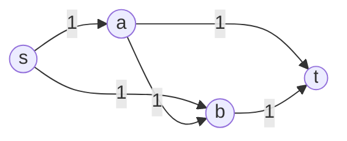

# Lecture 14：线性规划 III——最大流、最小割与覆盖问题的对偶

> 依据：[hand14.pdf](../lectures/hand14.pdf)（43 页讲义）与 [algo14.pdf](../lectures/algo14.pdf)（108 页，含逐步展示的幻灯片）。下文页码指讲义页脚编号。
> 主线：最大流的 LP 建模 → 残量网络与增广路 → 最大流最小割定理 → Edmonds–Karp 算法 → 二分图匹配 → 最大流与最小割的 LP 对偶 → 集合覆盖与多重覆盖。
> 标为“补充”“辨析”或“讲义补全”的内容用于补足条件、推导证明或演算例题，不是讲义原文。图论部分记 $n=|V|,m=|E|$，$s\ne t$；容量有限且非负，讲义采用正容量。除特别说明外，流量和 LP 变量可以取实数。运行时间默认一次容量加减、比较为 $O(1)$。

## 1. 本讲研究什么？

[Lecture 13](lecture13.md) 介绍了最短路的 LP 建模与单纯形法。本讲将同样的思路用于网络流，并进一步比较两类 LP 松弛：

- **最大流／最小割：** 图结构使 LP 具有整数性，可以得到精确的组合最优解。
- **集合覆盖：** LP 最优解可能是分数解，通常只能提供整数问题最优值的下界。

| 内容 | 核心问题 | 关键工具 |
| --- | --- | --- |
| 最大流建模 | 怎样同时表达容量限制与流量守恒？ | 每条边一个变量、节点平衡 |
| 增广算法 | 之前走错的路线能否重新调整？ | 反向残量边、撤销已有流量 |
| 最优性证明 | 为什么找不到增广路就已经最优？ | 残量可达集、割容量上界 |
| 运行时间 | 每轮很快，是否意味着整体多项式？ | 整数容量界、BFS 最短增广路 |
| LP 对偶 | 最大流的对偶为什么是最小割？ | 节点势、边变量、整数性 |
| 覆盖问题 | 变量上界何时能省略？ | LP 松弛、对偶变量与额外约束 |

本讲反复使用的证明方式是：**构造一个可行方案，再构造数值相同的界，两者共同证明最优。** 对最大流而言，这两个对象就是流与割。

## 2. 最大流的定义与 LP 建模（第 3–11 页）

### 2.1 网络、容量与可行流

给定有向图 $G=(V,E)$、源点 $s$、汇点 $t$，每条边 $(u,v)$ 有容量 $c_{uv}\ge0$。把它想象为输油管道：边上可以输送油，但中间节点不能储存或凭空产生油。

为每条边设置流量变量 $f_{uv}$。可行流满足：

**容量约束：**

$$
\boxed{0\le f_{uv}\le c_{uv}\qquad((u,v)\in E).}
$$

**中间节点的流量守恒：**

$$
\boxed{
\sum_{(w,u)\in E}f_{wu}
=\sum_{(u,z)\in E}f_{uz}
\qquad(u\in V\setminus\{s,t\}).
}
$$

守恒约束是“总流入等于总流出”，并不要求每条入边与某条出边一一对应。

**讲义修正。** 第 6 页流入求和的下标应为 $(w,u)\in E$，与正在讨论的节点 $u$ 一致。

### 2.2 流的值应使用净流量

一般有向网络中，定义

$$
\boxed{
|f|=\operatorname{val}(f)
=\sum_{(s,v)\in E}f_{sv}
-\sum_{(u,s)\in E}f_{us}.
}
$$

将所有节点的“流出减流入”相加，每条边恰好抵消一次；再使用中间节点守恒，得到

$$
|f|
=\sum_{(u,t)\in E}f_{ut}
-\sum_{(t,v)\in E}f_{tv}.
$$

所以源点的净流出等于汇点的净流入。

讲义第 7 页使用 $\sum_{(s,u)\in E}f_{su}$，适用于图例中源点没有入边的情形。若原图允许进入 $s$ 的边，就应使用净流量定义。

流可以拆分到多条路径上；可行流也可以含有环流。环流会占用容量，但不增加从 $s$ 到 $t$ 的净输送量。

### 2.3 最大流是线性规划

$$
\boxed{
\begin{aligned}
\max\quad
&\sum_{(s,v)\in E}f_{sv}-\sum_{(u,s)\in E}f_{us}\\
\text{s.t.}\quad
&\sum_{(w,u)\in E}f_{wu}-\sum_{(u,z)\in E}f_{uz}=0,
&&u\in V\setminus\{s,t\},\\
&0\le f_{uv}\le c_{uv},&&(u,v)\in E.
\end{aligned}
}
$$

目标和约束都是线性的，因此可以用通用 LP 算法求解。但利用网络结构，还能得到更直接的增广路算法。

讲义图例有 7 个节点、11 条边，所以原模型有：

- 11 个变量，每条边一个。
- 11 条非负约束、11 条容量上界。
- 5 条中间节点守恒等式。

这就是第 9 页的“11 个变量、27 条约束”。此处把一条等式计为一条约束；转成两个不等式后，计数会改变。

### 2.4 加入回边，把流变成环流

加入一条新的辅助边 $e_0:t\to s$，令其流量为 $F\ge0$，不设容量上界。记

$$
E'=E\cup\{e_0\}.
$$

现在对包括 $s,t$ 在内的所有节点都要求守恒，并最大化 $F$。源点的守恒等式给出

$$
F=\sum_{(s,v)\in E}f_{sv}-\sum_{(u,s)\in E}f_{us}=|f|.
$$

因此，回边只是把输送到 $t$ 的流量送回 $s$，方便统一约束。讲义将 $F$ 写成 $f_{ts}$；若原图已经存在 $t\to s$，应把新辅助边视为另一条独立边。

“无限容量”表示**没有这个上界约束**，不需要把 $+\infty$ 当作 LP 系数。所有原边容量有限，最大流值仍然有界。

### 2.5 为什么讲义把守恒等式写成不等式？

第 11、28 页使用

$$
\sum_{(w,i)\in E'}f_{wi}-\sum_{(i,z)\in E'}f_{iz}\le0
\qquad(i\in V).
$$

令左边为 $b_i(f)$。因为每条边在全体节点中贡献一次 $+f_e$、一次 $-f_e$，

$$
\sum_{i\in V}b_i(f)=0.
$$

每个 $b_i(f)\le0$ 且总和为 0，迫使所有 $b_i(f)=0$。因此，这组不等式**整体上等价于所有节点守恒**。

后面推导对偶时，统一使用：

$$
\boxed{
\begin{aligned}
\max\quad &F\\
\text{s.t.}\quad
&f_{ij}\le c_{ij},&&(i,j)\in E,\\
&\sum_{(w,i)\in E'}f_{wi}-\sum_{(i,z)\in E'}f_{iz}\le0,&&i\in V,\\
&f_{ij}\ge0,&&(i,j)\in E,\\
&F\ge0.
\end{aligned}
}
$$

**记号补全。** 容量约束只包括原边 $E$；节点平衡必须包括辅助边。若漏掉辅助边，却要求 $s,t$ 都守恒，就无法表示正值的 $s$–$t$ 流。

## 3. 残量网络：如何撤销之前的选择？（第 12–16 页）

### 3.1 只沿原图增加流量会卡住

考虑以下五条容量均为 1 的边：



如果先沿 $s\to a\to b\to t$ 输送 1 单位：

- $s\to a$ 已满，无法再沿 $s\to a\to t$ 增加流量。
- $b\to t$ 已满，无法再沿 $s\to b\to t$ 增加流量。

但最优值显然可以达到 2：分别走 $s\to a\to t$ 和 $s\to b\to t$。问题在于之前的 $a\to b$ 流量需要撤销。

### 3.2 每条原边产生两种调整机会

对原边 $e=(u,v)$，当前流量为 $f_e$：

| 残量弧 | 残量容量 | 对原流的实际操作 |
| --- | --- | --- |
| 正向 $u\to v$ | $c_e-f_e$ | 最多还能增加这么多流量 |
| 反向 $v\to u$ | $f_e$ | 最多可以撤销这么多已有流量 |

只保留残量容量严格大于 0 的弧，得到**残量网络（residual network）** $G_f$。

反向残量弧不表示原图多出了一条真实管道；它表示减少对应原边的流量。沿它调整后，原边流量仍然非负。

若原图中本来就同时存在 $u\to v$ 与 $v\to u$，两条原边各自产生自己的残量弧。实现时应保留“对应哪条原边、是正向还是反向”的信息，不能把两种操作混为一谈。

也可以将同方向的残量容量聚合为

$$
c_f(u,v)=c_{uv}-f_{uv}+f_{vu},
$$

其中不存在的原边视为容量和流量均为 0；但更新时仍需把增量分配回实际操作。配对残量边实现通常更直接。

### 3.3 增广路与瓶颈

在 $G_f$ 中找一条从 $s$ 到 $t$ 的简单路径 $P$，称为**增广路（augmenting path）**。可增加的最大流量是

$$
\boxed{\Delta=\min_{a\in P}c_f(a)>0.}
$$

沿整条路径调整：

$$
\boxed{
f_e\leftarrow
\begin{cases}
f_e+\Delta,&P\text{ 使用 }e\text{ 的正向残量弧},\\
f_e-\Delta,&P\text{ 使用 }e\text{ 的反向残量弧},\\
f_e,&\text{其他情况}.
\end{cases}
}
$$

这样做保持可行性：

1. $\Delta$ 不超过每条弧的残量容量，因此原边流量仍在 $[0,c_e]$ 内。
2. 每个中间节点在残量路径上恰好一进一出，净流量变化为 0。
3. 源点净流出增加 $\Delta$，汇点净流入增加 $\Delta$。

所以每次增广都有

$$
\boxed{|f'|=|f|+\Delta.}
$$

### 3.4 用反向边修复五边例子

先走 $s\to a\to b\to t$ 后，残量网络中存在

$$
s\to b\to a\to t.
$$

其中 $b\to a$ 是原边 $a\to b$ 的反向残量弧。三条残量弧容量均为 1，因此增广 1 单位：

$$
f_{sb}:0\to1,\qquad
f_{ab}:1\to0,\qquad
f_{at}:0\to1.
$$

原来的 $f_{sa}=f_{bt}=1$ 保持不变，最终恰好得到两条各承载 1 单位的路径，总流量为 2。

这说明增广算法虽然逐步改进，也允许通过残量边重新安排旧流量。

## 4. 增广路算法与讲义例子（第 16–19、23 页）

### 4.1 Ford–Fulkerson 与 Edmonds–Karp

从零流出发，不断寻找残量增广路并按瓶颈增广，就是 **Ford–Fulkerson 方法**。若每次都用 BFS 选择边数最少的增广路，就得到 **Edmonds–Karp 算法**。

```text
MAX_FLOW(G, capacity, s, t):
    f[e] = 0 for each original edge e

    while true:
        build or update the residual network G_f
        run BFS from s using only positive-residual-capacity arcs

        if t is not reached:
            L = the vertices reached by this BFS
            return f, (L, V \ L)

        P = the s-to-t path recovered from BFS parent arcs
        delta = minimum residual capacity along P

        for each residual arc a on P:
            e = the original edge associated with a
            if a is a forward residual arc:
                f[e] += delta
            else:
                f[e] -= delta
```

BFS 的“最短”指**残量路径边数最少**，与容量大小、瓶颈大小或原图的几何长度无关。

**实现说明。** 常见实现直接维护成对残量边：沿某弧增广 $\Delta$ 时，其残量容量减去 $\Delta$，配对反向弧加上 $\Delta$。BFS 的父指针应记录具体弧，而不只是父节点，以正确处理平行边。

**讲义辨析。** 第 12–16 页从单纯形法引出这种局部调整思路。这里的直接图算法应按“增广路方法”理解；不能据此认为任意通用单纯形换基规则都等于 BFS 增广。

### 4.2 原图的 11 条边与最终流量

下表整理第 4、8、17 页的容量和第 23 页的最终流：

| 原边 | 容量 $c_e$ | 最终流量 $f_e$ |
| --- | --- | --- |
| $s\to a$ | 3 | 2 |
| $s\to b$ | 3 | 1 |
| $s\to c$ | 4 | 4 |
| $b\to a$ | 10 | 0 |
| $a\to d$ | 2 | 2 |
| $b\to d$ | 1 | 1 |
| $d\to c$ | 1 | 1 |
| $d\to e$ | 1 | 0 |
| $c\to e$ | 5 | 5 |
| $d\to t$ | 2 | 2 |
| $e\to t$ | 5 | 5 |

尤其注意 $b\to a$ 和 $d\to c$ 的方向，不能只看图上两点的位置来判断。

### 4.3 按图中流量变化还原增广过程

| 轮次 | 残量增广路 | $\Delta$ | 增广后的总流量 |
| --- | --- | --- | --- |
| 0 | 零流 | — | 0 |
| 1 | $s\to a\to d\to c\to e\to t$ | 1 | 1 |
| 2 | $s\to a\to d\to e\to t$ | 1 | 2 |
| 3 | $s\to c\to e\to t$ | 3 | 5 |
| 4 | $s\to c\to e\to d\to t$ | 1 | 6 |
| 5 | $s\to b\to d\to t$ | 1 | 7 |

第 4 轮中的 $e\to d$ 是原边 $d\to e$ 的反向残量弧，将 $f_{de}$ 从 1 撤销为 0。它释放了原来从 $d$ 输往 $e$ 的流，使其可以改走 $d\to t$。

**辨析。** 这是一条用于展示撤销操作的增广序列，第一轮并未选择边数最少的路径，因此不是 Edmonds–Karp 的 BFS 执行轨迹。

最终源点流出量和汇点流入量分别为

$$
|f|=2+1+4=7=2+5.
$$

例如节点 $d$ 的流入是 $2+1=3$，流出是 $1+0+2=3$；节点 $c$ 的流入是 $4+1=5$，流出是 5。所有容量和守恒约束均满足。

## 5. 割、最优性证书与最大流最小割（第 20–23 页）

### 5.1 有向割只计算离开源点一侧的边

一个 $s$–$t$ 割把顶点划分为 $L$ 和 $R=V\setminus L$，其中 $s\in L,t\in R$。

记 $\delta^+(L)$ 为从 $L$ 指向 $R$ 的原边，$\delta^-(L)$ 为从 $R$ 指向 $L$ 的原边。割容量定义为

$$
\boxed{c(L,R)=\sum_{e\in\delta^+(L)}c_e.}
$$

容量只加 $L\to R$ 的原边，不把反方向边容量加进来，也不使用残量容量计算原图的割容量。

### 5.2 任意流都不超过任意割

对 $L$ 中所有节点的“流出减流入”求和，内部边抵消；除源点外的节点净流量均为 0。因此

$$
\boxed{
|f|=\sum_{e\in\delta^+(L)}f_e
-\sum_{e\in\delta^-(L)}f_e.
}
$$

再使用非负性与容量限制：

$$
|f|
\le\sum_{e\in\delta^+(L)}f_e
\le\sum_{e\in\delta^+(L)}c_e
=c(L,R).
$$

所以

$$
\boxed{\text{任意可行流的值}\le\text{任意 }s\text{–}t\text{ 割的容量}.}
$$

这是最大流与最小割之间的弱对偶关系：流提供最大流值的下界，割提供上界。

### 5.3 找不到增广路时，自动得到一个同值割

假设在当前残量网络中，$t$ 无法从 $s$ 到达。令

$$
L=\{v:v\text{ 在 }G_f\text{ 中从 }s\text{ 可达}\},
\qquad R=V\setminus L.
$$

显然 $s\in L,t\in R$。由可达集定义：

1. **原边 $u\in L\to v\in R$ 必须满流。** 若 $f_{uv}<c_{uv}$，就存在正向残量弧 $u\to v$，使 $v$ 也可达，矛盾。
2. **原边 $u\in R\to v\in L$ 必须零流。** 若 $f_{uv}>0$，就存在反向残量弧 $v\to u$，使 $u$ 也可达，矛盾。

因此

$$
|f|
=\sum_{e\in\delta^+(L)}c_e-0
=c(L,R).
$$

再结合任意流不超过任意割，当前流必为最大流，当前割必为最小割。

$$
\boxed{
\max_{f\text{ 可行}}|f|
=\min_{\substack{L\subseteq V\\s\in L,\ t\notin L}}c(L,V\setminus L).
}
$$

这就是**最大流最小割定理（max-flow min-cut theorem）**。

本证明不要求容量为整数；但“如果算法停止，则最优”与“算法一定停止”是两个不同结论。第 6 节说明路径选择如何影响终止性与运行时间。

### 5.4 三种等价的最优性条件

对任意可行流 $f$，以下条件等价：

1. $f$ 是最大流。
2. $G_f$ 中不存在 $s$ 到 $t$ 的增广路。
3. 存在一个割 $(L,R)$ 满足 $|f|=c(L,R)$。

证明方向分别是：有增广路就能严格增加流量；无增广路时取残量可达集；同值割给出不可超越的上界。

### 5.5 讲义例子的最优性证书

最终残量网络中，从 $s$ 可达的顶点恰为

$$
L=\{s,a,b\},\qquad R=\{c,d,e,t\}.
$$

从 $L$ 到 $R$ 的原边只有

$$
s\to c,\qquad a\to d,\qquad b\to d,
$$

故

$$
c(L,R)=4+2+1=7=|f|.
$$

于是“值为 7 的可行流”和“容量为 7 的割”共同证明答案为 7。割不必唯一；本例把 $t$ 单独放在右侧，也得到容量 $2+5=7$ 的割。

## 6. 运行时间、整数性与路径选择（第 24 页）

### 6.1 每轮成本与总轮数要分开

构建残量网络、DFS／BFS 找路、计算瓶颈和更新流量，一轮可在 $O(n+m)$ 时间完成。

讲义写 $O(m)$，通常是在忽略孤立节点、对相关子图分析的约定下。更严格地说，可以先用 $O(n+m)$ 时间删除底层无向图中不属于 $s$ 所在连通分量的顶点；若 $t$ 被排除，最大流立即为 0。相关分量中的顶点数至多为 $m+1$，后续每轮便可按 $O(m)$ 计。

### 6.2 整数容量：Ford–Fulkerson 的伪多项式界

设所有容量都是整数，最大容量为 $C$，最大流值为 $F^*$。

- 初始流为整数。
- 整数流产生整数残量容量。
- 每条增广路的瓶颈都是正整数，因此每轮至少增加 1。

所以增广次数至多 $F^*$，且

$$
F^*\le\sum_{(s,v)\in E}c_{sv}\le mC.
$$

在上述每轮 $O(m)$ 的约定下，增广阶段耗时

$$
O(mF^*)\subseteq O(m^2C),
$$

另计初始化与最后一次无路搜索的成本。该界依赖容量数值 $C$；当容量用二进制表示时，编码一个容量只需 $O(\log C)$ 位，因此这是**伪多项式界**。

整数性还说明：**整数容量网络存在一个整数最大流。** 这不表示所有最大流都必须为整数；不同整数最优流的凸组合也可能是分数最优流。

### 6.3 为什么任意选路可能很慢？（补充）

在第 3 节五边图中，把四条外围边容量改为 $C$，中间边 $a\to b$ 容量仍为 1。

若交替选择

$$
s\to a\to b\to t,
\qquad
s\to b\to a\to t,
$$

第二条使用反向残量弧，每次瓶颈都为 1。总流量可以达到 $2C$，却可能需要 $2C$ 轮。

如果直接选 $s\to a\to t$ 与 $s\to b\to t$，只需两轮。这说明瓶颈容量很小的曲折路径可能造成大量无谓迭代。

### 6.4 Edmonds–Karp：BFS 控制增广次数

每次使用 BFS 找边数最少的残量增广路，可以证明：

$$
\boxed{\text{增广次数}=O(nm),\qquad\text{总运行时间}=O(nm^2).}
$$

这里不再依赖容量数值 $C$。若保留任意多的孤立节点，应把一次性读入、预处理成本另写为 $O(n+m)$；上式是通常采用的网络规模约定。

**补充证明思路。** 令 $\ell_f(v)$ 为残量图中从 $s$ 到 $v$ 的最少边数，不可达时为 $+\infty$。

1. **BFS 距离不会下降。** 增广后新增的残量弧，只可能是本轮路径弧的反向。若路径弧为 $u\to v$，则旧距离满足 $\ell_f(v)=\ell_f(u)+1$；新增反向弧 $v\to u$ 朝旧的较小层号走，不会创造比旧距离更短的路线。形式上，对新图中每条弧 $x\to y$，都有 $\ell_f(y)\le\ell_f(x)+1$，沿新路径累加即可得到新距离不小于旧距离。
2. **每次增广至少饱和一条路径弧。** 称达到瓶颈的弧为关键弧。
3. **同一条残量弧反复成为关键弧时，其起点层号至少增加 2。** 假设 $u\to v$ 在某轮被饱和，当时 $\ell(v)=\ell(u)+1$。它再次获得正残量容量，必须先有一轮使用配对反向弧 $v\to u$，此时 $\ell'(u)=\ell'(v)+1\ge\ell(v)+1=\ell(u)+2$。
4. 有限 BFS 距离至多为 $n-1$，所以每条弧成为关键弧至多 $O(n)$ 次。总共至多 $2m$ 条配对残量弧，于是增广次数为 $O(nm)$。

每轮 $O(m)$，得到总时间 $O(nm^2)$。

### 6.5 非整数容量与终止性（补充）

| 容量与选路方式 | 结论 |
| --- | --- |
| 整数容量，任意增广路 | 每次至少增加 1，有限终止，但上述时间界是伪多项式 |
| 有理容量，任意增广路 | 可统一放大为整数后证明终止，但不能因此得到按输入位数计的多项式界 |
| 无理容量，任意增广路 | 不保证有限终止 |
| 有限非负容量，每次 BFS | Edmonds–Karp 的 $O(nm)$ 轮数界不依赖整数性 |

实数情形的复杂度是在精确算术模型下讨论；实际使用浮点数时，还需处理舍入误差和“残量是否为正”的判断。

## 7. 二分图匹配归约为最大流（第 25–26 页）

### 7.1 构造单位容量网络

给定二分图 $H=(A\cup B,E_H)$，其中每条边连接一个 $A$ 中的顶点和一个 $B$ 中的顶点。匹配要求任何顶点最多参与一条被选边，目标是最大化被选边数。

构造有向流网络：

1. 新增源点 $s$，对每个 $a\in A$ 加边 $s\to a$，容量为 1。
2. 对每条二分图边 $\{a,b\}\in E_H$，加边 $a\to b$，容量为 1。
3. 新增汇点 $t$，对每个 $b\in B$ 加边 $b\to t$，容量为 1。

这样每单位流沿 $s\to a\to b\to t$ 通过，表示选择匹配边 $\{a,b\}$。

### 7.2 为什么最大流值等于最大匹配大小？

**匹配 → 流。** 若匹配有 $k$ 条边，就沿对应的 $k$ 条三段路径各发送 1 单位流。因为匹配边不共享端点，所有容量约束均满足，流值为 $k$。

**整数流 → 匹配。** 网络容量全为整数，因此存在整数最大流。每条 $s\to a$ 和 $b\to t$ 容量为 1，守恒迫使任意顶点最多连接一条流量为 1 的中间边。这些中间边就是匹配，条数等于流值。

所以

$$
\boxed{\text{最大匹配大小}=\text{构造网络的最大流值}.}
$$

这里必须使用整数流。一个分数流可能把 1 单位拆分给多个邻居，不能直接把所有正流量中间边都当成匹配。

### 7.3 讲义图例与交替路

第 25–26 页的图有 4 个左侧顶点和 4 个右侧顶点。可以取匹配

$$
\{(\text{Al},\text{Beatrice}),
(\text{Bob},\text{Danielle}),
(\text{Chet},\text{Alice}),
(\text{Dan},\text{Carol})\}.
$$

它大小为 4，又不可能超过任一侧顶点数，因此是完美匹配，也是最大匹配。

**补充解释。** 残量网络里的反向中间边，表示取消当前已匹配的边。一次增广会在未匹配边与已匹配边之间交替前进，随后翻转这些边的选取状态，使匹配大小增加 1。这就是匹配中的**增广交替路**。

若原二分图有 $N$ 个顶点、$M$ 条边，则构造网络有 $N+2$ 个顶点、$M+N$ 条边。每轮匹配增广增加 1，最多增广 $\min\{|A|,|B|\}$ 次；直接实现的总时间为

$$
O\bigl((N+M)(1+\min\{|A|,|B|\})\bigr).
$$

这是利用单位容量得到的界，比直接机械套用一般网络的 $O(nm^2)$ 更有针对性。

## 8. 从最大流推导 LP 对偶（第 27–29 页）

### 8.1 为两类约束引入两类对偶变量

使用第 2.5 节的环流模型，其形式为“最大化、$\le$ 约束、变量非负”。因此对偶是“最小化、$\ge$ 约束、变量非负”。

| 原问题约束 | 对偶变量 | 在对偶目标中的贡献 |
| --- | --- | --- |
| $f_{ij}\le c_{ij}$ | $d_{ij}\ge0$ | $c_{ij}d_{ij}$ |
| 节点 $i$ 的流入减流出 $\le0$ | $p_i\ge0$ | $0\cdot p_i=0$ |

$d_{ij}$ 是边变量，$p_i$ 是节点势（potential）。这里 $d$ 不是实际边长，而是受势差约束的对偶变量。

### 8.2 按原变量的列写对偶约束

对一条原边 $i\to j$，变量 $f_{ij}$ 的系数为：

- 在自身容量约束中为 $+1$。
- 在尾节点 $i$ 的“流入减流出”中为 $-1$。
- 在头节点 $j$ 的“流入减流出”中为 $+1$。
- 在原目标中为 0。

故对应的对偶约束是

$$
d_{ij}-p_i+p_j\ge0,
\qquad\text{即 }d_{ij}\ge p_i-p_j.
$$

辅助回边 $t\to s$ 的流量 $F$ 没有容量上界；它在节点 $s$ 的系数为 $+1$、在节点 $t$ 的系数为 $-1$，目标系数为 1。因此

$$
p_s-p_t\ge1.
$$

### 8.3 完整对偶

$$
\boxed{
\begin{aligned}
\min\quad &\sum_{(i,j)\in E}c_{ij}d_{ij}\\
\text{s.t.}\quad
&d_{ij}-p_i+p_j\ge0,&&(i,j)\in E,\\
&p_s-p_t\ge1,\\
&d_{ij}\ge0,&&(i,j)\in E,\\
&p_i\ge0,&&i\in V.
\end{aligned}
}
$$

**辨析。** 如果原模型直接使用守恒等式，对应的 $p_i$ 应为自由变量。讲义中的 $p_i\ge0$ 来自其全节点不等式写法，两者不要混用。由于对偶约束只涉及势差，自由势也可以整体平移到非负，而不改变目标和可行性。

### 8.4 直接验证弱对偶（补充）

对任意原可行流 $f$ 与对偶可行解 $(d,p)$，

$$
\begin{aligned}
\sum_{(i,j)\in E}c_{ij}d_{ij}
&\ge\sum_{(i,j)\in E}f_{ij}d_{ij}\\
&\ge\sum_{(i,j)\in E}f_{ij}(p_i-p_j)\\
&=\sum_{v\in V}p_v\bigl(\operatorname{out}_f(v)-\operatorname{in}_f(v)\bigr)\\
&=|f|(p_s-p_t)\\
&\ge|f|.
\end{aligned}
$$

这里的入流、出流只计算原边；最后一步使用环流模型中的 $|f|=F\ge0$。中间节点的项由流量守恒消失，只剩源点和汇点。

因此对偶可行解给出了最大流的上界。接下来要说明：这个上界可以理解为一个割。

## 9. 为什么这个对偶就是最小割？（第 30–34 页）

### 9.1 先限制为 0–1 变量

暂时令

$$
p_i\in\{0,1\},\qquad d_{ij}\in\{0,1\}.
$$

$p_s-p_t\ge1$ 迫使 $p_s=1,p_t=0$。于是定义

$$
L=\{i:p_i=1\},\qquad R=\{i:p_i=0\}.
$$

对不同方向的边，约束 $d_{ij}\ge p_i-p_j$ 给出：

| 原边位置 | $p_i-p_j$ | 最小可行 $d_{ij}$ |
| --- | --- | --- |
| $L\to R$ | 1 | 1 |
| $R\to L$ | $-1$ | 0 |
| $L\to L$ 或 $R\to R$ | 0 | 0 |

因此对固定的 $p$，可以取

$$
d_{ij}=\begin{cases}
1,&i\in L,\ j\in R,\\
0,&\text{其他情况}.
\end{cases}
$$

目标便是

$$
\sum_{(i,j)\in E}c_{ij}d_{ij}
=\sum_{i\in L,j\in R}c_{ij}
=c(L,R).
$$

反过来，每个 $s$–$t$ 割都能构造这样的 0–1 可行解。所以这个整数规划恰好表示最小割。

**讲义补全。** 对非割边，$d_{ij}$ 也可以取 1 而不违反约束，但这会增加正容量边的目标贡献。应说“最小化时可以把非割边的 $d$ 取为 0”，不能说任意 0–1 可行解的目标都恰好等于其割容量。若允许零容量边，也总能选择这种标准表示。

### 9.2 LP 松弛给出什么关系？

将 $p,d\in\{0,1\}$ 放松为 $0\le p,d\le1$，可行域扩大，所以

$$
\operatorname{OPT}_{\mathrm{dual\ LP}}
\le\operatorname{OPT}_{\mathrm{min\ cut}}.
$$

仅凭“这是最小割的松弛”只能得到这个方向，尚不能断言两者相等。还必须证明分数解不会改善最优值。

### 9.3 为什么上界 $p,d\le1$ 可以省略？（补充证明）

取第 8.3 节不含上界的任意可行解 $(d,p)$，定义截断势

$$
q_i=\min\{1,\max\{0,p_i-p_t\}\}.
$$

因为 $p_s-p_t\ge1$，所以 $q_s=1,q_t=0$。再定义

$$
d'_{ij}=\max\{q_i-q_j,0\}.
$$

截断函数单调，且不会放大正向差值，因此

$$
0\le d'_{ij}\le\max\{p_i-p_j,0\}\le d_{ij}.
$$

于是 $(d',q)$ 可行，所有变量都落在 $[0,1]$ 内；因为 $c_{ij}\ge0$，目标值也没有增加。

因此添加或删除这些上界**不改变最优值**。这并不意味着无上界模型的每个可行解都自动满足上界。

### 9.4 阈值取割：分数解不会比整数割更好（补充证明）

对归一化后的势 $q_i\in[0,1]$，选取阈值 $\theta\in(0,1)$，令

$$
L_\theta=\{i:q_i\ge\theta\}.
$$

因为 $q_s=1,q_t=0$，每个 $L_\theta$ 都是合法割的源点一侧。

原边 $i\to j$ 被这个割计入，当且仅当

$$
q_j<\theta\le q_i.
$$

若 $\theta$ 在 $(0,1)$ 中均匀取值，这一事件的概率为 $\max\{q_i-q_j,0\}$。所以

$$
\begin{aligned}
\mathbb E[c(L_\theta,V\setminus L_\theta)]
&=\sum_{(i,j)\in E}c_{ij}\max\{q_i-q_j,0\}\\
&=\sum_{(i,j)\in E}c_{ij}d'_{ij}\\
&\le\sum_{(i,j)\in E}c_{ij}d_{ij}.
\end{aligned}
$$

至少有一个阈值的割容量不大于这个平均值，因此**每个分数对偶解都能对应到一个成本不更高的整数割**。

与松弛不等式结合，得到

$$
\boxed{
\operatorname{OPT}_{\mathrm{dual\ LP}}
=\operatorname{OPT}_{\mathrm{min\ cut}}.
}
$$

概率只是证明平均值的工具；实际寻找这个割时，只需把不同势值排序，检查相邻势值之间的阈值，不必随机运行。

最大流原问题可行且有界，LP 强对偶再给出

$$
\boxed{
\operatorname{OPT}_{\mathrm{max\ flow}}
=\operatorname{OPT}_{\mathrm{dual\ LP}}
=\operatorname{OPT}_{\mathrm{min\ cut}}.
}
$$

这提供了最大流最小割定理的另一种证明：组合算法使用残量可达集，LP 方法使用强对偶与最小割松弛的整数性。

### 9.5 全幺模性与两种整数性

讲义第 34 页用**全幺模性（total unimodularity，TU）**解释整数最优解的存在。

一个矩阵全幺模，是指它的任意方形子矩阵的行列式都属于 $\{0,1,-1\}$。全幺模约束矩阵配合整数右端项，可保证相应多面体的顶点为整数。

这里的矩阵来自有向图的节点—边关联矩阵及其转置，并配合单位行／列。加入 $0\le p,d\le1$ 后，整数顶点只能取 0 或 1。上面的阈值证明则直接说明了我们求解所需的结论：存在 0–1 最优割解。

应区分两件事：

| 对象 | 整数性结论 | 是否要求容量为整数？ |
| --- | --- | --- |
| 最大流原问题 | 存在整数最优流 | 要求原边容量为整数 |
| 最小割的对偶 LP | 存在 0–1 最优割表示 | 不要求；容量在对偶中是目标系数 |

最小割对偶的约束右端项只有 0 和 1；即使容量为实数，选取哪些顶点属于割的哪一侧仍然是 0–1 决策。

### 9.6 互补松弛解释“正向满流、反向零流”（补充）

使用守恒等式形式，原边对应的互补松弛条件为

$$
d_{ij}(c_{ij}-f_{ij})=0,
\qquad
f_{ij}(d_{ij}-p_i+p_j)=0.
$$

对于 0–1 割解：

- $L\to R$：$d_{ij}=1$，因此 $f_{ij}=c_{ij}$，必须满流。
- $R\to L$：$d_{ij}=0,p_i=0,p_j=1$，对应对偶约束余量为 1，因此 $f_{ij}=0$。
- 同侧边：对偶余量可以为 0，流量可以处于容量范围内的不同位置。

这与残量可达集证明得到的条件完全一致。

## 10. 集合覆盖与其 LP 对偶（第 36–39 页）

### 10.1 问题与整数规划

给定元素全集 $U$、集合族 $\mathcal S=\{S_1,\ldots,S_m\}$，要求选择若干集合，使其并集覆盖 $U$。

- **基数集合覆盖：** 每个集合成本为 1，最小化选择的集合数。
- **加权集合覆盖：** 每个集合有成本 $c(S)>0$，最小化总成本。

令 $x_S=1$ 表示选中集合 $S$。加权版本的整数规划是

$$
\boxed{
\begin{aligned}
\min\quad &\sum_{S\in\mathcal S}c(S)x_S\\
\text{s.t.}\quad
&\sum_{S\ni e}x_S\ge1,&&e\in U,\\
&x_S\in\{0,1\},&&S\in\mathcal S.
\end{aligned}
}
$$

如果某个元素不属于任何集合，它的约束就是 $0\ge1$，问题不可行。否则选中所有集合总能覆盖全集。

### 10.2 LP 松弛与上界冗余

先把 $x_S\in\{0,1\}$ 放松为 $0\le x_S\le1$。普通集合覆盖中，还可以省略 $x_S\le1$，得到

$$
\boxed{
\min\sum_{S\in\mathcal S}c(S)x_S,
\qquad
\sum_{S\ni e}x_S\ge1\ (e\in U),
\qquad x_S\ge0.
}
$$

原因是：对任意非负可行解，令 $x'_S=\min\{x_S,1\}$。对每个元素 $e$：

- 若覆盖它的所有集合变量原来都不超过 1，总覆盖量不变。
- 若某个覆盖它的变量原来大于 1，截断后该变量单独就贡献 1，仍满足需求。

因此截断保持可行，并且不会增加非负成本。这说明上界不改变最优值，**不表示松弛解自动为整数**。

### 10.3 为每个元素设置对偶价格

对每条元素覆盖约束，引入对偶变量 $y_e\ge0$。原问题形式为“最小化、$\ge$ 约束、变量非负”，故对偶为

$$
\boxed{
\begin{aligned}
\max\quad &\sum_{e\in U}y_e\\
\text{s.t.}\quad
&\sum_{e\in S}y_e\le c(S),&&S\in\mathcal S,\\
&y_e\ge0,&&e\in U.
\end{aligned}
}
$$

解释：给每个元素一个非负价格，但任意集合中元素的总价不能超过购买这个集合的成本。满足这些限制的元素总价，为任何覆盖方案提供成本下界。

当 $c(S)=1$ 时，就得到第 37 页的无权版本：每个集合中的元素总价至多为 1。

### 10.4 从加权求和验证下界

对任何原、对偶可行解，

$$
\begin{aligned}
\sum_{S\in\mathcal S}c(S)x_S
&\ge\sum_{S\in\mathcal S}x_S\sum_{e\in S}y_e\\
&=\sum_{e\in U}y_e\sum_{S\ni e}x_S\\
&\ge\sum_{e\in U}y_e.
\end{aligned}
$$

与最大流对偶的区别在于：这里得到的是整数集合覆盖成本的**下界**。LP 强对偶保证原、对偶两个 LP 的最优值相等，却不保证它们等于整数覆盖的最优值。

### 10.5 分数解确实可能更便宜（补充例子）

令

$$
U=\{a,b,c\},\qquad
S_1=\{a,b\},\quad S_2=\{b,c\},\quad S_3=\{a,c\},
$$

每个集合成本均为 1。

**整数最优值为 2。** 一个集合无法覆盖三个元素，而任意两个集合就能覆盖全集。

**LP 最优值为 $3/2$。** 取

$$
x_{S_1}=x_{S_2}=x_{S_3}=\frac12.
$$

每个元素恰好被覆盖 1 次，总成本为 $3/2$。同时，取对偶解

$$
y_a=y_b=y_c=\frac12.
$$

每个集合的元素总价恰为 1，对偶值也是 $3/2$。两侧可行且同值，证明 LP 最优值恰为 $3/2$。

$$
\boxed{\operatorname{OPT}_{\mathrm{LP}}=\frac32<2=\operatorname{OPT}_{\mathrm{ILP}}.}
$$

该实例的整数最优值与 LP 最优值之比为 $4/3$。它说明最小割中“松弛没有损失”的结论不能直接推广到集合覆盖。

### 10.6 覆盖 LP 的互补松弛（补充）

当原、对偶均可行时，最优性等价于

$$
x_S\left(c(S)-\sum_{e\in S}y_e\right)=0,
\qquad
y_e\left(\sum_{S\ni e}x_S-1\right)=0.
$$

含义是：

- $x_S>0$ 的集合，其对偶价格总额必须恰好等于成本。
- $y_e>0$ 的元素，其覆盖量必须恰好为 1。

这是 LP 的最优性条件，不能单凭它断言某个分数解就是整数覆盖方案。

## 11. 多重覆盖：上界约束不能再省略（第 40–43 页）

### 11.1 每个元素有自己的覆盖需求

**集合多重覆盖（set multicover）**要求每个元素 $e$ 被覆盖至少 $r_e\in\mathbb Z_{>0}$ 次，且每个给定集合最多选一次。

整数规划为

$$
\boxed{
\begin{aligned}
\min\quad &\sum_{S\in\mathcal S}c(S)x_S\\
\text{s.t.}\quad
&\sum_{S\ni e}x_S\ge r_e,&&e\in U,\\
&x_S\in\{0,1\},&&S\in\mathcal S.
\end{aligned}
}
$$

因为没有其他选择限制，问题可行当且仅当每个元素至少属于 $r_e$ 个给定集合；充分性由选中全部集合得到。

### 11.2 正确的 LP 松弛

$$
\boxed{
\begin{aligned}
\min\quad &\sum_{S\in\mathcal S}c(S)x_S\\
\text{s.t.}\quad
&\sum_{S\ni e}x_S\ge r_e,&&e\in U,\\
&-x_S\ge-1,&&S\in\mathcal S,\\
&x_S\ge0,&&S\in\mathcal S.
\end{aligned}
}
$$

将上界写成 $-x_S\ge-1$，是为了把所有约束统一为 $\ge$ 方向，方便推导对偶。

此时不能删除上界：若 $r_e>1$，把某个大于 1 的变量截断为 1，可能使元素的覆盖量低于需求。

### 11.3 删除上界会改变问题：一个完整例子（补充）

设

$$
U=\{a,b\},\qquad r_a=2,\quad r_b=1,
$$

三个集合及其成本为

| 集合 | 元素 | 成本 |
| --- | --- | --- |
| $S_1$ | $\{a\}$ | 1 |
| $S_2$ | $\{a,b\}$ | 100 |
| $S_3$ | $\{b\}$ | 1 |

有上界时，$a$ 的约束是 $x_1+x_2\ge2$，而 $x_1,x_2\le1$，所以必须 $x_1=x_2=1$。此时 $b$ 已覆盖，最优可取 $x_3=0$，成本为 101。

若删去上界，则可以取

$$
(x_1,x_2,x_3)=(2,0,1),
$$

成本仅为 3。这相当于允许把便宜的 $S_1$ 购买两次，已经改变了“每个集合最多选一次”的题意。

### 11.4 新增上界产生新的对偶变量

对每个覆盖约束引入 $y_e\ge0$，对每条 $-x_S\ge-1$ 引入 $z_S\ge0$。

根据右端项与矩阵列：

- 约束 $\sum_{S\ni e}x_S\ge r_e$ 在对偶目标中贡献 $r_ey_e$。
- 约束 $-x_S\ge-1$ 在对偶目标中贡献 $-z_S$。
- 原变量 $x_S$ 的列在各所属元素行中系数为 $+1$，在自身上界行中系数为 $-1$。

所以对偶为

$$
\boxed{
\begin{aligned}
\max\quad &\sum_{e\in U}r_ey_e-\sum_{S\in\mathcal S}z_S\\
\text{s.t.}\quad
&\sum_{e\in S}y_e-z_S\le c(S),&&S\in\mathcal S,\\
&y_e\ge0,&&e\in U,\\
&z_S\ge0,&&S\in\mathcal S.
\end{aligned}
}
$$

两个负号都来自原约束 $-x_S\ge-1$：一个来自右端项 $-1$，另一个来自 $x_S$ 的系数 $-1$。

### 11.5 如何理解 $z_S$？

普通覆盖对偶要求 $\sum_{e\in S}y_e\le c(S)$。多重覆盖允许该总价超过集合成本，但必须用 $z_S$ 抵消超出部分，而且目标中也要扣除 $z_S$。

固定 $y$ 时，最优会选择

$$
z_S=\max\left\{0,\sum_{e\in S}y_e-c(S)\right\}.
$$

因此 $z_S$ 不会无代价地提高下界；它是“集合最多选一次”这一上界在对偶中的体现。

对应的弱对偶推导为

$$
\begin{aligned}
\sum_S c(S)x_S
&\ge\sum_S x_S\left(\sum_{e\in S}y_e-z_S\right)\\
&=\sum_e y_e\sum_{S\ni e}x_S-\sum_S z_Sx_S\\
&\ge\sum_e r_ey_e-\sum_S z_S.
\end{aligned}
$$

最后一步同时使用覆盖下界、$y_e,z_S\ge0$ 和 $x_S\le1$。这也直接说明原问题为何必须保留上界。

### 11.6 用对偶证明例子的最优成本为 101（补充）

对第 11.3 节的实例，取

$$
(y_a,y_b)=(100,0),\qquad(z_1,z_2,z_3)=(99,0,0).
$$

三条对偶约束分别为

$$
100-99\le1,\qquad100+0-0\le100,\qquad0-0\le1.
$$

均成立，对偶目标为

$$
2\cdot100+1\cdot0-99=101.
$$

原可行解 $(1,1,0)$ 成本也是 101，所以两者共同证明该实例的 LP 和整数问题最优值都为 101。

这是本例的性质；一般多重覆盖依然可能存在整数间隙。

### 11.7 互补松弛与上界（补充）

多重覆盖 LP 的三组互补松弛条件是

$$
\boxed{
\begin{aligned}
y_e\left(\sum_{S\ni e}x_S-r_e\right)&=0,&&e\in U,\\
z_S(1-x_S)&=0,&&S\in\mathcal S,\\
x_S\left(c(S)-\sum_{e\in S}y_e+z_S\right)&=0,&&S\in\mathcal S.
\end{aligned}
}
$$

其中 $z_S>0$ 推出 $x_S=1$：上界对应的对偶变量为正时，原变量必须已经达到上界。反方向不一定成立。

## 12. 核心公式与易错点速查

### 12.1 算法与公式

| 内容 | 公式／结论 |
| --- | --- |
| 边容量约束 | $0\le f_e\le c_e$ |
| 中间节点守恒 | 总流入等于总流出 |
| 流值 | 源点净流出，等于汇点净流入 |
| 正向残量容量 | $c_e-f_e$ |
| 反向残量容量 | $f_e$ |
| 增广瓶颈 | $\Delta=\min_{a\in P}c_f(a)$ |
| 增广后流值 | $\lvert f'\rvert=\lvert f\rvert+\Delta$ |
| 割上的净流 | $\lvert f\rvert=f(\delta^+(L))-f(\delta^-(L))$ |
| 割容量 | $c(L,V\setminus L)=\sum_{e\in\delta^+(L)}c_e$ |
| 弱对偶 | 任意可行流值不超过任意割容量 |
| 最大流最小割 | $\max\lvert f\rvert=\min c(L,V\setminus L)$ |
| 最优割的提取 | 最终残量网络中从 $s$ 可达的顶点集合 |
| Ford–Fulkerson，整数容量 | 至多 $F^*\le mC$ 次增广；增广阶段 $O(mF^*)$ |
| Edmonds–Karp | 至多 $O(nm)$ 次增广，总时间 $O(nm^2)$ |
| 二分图匹配 | 单位容量网络的整数最大流值等于最大匹配大小 |
| 最大流对偶 | $\min\sum c_{ij}d_{ij}$，$d_{ij}\ge p_i-p_j$，$p_s-p_t\ge1$，$d,p\ge0$ |
| 集合覆盖对偶 | $\max\sum_e y_e$，$\sum_{e\in S}y_e\le c(S)$，$y\ge0$ |
| 多重覆盖对偶 | $\max\sum_e r_ey_e-\sum_S z_S$，$\sum_{e\in S}y_e-z_S\le c(S)$，$y,z\ge0$ |

复杂度表沿用第 6 节对相关网络和初始化成本的约定；$F^*$ 是最大流值，$C$ 是最大整数容量。

### 12.2 易错点与讲义补全

| 容易误记的说法 | 应掌握的表述 |
| --- | --- |
| 流值永远等于源点所有出边流量之和 | 一般要减去流入源点的流量；无入边时才可省略 |
| 加入 $t\to s$ 后只对原边写节点守恒 | 守恒必须包含辅助回边，容量上界则只针对原边 |
| 守恒等式可逐条随意改成 $\le$ | 此处依赖全体节点不平衡量总和为 0，整组才等价 |
| 反向残量边表示允许原边取负流量 | 它表示撤销原边已有流量，原流仍非负 |
| 原图里没有 $s$–$t$ 未满边路径就最优 | 必须检查包含反向弧的残量网络 |
| 增广时每条边都增加流量 | 正向弧增加对应原流，反向弧减少对应原流 |
| BFS 选择容量最大或瓶颈最大的路径 | BFS 选择残量图中边数最少的路径 |
| 讲义的五轮示例就是 BFS 运行过程 | 它展示一般增广与撤销，首条路径不是最少边数路径 |
| 割容量是两个方向跨割容量之和 | 有向割只累计从源点侧指向汇点侧的原边容量 |
| 没有增广路只说明局部最优 | 残量可达集给出同值割，证明全局最优 |
| 每轮 $O(m)$ 就说明总算法多项式 | 还需控制轮数；任意选路的整数容量界依赖 $C$ |
| 任意选路对所有实数容量都有限终止 | 无理容量下不保证；BFS 给出容量无关的轮数界 |
| 整数容量意味着所有最大流都是整数 | 保证存在整数最大流，分数最优流也可能存在 |
| 任意最大流解都可直接当作匹配 | 应使用整数最大流，再选流量为 1 的中间边 |
| 第 30 页的 0–1 模型就是普通 LP 对偶 | 第 29 页是连续 LP；第 30 页额外加入整数限制以解释割 |
| 最小割对偶的整数性也要求容量为整数 | 对偶中容量是目标系数；0–1 割最优解不依赖容量整数性 |
| LP 强对偶保证整数规划与松弛的最优值相同 | 强对偶只比较两个 LP；整数间隙还需另行分析 |
| 上界冗余意味着所有可行解自动满足上界 | 这里指可改造成满足上界且不更贵的解，最优值不变 |
| 集合覆盖和多重覆盖都能删掉 $x_S\le1$ | 普通覆盖可截断；多重覆盖截断可能破坏覆盖需求 |
| 多重覆盖对偶只需把目标改为 $\sum r_ey_e$ | 还要为集合上界引入 $z_S$，目标与约束中都出现负号 |

## 13. 复习检查清单

- [ ] 能写出最大流的容量约束、节点守恒和净流量目标。
- [ ] 能解释辅助回边如何把最大流变为环流，并区分原边集与扩展边集。
- [ ] 能证明全节点“流入减流出 $\le0$”整体上等价于守恒。
- [ ] 能根据任意可行流构造正向和反向残量弧，说明反向弧对应的实际操作。
- [ ] 能手算五边反例，说明为什么只沿原边增加流量会卡住。
- [ ] 能写出增广算法，并说明 BFS 父指针为什么应保存具体弧。
- [ ] 能复现讲义例子的 $0\to1\to2\to5\to6\to7$ 流值变化，指出撤销操作发生在哪一轮。
- [ ] 能从节点守恒推出割上的净流公式，再证明任意流不超过任意割。
- [ ] 能通过最终残量可达集构造最小割，证明出割边满流、入割边零流。
- [ ] 能写出“最大流、无增广路、同值割”三种条件及其等价关系。
- [ ] 能区分整数容量下的伪多项式界与 Edmonds–Karp 的 $O(nm^2)$ 界。
- [ ] 能解释 BFS 距离不下降，以及同一关键弧再次被饱和前起点层号至少增加 2。
- [ ] 能把二分图匹配归约为单位容量最大流，并指出整数性在证明中的作用。
- [ ] 能按每条流量变量的列推导 $d_{ij}-p_i+p_j\ge0$ 与 $p_s-p_t\ge1$。
- [ ] 能用 0–1 节点势表示割，并说明最优边变量为什么只标记出割边。
- [ ] 能用截断势和阈值取割解释最小割 LP 为什么没有整数间隙。
- [ ] 能区分“整数容量保证整数流”与“任意非负容量都有 0–1 最优割表示”。
- [ ] 能写出加权集合覆盖的整数规划、LP 松弛和对偶，并解释元素价格的含义。
- [ ] 能演算三元素例子，证明 LP 最优值为 $3/2$、整数最优值为 2。
- [ ] 能说明普通集合覆盖为何可删除变量上界，而多重覆盖不能。
- [ ] 能从 $-x_S\ge-1$ 正确推导多重覆盖对偶中的 $-z_S$，并用弱对偶验证符号。
