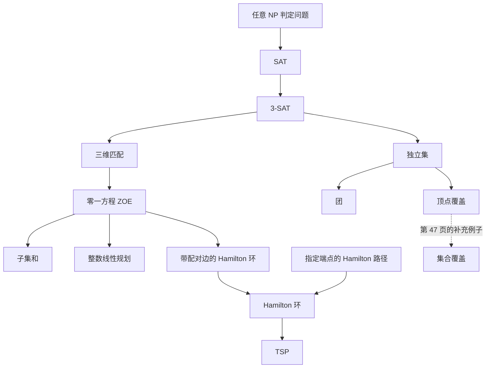

# Lecture 17：NP 问题 III——用归约建立 NP 完全性

> 依据：[hand17.pdf](../lectures/hand17.pdf)（67 页讲义）与 [algo17.pdf](../lectures/algo17.pdf)（124 页，含逐步展示的幻灯片）。下文页码指讲义页脚编号；已核对两份材料各页的最终正文，内容一致。
> 主线：归约的方向与证明模板 → Hamilton 路径与环 → 3-SAT、独立集、顶点覆盖与团 → SAT 的限制化 → 三维匹配 → 零一方程 → 子集和、整数线性规划、Hamilton 环 → TSP 与近似难度 → Cook–Levin 定理。
> 标为“补充”“辨析”“例题演算”或“讲义修正”的内容用于补全条件、证明或计算，不是讲义原文。讨论 NP 完全性时统一使用**判定版本**，同时说明如何恢复搜索解；$\le_p$ 表示多项式时间多对一归约。整数采用二进制编码，输入总位数记为 $L$。SAT 指 CNF-SAT；本讲的 3-SAT 允许每个子句含**至多三个文字**。Rudrata path/cycle 即 Hamilton 路径／环。除“带配对边”的中间问题外，图默认是有限简单无向图。

## 1. 从“定义难度”到“传递难度”（第 2–5 页）

[Lecture 16](lecture16.md) 定义了 P、NP、NP-hard 与 NP-complete。本讲的任务是：从一个已知 NP 完全问题出发，构造多项式时间归约，证明更多问题也是 NP 完全的。

### 1.1 本讲的归约路线

下图的箭头都表示“左边的实例可以转化为右边的实例”。其中“所有 NP 问题 → SAT”由最后介绍的 Cook–Levin 定理提供。



**图的含义。** 它展示的是困难性如何沿归约链传递，不是问题类之间的包含关系，也不是说必须依次运行这些算法。

### 1.2 搜索问题归约需要两种转换

从搜索问题 $A$ 归约到 $B$，包括：

1. 实例转换 $f$：把 $A$ 的实例 $I$ 转成 $B$ 的实例 $f(I)$。
2. 解的转换 $h$：把 $f(I)$ 的任意合法解 $S$ 转回 $I$ 的合法解。
3. 无解保持：若 $f(I)$ 无解，则 $I$ 也无解。

$f,h$ 都必须在多项式时间内完成。严格写法可记为 $h(I,S)$，因为恢复原解时可能需要原实例；讲义简写为 $h(S)$。

```text
SOLVE_A(I):
    J = f(I)
    S = SOLVE_B(J)
    if S says "no solution":
        return "no solution"
    return h(I, S)
```

“目标实例的每个解都能还原”保证不会把 NO 实例误判为 YES；“目标无解则原实例无解”保证不会把 YES 实例误判为 NO。

对于判定问题，核心条件简化为

$$
\boxed{I\in A\iff f(I)\in B.}
$$

**辨析。** 一般的判定归约只要求这个等价关系，不自动包含搜索解的恢复方法。本讲的具体构造通常也提供了后者。

### 1.3 归约箭头怎么读？

若 $A\le_p B$，则：

| 已知条件 | 能推出什么？ |
| --- | --- |
| $B\in\mathrm P$ | $A\in\mathrm P$ |
| $A$ 是 NP-hard | $B$ 是 NP-hard |
| $A\notin\mathrm P$ | $B\notin\mathrm P$ |
| $A\in\mathrm P$ | 不能据此断言 $B$ 容易 |
| $B$ 是 NP-hard | 不能据此断言 $A$ 困难 |

一句话记忆：**算法沿箭头往回用，困难性沿箭头往前传。**

归约具有传递性：若 $A\le_p B$ 且 $B\le_p C$，则 $A\le_p C$。因为多项式时间转换的复合仍是多项式时间；第一个转换输出的长度也至多是原输入长度的多项式。

### 1.4 证明 NP 完全性的固定模板

要证明新问题 $B$ 是 NP 完全的，应写清：

1. **属于 NP：** 给出多项式长度的 YES 证书和多项式时间验证器。
2. **归约来源：** 选一个已知 NP 完全问题 $A$，构造 $A\le_p B$。
3. **实例构造：** 说明目标实例、参数及其含义。
4. **双向正确性：** 原实例有解 $\Rightarrow$ 目标有解；目标有解 $\Rightarrow$ 原实例有解。
5. **规模与时间：** 目标编码长度、构造时间都是 $\operatorname{poly}(L)$。

只完成第 2–5 步，得到的是 NP-hard。证明 $B\le_p A$，则是把 $B$ 交给 $A$ 求解，不能用来证明 $B$ 至少和 $A$ 一样难。

## 2. 指定端点的 Hamilton 路径 → Hamilton 环（第 6–10 页）

### 2.1 问题与构造

- **Hamilton $(s,t)$-PATH：** 给定图 $G$ 和不同的顶点 $s,t$，是否存在从 $s$ 到 $t$、恰好经过每个顶点一次的路径？
- **Hamilton CYCLE：** 给定图，是否存在恰好经过每个顶点一次并回到起点的环？

在 $G=(V,E)$ 中加入新顶点 $x$，只让它连接 $s,t$：

$$
V'=V\cup\{x\},\qquad
E'=E\cup\{\{s,x\},\{x,t\}\}.
$$

```text
原路径： s -------- 遍历 G 的其余顶点 -------- t
新环：   s -------- 遍历 G 的其余顶点 -------- t
          \                                    /
           ---------------- x ----------------
```

### 2.2 为什么等价？

**正向。** 若 $G$ 有 Hamilton $(s,t)$ 路径 $P$，则 $P$ 加上 $\{t,x\}$ 和 $\{x,s\}$ 就是 $G'$ 的 Hamilton 环。

**反向。** 若 $G'$ 有 Hamilton 环，由于 $x$ 的度数恰好为 2，该环必须同时使用 $\{s,x\}$ 和 $\{x,t\}$。删除 $x$ 及这两条边，剩下的正是一条从 $s$ 到 $t$、遍历 $V$ 的 Hamilton 路径。

因此

$$
(G,s,t)\in\mathrm{HAM}_{s,t}\iff G'\in\mathrm{HAM\text{-}CYCLE}.
$$

构造只增加一个顶点和两条边；若需要复制输入，时间为 $O(|V|+|E|)$。解的恢复只需删除 $x$。

**辨析。** 这里源问题指定了端点。对于端点未知的 Hamilton 路径，不能任意挑两个点当作 $s,t$ 后直接套用本构造。也不能简单在原图中加一条 $\{s,t\}$ 就结束证明，因为目标环未必使用这条边；新顶点 $x$ 的作用是强制经过指定连接。

## 3. 3-SAT → 独立集（第 11–17 页）

### 3.1 两类约束：每个子句选一个，选择之间不能冲突

设

$$
\varphi=C_1\land C_2\land\cdots\land C_m.
$$

每个非空子句含 1–3 个文字。满足公式等价于：能从每个子句中挑出一个真文字，而且这些选择不会同时要求 $x$ 和 $\neg x$ 为真。

独立集要求所选顶点之间没有边。因此，可以把“不允许同时选择”编码成边。

### 3.2 构造冲突图

目标实例为 $(G,g)$，其中 $g=m$。

1. **一个文字出现位置对应一个顶点。** 同一个文字在不同子句中出现，必须建立不同的顶点。
2. **同一子句内部两两连边。** 三个文字构成三角形，两个文字构成一条边，一个文字对应单个顶点。
3. **互为否定的文字之间连边。** 任意标记为 $x$ 与 $\neg x$ 的两个顶点都不能同时选。

第 2 条保证每个子句最多选一个；目标大小 $m$ 再迫使每个子句恰好选一个。第 3 条保证不同子句的选择能够组成一致赋值。

**讲义补全。** 第 16 页写“每个子句一个三角形”，针对的是三文字子句。由于第 12 页允许少于三个文字，统一写成“每个子句对应一个完全图”更准确。三角形本身只保证**至多一个**，不能单独保证恰好一个。

### 3.3 双向证明

**满足赋值 $\Rightarrow$ 大小为 $m$ 的独立集。** 从每个子句选一个在该赋值下为真的文字，共得到 $m$ 个顶点。

- 不会选到同一子句中的两个顶点。
- 不会同时选中 $x$ 与 $\neg x$，因为两者不可能同时为真。

因此所选集合没有内部边。

**大小至少为 $m$ 的独立集 $\Rightarrow$ 满足赋值。** 每个子句的完全图至多贡献一个顶点，所以整个独立集至多有 $m$ 个顶点。达到 $m$ 就意味着每个子句恰好贡献一个。

把所有选中文字置真。由于相反文字之间有边，这些要求不冲突；未被确定的变量任意赋值。每个子句都有一个真文字，公式因此满足。

$$
\boxed{\varphi\text{ 可满足}\iff G\text{ 有大小至少 }m\text{ 的独立集}.}
$$

### 3.4 规模、验证与解的恢复

若总文字出现次数为 $q\le 3m$，则图有 $q$ 个顶点和至多 $O(q^2)$ 条边。朴素地检查所有顶点对即可在多项式时间内构造。

独立集的证书是顶点列表；检查数量和任意两点间是否有边即可，故判定版属于 NP。结合 $\mathrm{SAT}\le_p\mathrm{3SAT}$ 和 SAT 的 NP 完全性，可得到独立集是 NP 完全的。

**边界补充。** 若公式含空子句，它必不可满足，可直接输出固定的独立集 NO 实例；没有任何子句则是 YES。后续 SAT 构造默认已处理这两种情况。

### 3.5 例题演算：第 17 页

图对应的公式为

$$
(\neg x\lor y\lor\neg z)
\land(x\lor\neg y\lor z)
\land(x\lor y\lor z)
\land(\neg x\lor\neg y).
$$

取 $x=0,y=0,z=1$，可以依次选择

$$
\neg x\text{（第 1 子句）},\quad
\neg y\text{（第 2 子句）},\quad
z\text{（第 3 子句）},\quad
\neg x\text{（第 4 子句）}.
$$

这是四个不同的顶点，构成大小为 4 的独立集。两次选择 $\neg x$ 不冲突；冲突的是 $x$ 与 $\neg x$，而不是同一文字的不同出现。

## 4. SAT → 3-SAT：用新变量拆长子句（第 18–20 页）

### 4.1 为什么“特殊情况”仍可能一样难？

3-SAT 是 SAT 的特殊情况，所以 $\mathrm{3SAT}\le_p\mathrm{SAT}$ 可用恒等转换完成。本节证明另一个方向：任意长的 CNF 子句也能用短子句模拟。

设一个子句为

$$
C=(a_1\lor a_2\lor\cdots\lor a_k),\qquad k>3,
$$

其中 $a_i$ 是文字，不一定是正变量。引入该子句专用的 $k-3$ 个新变量 $y_1,\ldots,y_{k-3}$，替换为

$$
\begin{aligned}
C'={}&(a_1\lor a_2\lor y_1)\\
&\land\bigwedge_{j=1}^{k-4}(\neg y_j\lor a_{j+2}\lor y_{j+1})\\
&\land(\neg y_{k-3}\lor a_{k-1}\lor a_k).
\end{aligned}
$$

当 $k=4$ 时，中间的合取为空，只保留首尾两个子句。不同原子句必须使用不同的新变量；长度不超过 3 的子句保持原样。

### 4.2 正确性：等可满足，不是直接逻辑等价

准确的关系是：对原变量的每个固定赋值，

$$
\boxed{C\iff\exists y_1,\ldots,y_{k-3}:C'.}
$$

**新公式满足 $\Rightarrow$ 原子句满足。** 假设所有 $a_i$ 都为假。第一条子句迫使 $y_1=1$，下一条迫使 $y_2=1$，依次得到全部 $y_j=1$。最后一条就变成 $0\lor0\lor0$，矛盾。

**原子句满足 $\Rightarrow$ 新变量可补全。** 可以统一设置

$$
y_j=\neg(a_1\lor a_2\lor\cdots\lor a_{j+1}),
\qquad 1\le j\le k-3.
$$

$y_j$ 表示“到这个位置为止，还没有遇到真文字”。首条和中间各条均满足；最后一条若 $y_{k-3}=0$ 就自动满足，否则前 $k-2$ 个文字全假，而原子句为真保证最后两个文字中至少一个为真。

**辨析。** 引入辅助变量以后，不是对辅助变量的任意赋值都等价。恢复 SAT 解时只保留原变量；从原解构造新解时，则需要选择适当的 $y_j$。

### 4.3 例子与复杂度

**补充例子。**

$$
(a\lor b\lor c\lor d\lor e)
\quad\longmapsto\quad
(a\lor b\lor y_1)
\land(\neg y_1\lor c\lor y_2)
\land(\neg y_2\lor d\lor e).
$$

若只有 $c$ 为真，可取 $y_1=1,y_2=0$；若五个文字全假，则会迫使 $y_1=y_2=1$，使最后一条失败。

长度为 $k$ 的长子句变成 $k-2$ 条三文字子句，只增加 $k-3$ 个变量。若原公式总文字数为 $q$，新公式的变量、子句和文字出现数量都是 $O(q)$；考虑编号的位数后，编码长度和构造时间仍为多项式。

## 5. 限制出现次数：用蕴含环保持副本一致（第 21 页）

这一技巧为后面的三维匹配归约做准备：变量构件只提供有限数量的“可用接口”，所以需要控制同一文字的出现次数。

### 5.1 拆分变量，再连接成环

若变量 $x$ 共出现 $k$ 次，把这 $k$ 次出现分别改为 $x_1,\ldots,x_k$，并保留原来的正负号。例如原出现是 $\neg x$，替换后就是 $\neg x_i$。

对 $k\ge2$，加入

$$
\boxed{
(\neg x_1\lor x_2)
\land(\neg x_2\lor x_3)
\land\cdots
\land(\neg x_k\lor x_1).
}
$$

这就是

$$
x_1\Rightarrow x_2\Rightarrow\cdots\Rightarrow x_k\Rightarrow x_1.
$$

只要一个副本为真，就会沿环迫使所有副本为真；若没有副本为真，则全为假。因此，满足这些子句当且仅当所有副本取值相同。

从原赋值出发，让所有副本等于 $x$；从新赋值恢复时，读取任意一个副本即可。

### 5.2 出现次数为什么受控？

每个副本恰好出现在：

1. 一条原子句中；
2. 蕴含环中作为前件的一条子句中，出现为 $\neg x_i$；
3. 蕴含环中作为后件的一条子句中，出现为 $x_i$。

所以每个变量最多出现三次，而且每种极性最多出现两次。只出现一次的原变量可以直接保留。

**讲义修正。** 第 21 页只对出现次数 $k>3$ 的变量做拆分，然后声称“每个文字最多出现两次”。仅按这一操作，仍可能留下同一文字出现三次的变量。为严格满足第 34 页三维匹配构造的前提，本文对**所有出现至少两次的变量**都做上述拆分；这仍是多项式时间，并同时保证两个次数上界。

重复文字可在各子句内去重，含 $x\lor\neg x$ 的永真子句可直接删除；空子句单独处理。这些预处理都保持可满足性。

### 5.3 后续需要的数量关系

**补充。** 设拆分前共有 $q$ 次文字出现、$m_0$ 个非空子句。按上述统一拆分方式：

- 新变量数 $n=q$；只出现一次的变量也各对应一个新公式中的变量。
- 新加入的环子句不超过 $q$ 条。
- 原子句数 $m_0\le q$，所以新子句总数 $m\le2q=2n$。

因此后面的 $2n-m$ 是非负整数。这一步也保证构造所需的“补齐对象”数量合法。

**辨析。** 这里允许二文字子句，恰好符合本讲“至多三个文字”的 3-SAT 定义。不能不加说明地把结论改写成“每条子句恰好有三个不同变量、每个变量至多出现三次”。

## 6. 独立集 → 顶点覆盖、团（第 22–27 页）

### 6.1 顶点覆盖：在同一张图中取顶点补集

$C\subseteq V$ 是顶点覆盖，指每条边至少有一个端点属于 $C$。核心关系是

$$
\boxed{S\text{ 是 }G\text{ 的独立集}\iff V\setminus S\text{ 是 }G\text{ 的顶点覆盖}.}
$$

**证明。** 若 $V\setminus S$ 不能覆盖某条边，那么这条边的两个端点都在 $S$，与独立性矛盾。反过来，若 $S$ 中有一条内部边，其两个端点都不在覆盖中，该边就没有被覆盖。

因此，对 $0\le g\le n=|V|$，归约为

$$
\boxed{(G,g)\longmapsto(G,n-g).}
$$

源问题要求独立集大小至少为 $g$；目标要求顶点覆盖大小至多为 $n-g$。解的恢复为 $S=V\setminus C$。

构造只改变参数，复制图的时间为 $O(|V|+|E|)$。顶点覆盖可通过扫描所有边验证，故判定版属于 NP。

**补充恒等式。** 记 $\alpha(G)$ 为最大独立集大小，$\tau(G)$ 为最小顶点覆盖大小，则

$$
\alpha(G)+\tau(G)=|V|.
$$

讲义使用“找 $g$ 个／$b$ 个顶点”的措辞。对合法阈值，独立集可以删点、覆盖可以添点，所以它们分别对应标准的“至少 $g$”与“至多 $b$”判定。

### 6.2 团：保持顶点集合，改为补图

简单图 $G=(V,E)$ 的补图为

$$
\overline G=(V,\overline E),\qquad
\overline E=\{\{u,v\}:u\ne v,\ \{u,v\}\notin E\}.
$$

$S$ 是团，指其中任意两个不同顶点之间都有边。因此

$$
\boxed{S\text{ 是 }G\text{ 的独立集}\iff S\text{ 是 }\overline G\text{ 的团}.}
$$

归约为

$$
\boxed{(G,g)\longmapsto(\overline G,g).}
$$

构造补图需要检查 $O(n^2)$ 个顶点对；解本身不变。给定团的顶点列表也能在多项式时间验证。

| 目标问题 | 图如何变？ | 参数如何变？ | 解如何恢复？ |
| --- | --- | --- | --- |
| 顶点覆盖 | 保留 $G$ | $g\mapsto n-g$ | 对顶点集合取补集 |
| 团 | $G\mapsto\overline G$ | 保持 $g$ | 保留同一顶点集合 |

**易错点。** “顶点集合的补集”和“图的补图”是两种不同操作；它们也不是 Lecture 16 中将 YES／NO 翻转的“补问题”。

## 7. 3-SAT → 三维匹配（第 28–35 页）

### 7.1 问题定义与构造目标

给定三个互不相交、大小均为 $N$ 的集合 $B,G,P$，以及允许选择的三元组集合

$$
T\subseteq B\times G\times P,
$$

是否能选出 $N$ 个两两不相交的三元组，恰好覆盖全部 $3N$ 个元素？这就是本讲的**完美三维匹配**。讲义把三类元素比喻为男孩、女孩和宠物。

先对 3-SAT 使用第 5 节的出现次数限制。以下令 $n,m$ 分别表示**处理后**的变量数和子句数，保证每个正文字和负文字各至多出现两次，且 $m\le2n$。

整个归约有三部分：

| 构件 | 作用 |
| --- | --- |
| 变量构件 | 强制选择真／假两种一致状态之一 |
| 子句构件 | 要求至少一个文字为真，才有可用宠物 |
| 补齐构件 | 吸收剩余宠物，使匹配覆盖所有元素 |

### 7.2 变量构件：四个三元组只有两种完整覆盖方式

每个变量 $x$ 建立两个男孩 $b^x_0,b^x_1$、两个女孩 $g^x_0,g^x_1$、四只宠物 $p^x_0,p^x_1,p^x_2,p^x_3$，并加入四个三元组：

$$
\begin{aligned}
T^x_0&=(b^x_0,g^x_1,p^x_0),&
T^x_2&=(b^x_1,g^x_0,p^x_2),\\
T^x_1&=(b^x_0,g^x_0,p^x_1),&
T^x_3&=(b^x_1,g^x_1,p^x_3).
\end{aligned}
$$

这些男孩和女孩只出现在本变量的四个三元组中。要恰好覆盖它们，只能选下面两组之一：

| 状态 | 选中的三元组 | 已占用宠物 | 留给子句的宠物 |
| --- | --- | --- | --- |
| $x=1$ | $T^x_0,T^x_2$ | $p^x_0,p^x_2$ | $p^x_1,p^x_3$ |
| $x=0$ | $T^x_1,T^x_3$ | $p^x_1,p^x_3$ | $p^x_0,p^x_2$ |

例如选了 $T^x_0$，第二个男孩 $b^x_1$ 就只能与剩余女孩 $g^x_0$ 匹配，所以必须选 $T^x_2$。这正是布尔变量的两种状态。

**辨析。** 第 30 页的“任何匹配必须选择这两组之一”应理解为：任何能覆盖变量构件全部男孩、女孩的**完美匹配**必须如此。任意一个局部、不完整匹配并不受此结论限制。

### 7.3 子句构件：真文字才会留下可用接口

每个子句 $C$ 新建一对男孩、女孩 $b_C,g_C$。对 $C$ 中的每次文字出现，加入一个形如

$$
(b_C,g_C,p)
$$

的三元组：

- 若该文字是 $x$，为它分配 $p^x_1$ 或 $p^x_3$。
- 若该文字是 $\neg x$，为它分配 $p^x_0$ 或 $p^x_2$。
- **不同的文字出现位置分配不同的宠物。**

每个正文字和负文字最多出现两次，所以两只对应宠物足够分配。

以讲义的 $C=(x\lor\neg y\lor z)$ 为例，可以加入

$$
(b_C,g_C,p^x_1),\quad
(b_C,g_C,p^y_0),\quad
(b_C,g_C,p^z_1).
$$

$b_C,g_C$ 必须通过其中一个三元组被覆盖；相应宠物只有在该文字为真时才没有被变量构件占用。因此，覆盖这对子句元素就相当于为子句选一个真文字。

**易错点。** 不能让同一文字的两次出现共用一只宠物。即使两次出现都为真，两个子句也不能在匹配中重复使用同一宠物。

### 7.4 补齐构件：把未使用的宠物全部匹配

变量构件一共生成 $4n$ 只宠物，其中 $2n$ 只被变量三元组使用；每个子句再使用一只，共使用 $m$ 只。因此剩下

$$
4n-2n-m=2n-m
$$

只宠物。

新建 $2n-m$ 对通用男孩、女孩 $(\widehat b_r,\widehat g_r)$，对每对和每只宠物 $p$ 都加入

$$
(\widehat b_r,\widehat g_r,p).
$$

在得到满足赋值后，可把剩余宠物任意一一分配给这些通用对。

三类元素的总数现在相同：

$$
|B|=|G|=2n+m+(2n-m)=4n=|P|.
$$

补齐构件不会帮助不满足的子句“作弊”：它的三元组只包含通用男孩和女孩，不能覆盖 $b_C,g_C$；已经被变量构件占用的宠物也不能再次使用。

### 7.5 双向正确性

**满足赋值 $\Rightarrow$ 完美三维匹配。**

1. 按每个变量的真假选择对应的两个变量三元组。
2. 每个子句选一个真文字，并选取该出现位置对应的子句三元组。
3. 这些子句宠物彼此不同，且未被变量构件占用。
4. 用通用对吸收剩余宠物。

得到 $2n+m+(2n-m)=4n$ 个互不相交的三元组。

**完美三维匹配 $\Rightarrow$ 满足赋值。** 每个变量构件的男孩和女孩只能在内部被覆盖，故其选择必为两种状态之一，由此读取真假值。每对子句元素也必须被覆盖，所用宠物没有被变量构件使用，所以对应文字为真。于是每个子句满足。

### 7.6 规模与 NP 成员关系

变量三元组有 $4n$ 个，子句三元组至多 $3m$ 个，补齐三元组有

$$
4n(2n-m)=O(n^2)
$$

个。因此，元素数和三元组数都是输入规模的多项式。

证书是选中的 $N$ 个三元组。检查它们是否在允许集合中，以及每个元素是否恰好出现一次，即可验证。故三维匹配属于 NP，并由上述归约得到 NP 完全性。

## 8. 三维匹配 → 零一方程 ZOE（第 36–40 页）

### 8.1 ZOE 的定义

给定矩阵 $A\in\{0,1\}^{r\times q}$，问是否存在

$$
x\in\{0,1\}^q
\quad\text{使得}\quad
\boxed{Ax=\mathbf1.}
$$

$\mathbf1$ 是所有分量均为 1 的向量。这里用的是**普通整数加法**，不是模 2 加法；一行恰好有一个被选中的列，不能是三个、五个。

### 8.2 每个三元组一列，每个元素一行

设三维匹配每类有 $N$ 个元素，共有 $q$ 个允许三元组 $t_1,\ldots,t_q$。建立 $3N\times q$ 的关联矩阵：

$$
A_{u,j}=\begin{cases}
1,&u\in t_j,\\
0,&u\notin t_j.
\end{cases}
$$

令 $x_j=1$ 表示选择三元组 $t_j$。对每个元素 $u$，方程

$$
\sum_{j:u\in t_j}x_j=1
$$

表示它恰好被覆盖一次。

因此：完美匹配的指示向量满足 $Ax=\mathbf1$；反过来，任意零一解选出的三元组也恰好覆盖所有元素，且两两不相交。

每列恰好有三个 1。把全部方程相加还可得到

$$
3\sum_jx_j=3N\quad\Rightarrow\quad\sum_jx_j=N,
$$

所以不用再额外写“恰好选 $N$ 个三元组”的约束。

### 8.3 例题演算：第 40 页

讲义给出的矩阵是

$$
A=\begin{pmatrix}
1&0&0&0&0\\
0&0&0&1&1\\
0&1&1&0&0\\
1&0&0&0&1\\
0&1&0&0&0\\
0&0&1&1&0\\
1&0&0&0&1\\
0&0&1&1&0\\
0&1&0&0&0
\end{pmatrix}.
$$

第 1、5 行先给出 $x_1=x_2=1$；第 4 行推出 $x_5=0$；第 2 行推出 $x_4=1$；第 3 行推出 $x_3=0$。所以

$$
x=(1,1,0,1,0)^{\mathsf T},\qquad Ax=\mathbf1.
$$

对应选择第 1、2、4 个三元组，覆盖全部 9 个元素。

### 8.4 复杂度与结论

显式写出矩阵需 $O(Nq)$ 个条目；稀疏表示只需记录每列的三个 1。两种表示都能在多项式时间构造。

ZOE 的证书只有 $q$ 个二进制位，直接计算各行和即可验证。因此 ZOE 是 NP 完全的，甚至上述“每列恰好三个 1”的受限实例已经足以承载困难性。

## 9. ZOE → 子集和：用足够大的进制消除进位（第 41–45 页）

### 9.1 把很多方程压成一个方程

子集和的判定版本：给定整数列表 $w_1,\ldots,w_n$ 和目标 $W$，问是否存在 $J\subseteq\{1,\ldots,n\}$，使

$$
\sum_{j\in J}w_j=W.
$$

每个输入位置最多选一次；即使两个位置的数值相同，也应保留为两个可选项。

对 $A\in\{0,1\}^{m\times n}$，希望每一列编码成一个数，每一行对应这个数的某一位。选择数字就相当于选择列。

### 9.2 为什么直接用二进制不行？

讲义的反例是

$$
00101_2+00110_2+10100_2=11111_2,
\qquad 5+6+20=31.
$$

但逐坐标相加得到的是

$$
(0,0,1,0,1)+(0,0,1,1,0)+(1,0,1,0,0)
=(1,0,3,1,1),
$$

并不是全 1 向量。中间的 3 通过进位填补了前面的 0，导致整数相等，却不满足原方程。

### 9.3 正确构造：取基数 $B=n+1$

令

$$
\boxed{
w_j=\sum_{i=1}^mA_{ij}B^{m-i},\qquad
W=\sum_{i=1}^mB^{m-i},\qquad B=n+1.
}
$$

也就是把第 $j$ 列从上到下看作一个 $m$ 位的 $B$ 进制数，目标是 $(11\cdots1)_B$。

任意子集最多选择 $n$ 列，而每个数位只有 0 或 1，所以任意位的和至多为

$$
n<B.
$$

不会发生进位，故

$$
\sum_{j=1}^nx_jw_j=W
\iff
\forall i,\ \sum_{j=1}^nA_{ij}x_j=1.
$$

这就证明了

$$
\boxed{Ax=\mathbf1,\ x\in\{0,1\}^n\iff\text{相应子集和实例有解}.}
$$

解的转换只是“所选下标”和“零一指示向量”之间的转换。

### 9.4 例题演算：第 44 页

讲义矩阵为

$$
A=\begin{pmatrix}
1&0&0&0\\
0&0&0&1\\
0&1&1&0\\
1&0&0&0\\
0&1&0&0
\end{pmatrix}.
$$

共有 $n=4$ 列，所以取 $B=5$：

| 列 | 五进制编码 | 十进制值 |
| --- | --- | --- |
| 1 | $10010_5$ | 630 |
| 2 | $00101_5$ | 26 |
| 3 | $00100_5$ | 25 |
| 4 | $01000_5$ | 125 |
| 目标 | $11111_5$ | 781 |

选择第 1、2、4 列：

$$
630+26+125=781,
\qquad x=(1,1,0,1)^{\mathsf T}.
$$

相应的列向量逐行相加也恰好为 1。

### 9.5 数值很大，为什么仍是多项式归约？

每个数小于 $B^m$，所以二进制编码长度为

$$
O(m\log B)=O(m\log(n+1)).
$$

总输出长度为 $O((n+1)m\log(n+1))$，是原矩阵输入长度的多项式。可通过反复执行“当前值乘 $B$，再加下一位”构造，整数运算所处理的位数也保持多项式。

**关键区别。** 归约要控制的是**编码长度**，不是数值大小。不能因为 $W$ 可能达到指数数量级就说归约是指数时间。

子集和证书是所选下标；对二进制整数求和和比较可在多项式时间完成，因此判定版是 NP 完全的。这也解释了 [Lecture 15](lecture15.md) 中 $O(nW)$ 动态规划的局限：它依赖 $W$ 的数值，是伪多项式时间，不能据此推出 $\mathrm P=\mathrm{NP}$。

## 10. ZOE → ILP，以及“特殊情况 → 一般问题”（第 46–48 页）

### 10.1 把等式和零一约束改写成整数不等式

一般整数线性规划可行性问题要求寻找整数向量 $x$，满足

$$
Mx\le b.
$$

对 ZOE 的 $Ax=\mathbf1$，构造

$$
\boxed{
\begin{aligned}
Ax&\le\mathbf1,\\
-Ax&\le-\mathbf1,\\
x&\le\mathbf1,\\
-x&\le\mathbf0,\\
x&\in\mathbb Z^n.
\end{aligned}}
$$

前两组共同保证等式，后两组结合整数性保证每个 $x_i\in\{0,1\}$。若原矩阵有 $m$ 行、$n$ 列，就得到 $2m+2n$ 条不等式；解向量保持不变。

**易错点。**

- 只保留 $Ax\le\mathbf1$，就只要求每行“至多一个”，零向量总会满足。
- 不加 $0\le x_i\le1$，整数变量可能超出零一范围。
- 去掉整数性，得到的是 LP 松弛，可能出现分数解，不能用来证明原 ZOE 实例有解。

### 10.2 一般化能传递 NP-hard，但仍须单独证明属于 NP

若 $A$ 的实例本来就是 $B$ 的合法实例，而且答案含义一致，则可用恒等或简单编码转换得到 $A\le_p B$。

例如 3-SAT 是 SAT 的特殊情况；ZOE 则是加上等式及变量范围限制的一类 ILP。

**讲义补全。** 第 47 页说“已知 NP 完全问题的一般化是 NP 完全的”，还需附加目标问题属于 NP。一般化本身直接给出的是 NP-hard。

对于本节构造出的 **0/1 ILP**，证书只有 $n$ 位，属于 NP 很直接。对没有显式变量上下界的一般 ILP，若要完整证明属于 NP，还需要说明有解时存在编码长度为输入长度多项式的整数解，不能仅说“给定整数向量容易验证”；讲义没有展开这一短证书论证。

### 10.3 补充：顶点覆盖为什么是集合覆盖的特殊情况？

给定顶点覆盖实例 $(G=(V,E),b)$，建立集合覆盖实例：

$$
U=E,\qquad S_v=\{e\in E:v\in e\}\quad(v\in V),\qquad K=b.
$$

全集是所有边；每个顶点对应包含其全部关联边的集合。选至多 $b$ 个顶点覆盖所有边，当且仅当选至多 $b$ 个相应集合覆盖 $U$。

这给出

$$
\mathrm{VERTEX\ COVER}\le_p\mathrm{SET\ COVER}.
$$

集合覆盖的证书是选中集合的编号，能够快速检查数量和并集，故再结合 NP 成员关系，得到其判定版的 NP 完全性。

## 11. ZOE → Hamilton 环：先引入约束，再用图结构消除约束（第 49–60 页）

这是本讲最复杂的一组构造。讲义把它拆成两步：

$$
\mathrm{ZOE}
\le_p
\mathrm{Hamilton\ Cycle\ with\ Paired\ Edges}
\le_p
\mathrm{Hamilton\ Cycle}.
$$

第一步用额外的“边对约束”表达方程；第二步设计一个固定大小的图构件，让普通 Hamilton 环自动遵守这些约束。

### 11.1 带配对边的 Hamilton 环是什么？

输入一个允许平行边的图 $G=(V,E)$，以及边对集合 $\mathcal C\subseteq E\times E$。要求找一个 Hamilton 环 $H$，并满足对每个 $(e,e')\in\mathcal C$：

$$
\boxed{\mathbf1[e\in H]+\mathbf1[e'\in H]=1.}
$$

即两条边**恰好使用一条**，是异或约束。它既不是“两条一起使用或一起不用”，也不只是“不能同时使用”。一条边可以属于多个边对。

### 11.2 用一圈平行边组表达选择

设 ZOE 为 $Ax=\mathbf1$，其中 $A$ 有 $m$ 行、$n$ 列。

沿一个环排列 $m+n$ 组选择位置。按第 55 页的图，可以给每组建立两个端点，在组内加入平行边，再用普通连接边把各组首尾相接。

- **变量组 $j$：** 两条平行边 $v_j^0,v_j^1$，表示 $x_j=0$ 或 $x_j=1$。
- **方程组 $i$：** 对每个满足 $A_{ij}=1$ 的变量加入一条平行边 $e_{ij}$，表示“这一行选择变量 $x_j$ 为唯一的 1”。

一个覆盖全图的 Hamilton 环必须绕完整圈，且每组恰好选择一条边。于是它给每个变量指定真假，并给每个方程指定一个被选中的变量。

**边界补充。** 全零行代表 $0=1$，可直接映到固定 NO 实例；全零列不参与任何方程，可以删除，恢复解时令对应变量为 0。无方程的情况直接映到固定 YES 实例。这些处理不需要求解一般 ZOE。

### 11.3 最关键的边对：把“方程选择”连到变量的 0 边

仅有平行边组还不够：方程组可能选了 $x_j$，变量组却选 $x_j=0$，或者某行有多个变量取 1。

**补充完整构造。** 对每个 $A_{ij}=1$，加入边对

$$
\boxed{(e_{ij},v_j^0)\in\mathcal C.}
$$

因为变量组恰好选一条边，

$$
\mathbf1[v_j^0\in H]=1-x_j.
$$

再由异或约束，

$$
\mathbf1[e_{ij}\in H]+(1-x_j)=1
\quad\Longrightarrow\quad
\boxed{\mathbf1[e_{ij}\in H]=x_j.}
$$

| $x_j$ | 是否使用 $v_j^0$？ | 配对约束迫使 $e_{ij}$ 如何？ |
| --- | --- | --- |
| 0 | 使用 | 不使用 |
| 1 | 不使用 | 使用 |

而第 $i$ 个方程组恰好选一条边，所以

$$
\sum_{j:A_{ij}=1}x_j
=\sum_{j:A_{ij}=1}\mathbf1[e_{ij}\in H]
=1.
$$

这就把每条零一方程精确编码成图中的选择。

**双向对应。** 给定零一解，变量组按 $x_j$ 选边，方程组选择其唯一取 1 的变量；得到满足所有边对约束的环。反过来，从这样的环读取变量组选择，上述等式保证 $Ax=\mathbf1$。

**易错点。** 应把方程边与变量的 **0 边**配对。若与 1 边配对，异或约束会迫使方程边表示 $1-x_j$，语义就反了。

### 11.4 消除一对边：四列梯子形构件

现在考虑一个边对 $(\{a,b\},\{c,d\})$。删去这两条边，用第 56 页的构件替代：

```text
a --- f --- l --- m --- s --- b
      |     |     |     |
      g     k     n     r
      |     |     |     |
c --- h --- j --- p --- q --- d
```

四个竖列分别是 $f-g-h$、$l-k-j$、$m-n-p$、$s-r-q$。只允许四个端点 $a,b,c,d$ 与外部连接，12 个内部顶点没有其他外部边。

**构件的接口性质：** 任何全图 Hamilton 环，在这个构件内部只能选择下面两种完整遍历方式之一：

$$
\begin{aligned}
P_{ab}:\quad&
a-f-g-h-j-k-l-m-n-p-q-r-s-b,\\
P_{cd}:\quad&
c-h-g-f-l-k-j-p-n-m-s-r-q-d.
\end{aligned}
$$

第一条遍历所有内部顶点并连接 $a,b$，不使用端口 $c,d$；第二条连接 $c,d$，不使用端口 $a,b$。未使用端口对应的外部顶点仍由全图环的其余部分访问。

因此它恰好模拟了“两条原边只能且必须选一条”。

### 11.5 补充证明：为什么没有第三种遍历方式？

首先，$g,k,n,r$ 的度数均为 2，所以 Hamilton 环必须使用四个竖列的全部 8 条边。

因此，每个竖列的上、下端点已经占用一个环上的度数，还必须从左右横边中恰好再选一条。

对上排而言，只有两种满足这些度数条件的选法：

$$
\begin{aligned}
U_0&=\{\{f,l\},\{m,s\}\},\\
U_1&=\{\{a,f\},\{l,m\},\{s,b\}\}.
\end{aligned}
$$

下排同样只有

$$
\begin{aligned}
D_0&=\{\{h,j\},\{p,q\}\},\\
D_1&=\{\{c,h\},\{j,p\},\{q,d\}\}.
\end{aligned}
$$

组合起来只有四种情况：

| 横边组合 | 结果 |
| --- | --- |
| $U_1,D_0$ | 得到完整的 $P_{ab}$ |
| $U_0,D_1$ | 得到完整的 $P_{cd}$ |
| $U_0,D_0$ | 内部形成两个独立闭环，与外部断开 |
| $U_1,D_1$ | 中间形成闭环 $l-k-j-p-n-m-l$，不能成为一个覆盖全图的环 |

后两种都不可能属于全图的单个 Hamilton 环，故只剩两种合法状态。

这也展示了 Hamilton 构件证明的常用方法：**先用度数为 2 的点强制局部边，再用“不能提前闭合成小环”排除错误组合。**

### 11.6 同一条边参与多个配对怎么办？

逐一处理 $\mathcal C$ 中的边对。用构件消去 $(\{a,b\},\{c,d\})$ 后：

- 其他配对中原来提到 $\{a,b\}$ 的位置，改为提到 $\{a,f\}$。
- 原来提到 $\{c,d\}$ 的位置，改为提到 $\{c,h\}$。

理由是，$\{a,f\}$ 被使用当且仅当构件处于 $P_{ab}$ 状态；$\{c,h\}$ 被使用当且仅当构件处于 $P_{cd}$ 状态。它们分别保留了原边是否被使用的布尔含义。

恢复解时，按替换的逆序把每个构件的完整路径压缩成对应原边，得到满足全部配对约束的原图 Hamilton 环，再读取 ZOE 的解。

### 11.7 规模与 NP 完全性

记 $s$ 为矩阵中 1 的个数。第一步建立 $O(m+n)$ 个顶点、$O(m+n+s)$ 条边和 $s$ 个边对；第二步每消去一个边对只增加常数个顶点和边，所以最终图规模仍为 $O(m+n+s)$。即使朴素扫描并更新剩余配对，构造时间也仍为多项式。

所有配对消除后，若仍有平行边，保留其中一条即可：对于至少三个顶点的无向 Hamilton 环，可行性只取决于两点间是否存在边。中间阶段则不能提前合并，因为不同平行边可能承担不同约束。

Hamilton 环的证书是顶点的循环排列；检查每点恰好出现一次，且相邻顶点及末首顶点之间都有边，即可多项式时间验证。结合上述归约，Hamilton 环判定是 NP 完全的。

## 12. Hamilton 环 → TSP：费用差距与近似难度（第 61–64 页）

### 12.1 用便宜边表示原图中的边

给定 $n$ 个顶点的图 $G=(V,E)$，在同一顶点集上构造完全加权图。对不同的 $u,v$，令

$$
d(u,v)=\begin{cases}
1,&\{u,v\}\in E,\\
1+\alpha,&\{u,v\}\notin E,
\end{cases}
\qquad K=n,
$$

其中 $\alpha>0$，并选择具有多项式编码长度的整数即可。

**讲义修正。** 第 62 页写 $\alpha>1$，但第 63 页取 $\alpha=1$。前面的正确性实际只需要 $\alpha>0$，因而两个讨论可以统一。

### 12.2 双向证明及费用差距

**原图有 Hamilton 环。** 沿这个环旅行，所有 $n$ 条边费用都是 1，总费用恰好为 $n$。

**TSP 有费用至多 $n$ 的巡回路线。** 巡回路线包含 $n$ 条边，而每条费用至少为 1。因此它的每条边都必须费用为 1，也就是全是原图的边，构成原图的 Hamilton 环。

于是

$$
\boxed{G\text{ 有 Hamilton 环}\iff\operatorname{OPT}_{\mathrm{TSP}}\le n.}
$$

更具体地：

$$
\operatorname{OPT}_{\mathrm{TSP}}=
\begin{cases}
n,&G\text{ 有 Hamilton 环},\\
\text{至少 }n+\alpha,&G\text{ 没有 Hamilton 环}.
\end{cases}
$$

构造需要填入 $O(n^2)$ 个权值；巡回路线可用顶点排列作为证书，并快速检查总费用。因此 TSP 的预算判定版是 NP 完全的，最优化版是 NP-hard。

**易错点。** 目标图是完全图，总有巡回路线。NO 实例表示“没有费用在预算内的路线”，不是“没有任何路线”。

### 12.3 取 $\alpha=1$：满足三角不等式，仍然 NP 完全

此时不同城市间的距离只有 1 或 2。对三个不同城市，

$$
d(i,j)+d(j,k)\ge1+1=2\ge d(i,k).
$$

再令 $d(i,i)=0$，便得到满足三角不等式的度量 TSP 实例。因此，即使限制到这种距离只有 1、2 的实例，精确预算判定仍是 NP 完全的。

**辨析。** 讲义说这种 TSP “在某种意义上更容易”，指可以获得有效的近似保证，不是指精确最优解已经能在多项式时间求出。

**补充直觉：MST 的 2-近似。** 对满足三角不等式的对称 TSP：最优巡回路线删去一条边得到生成树，所以 MST 权重不超过最优巡回费用。把 MST 每条边走两遍，费用不超过 $2\operatorname{OPT}$；再按三角不等式跳过重复访问的城市，不增加费用，得到一条巡回路线。这里三角不等式正是“抄近路不更贵”的依据。

### 12.4 取很大的 $\alpha$：排除一般 TSP 的常数近似比

**讲义补全。** 第 64 页的“没有近似算法”过于宽泛。由这个费用差距可以严谨推出：**除非 $\mathrm P=\mathrm{NP}$，一般非度量 TSP 不存在具有固定常数近似比的多项式时间算法。**

证明如下。假设存在固定 $\rho\ge1$ 的多项式时间近似算法，输出合法路线，且保证

$$
\operatorname{cost}(\text{输出路线})\le\rho\operatorname{OPT}.
$$

取整数 $\alpha$ 使得

$$
n+\alpha>\rho n,
$$

例如 $\alpha=\lceil\rho n\rceil$。由于 $\rho$ 固定，权值只需 $O(\log n)$ 位。

- 若原图有 Hamilton 环，则输出费用至多为 $\rho n$。
- 若原图没有 Hamilton 环，则任何合法输出路线的费用都至少为 $n+\alpha>\rho n$。

只比较输出费用与 $\rho n$，就能在多项式时间判断 Hamilton 环是否存在，推出 $\mathrm P=\mathrm{NP}$。

**辨析。** 结论针对有明确保证的多项式时间近似算法，不排除启发式、指数时间精确算法，或依赖权值范围的较弱保证。大惩罚边也可能破坏三角不等式，所以这一论证不能原样用于度量 TSP。

## 13. 为什么归约链有起点？Cook–Levin 定理（第 65–67 页）

讲义最后给出定理，完整证明留作课后阅读：

$$
\boxed{\mathrm{SAT}\text{ 是 NP 完全的}.}
$$

其两部分含义是：

1. $\mathrm{SAT}\in\mathrm{NP}$：满足赋值是短证书，逐子句检查即可。
2. 对任意 $A\in\mathrm{NP}$，都有 $A\le_p\mathrm{SAT}$。

因此，本讲不需要对每个问题重新模拟所有 NP 验证器。只要从 SAT 出发沿着归约链传递困难性，再分别验证 NP 成员关系即可。

**讲义辨析。** 第 65 页标题 “Any Problem → SAT” 在这里指的是**任意 NP 判定问题**，不能理解为所有可计算问题，更不能包括不可判定问题。

### 13.1 补充证明轮廓：把验证计算编码成可满足性

若 $A\in\mathrm{NP}$，存在多项式时间验证器 $V$ 和多项式长度的证书 $w$，使得

$$
I\in A\iff\exists w:V(I,w)=1.
$$

对固定输入 $I$：

1. 把验证器的有界时间计算展开成多项式大小的布尔电路，输入 $I$ 固定，证书位 $w$ 保持可变。
2. 为每个逻辑门的输出建立新变量，并用常数条 CNF 子句约束其输出与输入一致。
3. 加入要求最终接受位为 1 的单位子句。

例如，AND 门 $z=a\land b$ 可编码为

$$
(\neg z\lor a)
\land(\neg z\lor b)
\land(z\lor\neg a\lor\neg b).
$$

前两条保证 $z=1$ 时两个输入都为 1；最后一条保证两个输入都为 1 时 $z$ 不能为 0。其他门也能用常数条子句表达。

于是，公式可满足当且仅当存在一个让验证器接受的证书。公式大小为多项式，因为计算只展开多项式步，每个门只引入常数规模的约束。

**关键点。** 编码的是“存在一条一致、接受的计算”，不是先运行指数搜索去找出答案，再把答案写进公式。

## 14. 核心构造与易错点速查

### 14.1 每条归约到底保留了什么？

| 归约 | 关键构造／不变量 | 反向恢复 |
| --- | --- | --- |
| Hamilton $(s,t)$ 路径 → 环 | 新顶点度数为 2，强制连接 $s,t$ | 删除新顶点 |
| 3-SAT → 独立集 | 子句内部互斥，反文字之间冲突，目标为子句数 | 把选中的文字置真 |
| SAT → 3-SAT | 辅助变量传递“前缀还没满足”的状态 | 丢弃辅助变量 |
| 限制变量出现次数 | 副本沿蕴含环取相同值 | 合并副本 |
| 独立集 → 顶点覆盖 | $S$ 独立当且仅当 $V\setminus S$ 覆盖 | 对顶点集合取补集 |
| 独立集 → 团 | 非邻接在补图中变为邻接 | 保留顶点集合 |
| 3-SAT → 三维匹配 | 两态变量构件，真文字留下可用宠物 | 读取变量构件状态 |
| 三维匹配 → ZOE | 每个元素恰好被一个选中三元组覆盖 | 取 $x_j=1$ 的三元组 |
| ZOE → 子集和 | $B=n+1$ 保证按位求和没有进位 | 取所选数的指示向量 |
| ZOE → ILP | 等式拆两边，整数变量加零一范围 | 保留整数解 |
| ZOE → 带配对边的环 | 方程边与变量的 0 边异或 | 读取变量组的 0／1 选择 |
| 带配对边的环 → 普通环 | 梯子形构件只有两种合法贯穿方式 | 逆序压缩构件 |
| Hamilton 环 → TSP | 原边费用 1，非边费用 $1+\alpha$，预算 $n$ | 读取预算内的巡回路线 |

### 14.2 最容易写错的条件

1. **方向：** 证明新问题难，要把已知困难问题归约到它。
2. **双向：** 只证明“原有解则目标有解”不够，还必须排除目标的伪解。
3. **NP 成员关系：** 归约证明 NP-hard；短证书和快速验证补上 NP-complete。
4. **文字出现位置：** 同名文字的不同出现是不同顶点或不同接口。
5. **否定号：** 长子句链和蕴含环中的 $\neg y_i,\neg x_i$ 不能漏。
6. **3-SAT 的约定：** 本讲是至多三个文字，允许单位子句和二文字子句。
7. **三维匹配容量：** 每次文字出现使用独立宠物，并补齐剩下的 $2n-m$ 只。
8. **ZOE 的算术：** $Ax=\mathbf1$ 是整数等式，不是模 2，也不是 $Ax\le\mathbf1$。
9. **子集和进制：** 基数要大于可能的最大数位和；这里取列数加一。
10. **输入长度：** 大整数的位数可能很小；多项式与否按位数判断。
11. **Hamilton 环：** 局部每点度数为 2 还不够，必须避免形成多个不相连的小环。
12. **TSP：** 度量性影响近似保证；精确难度与近似难度应分别表述。

## 15. 复习检查清单

- [ ] 能否不用背结论，解释为什么 $A\le_p B$ 把 $B$ 的算法变成 $A$ 的算法？
- [ ] 能否写出 NP 完全性证明的五个组成部分？
- [ ] 能否说明 Hamilton 路径归约中为什么要引入新顶点，而不只是加边？
- [ ] 能否从 3-SAT 的满足赋值构造独立集，再从独立集恢复赋值？
- [ ] 能否将五文字子句拆成三文字子句，并解释辅助变量的存在量词？
- [ ] 能否证明蕴含环强制所有副本相等，并数清每个正、负文字的出现次数？
- [ ] 能否区分“取顶点补集”“取补图”和“取补问题”？
- [ ] 能否画出三维匹配变量构件的四个三元组，说明两种状态各留下哪些宠物？
- [ ] 能否说明子句构件、独立出现接口和通用补齐对各自解决什么问题？
- [ ] 能否将三维匹配写成关联矩阵，并解释为什么选中三元组数量自动正确？
- [ ] 能否用 $5+6+20=31$ 解释二进制编码的漏洞，再用 $n+1$ 进制修复？
- [ ] 能否同时给出子集和构造的数值范围、位数上界，以及伪多项式 DP 的区别？
- [ ] 能否写出从 ZOE 到 ILP 所需的全部四组不等式？
- [ ] 能否解释方程边为什么必须与变量的 0 边配对？
- [ ] 能否列出梯子形构件的四种横边组合，排除含内部闭环的两种？
- [ ] 能否用 $n$ 与 $n+\alpha$ 的费用差距，分别证明 TSP 精确困难性和常数近似困难性？
- [ ] 能否说明 Cook–Levin 定理为何能成为整条 NP 完全性归约链的起点？
