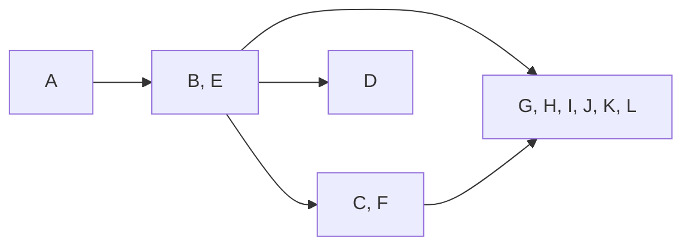

# Lecture 6：图的分解——DFS、拓扑排序与强连通分量

> 依据：`lectures/hand6.pdf`（38 页讲义）与 `lectures/algo6.pdf`（84 页，含逐步展示的幻灯片）。下文页码指讲义页脚编号。
> 主线：图的探索 → 无向图连通分量 → DFS 前后序编号 → 有向图边分类与判环 → DAG 拓扑排序 → 强连通分量与缩点 → 两遍 DFS 求 SCC → 课程安排与全图可达点。
> 标为“补充”“辨析”或“实现说明”的内容用于解释、补全证明、回答练习或指出适用条件，不是讲义原文。默认图有限，使用邻接表，记 $n=|V|,m=|E|$。

## 1. 本讲研究什么？

图 $G=(V,E)$ 由顶点集合与边集合组成。无向图的边可以双向通行；有向图中，$(u,v)$ 表示只能沿 $u\to v$ 的方向通行。

记 $u\leadsto v$ 表示存在从 $u$ 到 $v$ 的路径，允许长度为 0 的路径，所以 $u\leadsto u$。

本讲的三个核心问题是：

| 问题 | 要得到的结构 | 关键工具 |
| --- | --- | --- |
| 无向图中哪些顶点彼此可达？ | 连通分量 | 一次 DFS 探索一个分量 |
| 有依赖关系的任务能否排成合法顺序？ | DAG 的拓扑序 | DFS 完成时间，或逐次删除源点 |
| 有向图中哪些顶点彼此可达？ | 强连通分量（SCC）及其组成的 DAG | 反图上的完成顺序 + 原图上的探索 |

**本讲的“分解”是把图拆成有结构的部分。** 它不要求像前两讲那样，把输入均匀地分成几个规模减半的子问题。

**复杂度约定。** 邻接表 `Adj[v]` 保存从 $v$ 出发可直接到达的顶点。有向边在出边表中出现一次，无向边通常在两个端点的表中各出现一次。后面的线性时间均指 $O(n+m)$。

## 2. 从 EXPLORE 到完整 DFS（第 3–6 页）

### 2.1 EXPLORE：沿一条路深入，再回溯

```text
EXPLORE(G, v):
    visited[v] = true
    PREVISIT(v)
    for each u in Adj[v]:
        if not visited[u]:
            parent[u] = v
            EXPLORE(G, u)
    POSTVISIT(v)
```

- 进入顶点时立即标记，防止环导致重复递归。
- 遇到尚未访问的邻居，先完整探索它，再处理下一个邻居。
- `PREVISIT` 在首次进入时执行；`POSTVISIT` 在所有邻居处理完、即将返回时执行。
- `parent` 是补充的记录项，用于保存 DFS 森林；根的父亲为 `NIL`。

“深度优先”的含义是：**只要还能沿未访问顶点继续深入，就暂不返回上层。** `visited` 标记不会在回溯时清除。

### 2.2 为什么恰好访问所有可达顶点？

假设调用前所有顶点均未访问。从 $v$ 调用 `EXPLORE`，恰好访问满足 $v\leadsto u$ 的顶点。

**补充证明。** 分两个方向：

1. **不会多访问。** 除起点外，每次新访问都沿着某条边，从已访问顶点走到新顶点。沿递归调用链连接起来，就是从 $v$ 出发的路径。
2. **不会漏访问。** 假设调用结束后，仍有可达顶点未访问。在一条从 $v$ 到它的路径上，取第一个未访问顶点 $y$，其前驱 $x$ 已访问。处理 $x$ 时必然扫描边 $x\to y$，于是 $y$ 应当被访问，矛盾。

**适用条件。** 如果调用前任意预先标记一些顶点，搜索可能被这些标记挡住，不能直接声称“本次新访问了原图中所有可达顶点”。完整 DFS 会保留此前搜索的标记；此时应结合已有搜索的性质理解。SCC 算法第二遍则把已分配顶点视为从当前剩余图中删除。

### 2.3 DFS：覆盖整个图

一次探索可能只覆盖图的一部分，因此需要外层循环：

```text
DFS(G):
    for each v in V:
        visited[v] = false
        parent[v] = NIL
    for each v in V:
        if not visited[v]:
            EXPLORE(G, v)
```

每次外层调用产生一棵 DFS 树；所有树合在一起称为 **DFS 森林**。邻接点扫描顺序、外层顶点顺序会影响森林和编号，但不影响最终的可达性与分量划分。

### 2.4 时间与空间复杂度

每个顶点只进入一次，顶点上的固定操作总共 $O(n)$。扫描邻接表的总成本为

$$
\sum_{v\in V}|\operatorname{Adj}[v]|=
\begin{cases}
m,&\text{有向图},\\
2m,&\text{无向图（通常的双向存储）}.
\end{cases}
$$

因此完整 DFS 的时间为

$$
\boxed{\Theta(n+m)}.
$$

**辨析。** 第 6 页“每条边扫描两次”的说法对应无向图。有向图按出边邻接表存储时，每条有向边扫描一次；复杂度结论相同。

**实现说明。** 不计输入图，标记、父亲数组及递归栈需要 $O(n)$ 额外空间；递归深度最坏为 $n$，例如一条长链。若采用邻接矩阵，每个顶点都扫描一整行，完整 DFS 的时间通常为 $\Theta(n^2)$。

## 3. 无向图：连通分量与边分类（第 7–10 页）

### 3.1 连通分量

无向图连通，当且仅当任意两个顶点之间都有路径。一个**连通分量**是按顶点集合包含关系极大的连通部分；它与其他分量之间没有边。

从未访问顶点 $v$ 开始的探索，恰好访问包含 $v$ 的整个连通分量。因此 DFS 外层每启动一次探索，就发现一个新分量。

```text
CONNECTED_COMPONENTS(G):       // G is undirected
    visited[v] = false for every v
    cc = 0
    for each v in V:
        if not visited[v]:
            cc = cc + 1
            EXPLORE_CC(v, cc)
    return (cc, ccnum)

EXPLORE_CC(v, cc):
    visited[v] = true
    ccnum[v] = cc
    for each u in Adj[v]:
        if not visited[u]:
            EXPLORE_CC(u, cc)
```

得到编号后：

$$
\boxed{u\text{ 与 }v\text{ 连通}\iff\operatorname{ccnum}[u]=\operatorname{ccnum}[v]}.
$$

预处理耗时 $O(n+m)$，之后每次查询只需 $O(1)$。对非空图，连通当且仅当分量数为 1；孤立顶点自身也构成一个分量。

第 8 页的图共有两个分量：$\{A,B,C,D,E,F,G,H,I,J\}$ 与 $\{K,L\}$。右侧展示的是第一个分量的 DFS 树。

### 3.2 树边与回边

- **树边（tree edge）**：首次发现一个未访问顶点、真正触发递归调用的边。
- **回边（back edge）**：其余边连接 DFS 树中的祖先与后代，可以按后代指向祖先的方向理解。

**辨析。** “扫描过的边”不等于“树边”：DFS 会扫描所有邻接表项，只有导致首次发现的边才是树边。无向图中一条树边在子节点处再次被扫描，仍是同一条树边，不能因此把它算成回边。

**补充：为什么无向图没有连接两个独立分支的横叉边？** 若边 $\{u,v\}$ 的一个端点先被发现，而另一个端点在本次探索之外仍未访问，那么扫描这条边时就会进入另一个端点，把它纳入当前子树。因此非树边的两个端点必为祖先与后代。

有 $k$ 个连通分量时，DFS 森林恰好有 $n-k$ 条树边，因为每个非根顶点对应一条父边。

## 4. 前序与后序编号：把递归结构变成区间（第 11–13 页）

### 4.1 两个时间戳

在一次完整 DFS 开始前令 `clock = 1`，并让所有树共用这个时钟：

```text
PREVISIT(v):
    pre[v] = clock
    clock = clock + 1

POSTVISIT(v):
    post[v] = clock
    clock = clock + 1
```

- $\operatorname{pre}[v]$：首次发现 $v$ 的时间。
- $\operatorname{post}[v]$：完成 $v$ 的全部递归探索、准备返回的时间。

$n$ 个顶点共有 $2n$ 个互不相同的时间戳，且始终有 $\operatorname{pre}[v]<\operatorname{post}[v]$。

### 4.2 括号性质

**定理。** 对任意两个不同顶点 $u,v$，区间

$$
I_u=[\operatorname{pre}[u],\operatorname{post}[u]],\qquad
I_v=[\operatorname{pre}[v],\operatorname{post}[v]]
$$

要么不相交，要么一个严格包含另一个；不会部分交叠。

**补充证明。** 假设先进入 $u$：

- 若在 $u$ 返回之前进入 $v$，则 $v$ 的调用属于 $u$ 的递归子树，必须先返回 $v$，才能返回 $u$。
- 若在 $u$ 返回之后才进入 $v$，则两个区间不相交。

这就像合法括号序列：可以出现 `u[ v[ ]v ]u` 或 `u[ ]u v[ ]v`，不能出现 `u[ v[ ]u ]v`。

### 4.3 用时间戳判断祖先关系

$$
\boxed{u\text{ 是 }v\text{ 的严格祖先}
\iff \operatorname{pre}[u]<\operatorname{pre}[v]
<\operatorname{post}[v]<\operatorname{post}[u]}.
$$

第 12 页例子中，$A$ 的区间为 $[1,10]$，$B$ 为 $[2,3]$，$E$ 为 $[4,9]$，$I$ 为 $[5,8]$，$J$ 为 $[6,7]$：

```text
A [1,10]
├── B [2,3]
└── E [4,9]
    └── I [5,8]
        └── J [6,7]
```

$A$ 是 $B,E,I,J$ 的祖先；$B,E$ 的区间不相交。后面的另一棵树以 $C[11,22]$ 为根，孤立顶点 $F$ 的区间是 $[23,24]$。

**辨析。** 区间包含关系说明的是 **DFS 树中的祖先关系**。区间不相交不代表原有向图中不存在路径，因为路径还可以使用非树边。

## 5. 有向图中的四类边（第 14–17 页）

### 5.1 定义与时间戳条件

对有向边 $(u,v)$，按照一次固定的 DFS 森林分类。以下表格先假设 $u\ne v$：

| 类型 | 在 DFS 森林中的意义 | 时间戳关系 |
| --- | --- | --- |
| 树边 Tree | 该边首次发现 $v$，令其成为 $u$ 的孩子 | $\operatorname{pre}[u]<\operatorname{pre}[v]<\operatorname{post}[v]<\operatorname{post}[u]$ |
| 前向边 Forward | 非树边，指向自己的后代 | 与树边相同 |
| 回边 Back | 指向自己的祖先 | $\operatorname{pre}[v]<\operatorname{pre}[u]<\operatorname{post}[u]<\operatorname{post}[v]$ |
| 横叉边 Cross | 两端互非祖先、后代 | $\operatorname{pre}[v]<\operatorname{post}[v]<\operatorname{pre}[u]<\operatorname{post}[u]$ |

仅凭时间戳不能区分树边与前向边，还需要父边记录。对简单图，树边满足 `parent[v] == u`；若允许平行边，应记录具体的父边。

**补充。** 自环 $u\to u$ 直接构成有向环，判环时归入指向活动顶点的回边情形，不适用表中针对不同顶点的严格不等式。

### 5.2 为什么没有“从早结束的区间指向晚开始的区间”？

第 17 页问：表中的情况是否穷尽了？看似还可能有

$$
\operatorname{pre}[u]<\operatorname{post}[u]
<\operatorname{pre}[v]<\operatorname{post}[v].
$$

但如果确实有边 $u\to v$，扫描它时 $v$ 尚未访问，DFS 就会立刻探索 $v$，使其成为 $u$ 的后代，无法等到 $u$ 返回后才首次进入 $v$。因此这种顺序不可能对应一条 $u\to v$ 边。

### 5.3 讲义例子

第 16 页的 DFS 中：

| 边 | 类型 | 判断依据 |
| --- | --- | --- |
| $A\to B$ | 树边 | $B$ 由 $A$ 首次发现 |
| $A\to F$ | 前向边 | $F$ 是经 $A\to B\to E\to F$ 发现的后代 |
| $F\to B$ | 回边 | $B$ 是 $F$ 的祖先 |
| $D\to A$ | 回边 | $A$ 是 $D$ 的祖先 |
| $D\to H$ | 横叉边 | $\operatorname{post}[H]=9<\operatorname{pre}[D]=13$ |
| $H\to G$ | 横叉边 | $\operatorname{post}[G]=6<\operatorname{pre}[H]=8$ |

### 5.4 在线判断需要三种状态

**实现补充。** 用颜色区分：

- `WHITE`：尚未发现。
- `GRAY`：已经发现，但尚未完成；仍在递归调用栈上。
- `BLACK`：已经完成。

扫描 $u\to v$ 时：

- `v` 为白色：这是树边，递归进入。
- `v` 为灰色：这是回边，发现了有向环。
- `v` 为黑色：可能是前向边或横叉边，不能仅据此判定有环。

**只有一个 `visited` 布尔数组，足够完成遍历，却不足以直接区分回边与其他指向已访问节点的边。**

## 6. 有向无环图与拓扑排序（第 18–23 页）

### 6.1 有环当且仅当 DFS 存在回边

有向无环图称为 **DAG（Directed Acyclic Graph）**。

$$
\boxed{G\text{ 有有向环}\iff G\text{ 的 DFS 发现回边}}.
$$

**补充证明。**

- 若有回边 $u\to v$，DFS 树上有从祖先 $v$ 到后代 $u$ 的有向路径，再接上 $u\to v$ 就构成环。自环本身也是环。
- 若存在环，取环上最先被发现的顶点 $v$。此时其他环上顶点都未访问，且沿环从 $v$ 可达，因此会在 $v$ 的调用结束前被探索。环上指向 $v$ 的前驱在扫描该边时，$v$ 仍为灰色，于是出现回边。

注意这是**有向图**的判环规则。无向图沿树边反向看到父亲时，不能把同一条父边误当成一个环。

### 6.2 拓扑序与后序编号

**拓扑排序（topological sort / linearization）**：把所有顶点排成序列，使每条边 $u\to v$ 的起点 $u$ 都排在终点 $v$ 之前。

对 DAG 中任意边 $u\to v$，不存在回边，剩余的树边、前向边、横叉边均满足

$$
\boxed{\operatorname{post}[u]>\operatorname{post}[v]}.
$$

因此：

$$
\boxed{\text{按 post 从大到小排列，就是 DAG 的一个拓扑序。}}
$$

反过来，若图有拓扑序，就不可能有环；否则沿环位置必须严格递增，最终又回到原位置，矛盾。于是

$$
\boxed{\text{无有向环}\iff\text{存在拓扑序}\iff\text{DFS 无回边}}.
$$

### 6.3 带判环的线性时间算法

**实现补充。** 不必对时间戳调用比较排序。每次完成顶点时追加到列表，最后把列表反转即可。

```text
TOPOLOGICAL_SORT(G):
    color[v] = WHITE for every v
    finished = empty list

    VISIT(v):
        color[v] = GRAY
        for each u in Adj[v]:
            if color[u] == GRAY:
                fail: G contains a directed cycle
            if color[u] == WHITE:
                VISIT(u)
        color[v] = BLACK
        append v to finished

    for each v in V:
        if color[v] == WHITE:
            VISIT(v)
    return reverse(finished)
```

这里的 `fail` 表示终止整个算法并报告不存在拓扑序。有向环上的图也能得到一份完成顺序，但其逆序不保证满足所有边的先后关系。

时间为 $O(n+m)$，辅助空间为 $O(n)$。需要控制好列表操作：完成时尾部追加，最后线性反转；若每次向数组头部插入，可能引入 $O(n^2)$ 的搬移成本。

### 6.4 讲义例子与非唯一性

第 19 页的依赖关系为

$$
B\to A,\quad B\to D,\quad A\to C,\quad D\to C,
\quad C\to E,\quad C\to F.
$$

例如下面两个序列都合法：

$$
B,A,D,C,E,F;\qquad B,D,A,C,F,E.
$$

$A,D$ 之间没有强制先后关系，$E,F$ 也是如此。因此拓扑序一般不唯一。

### 6.5 源点、汇点与删除源点算法

- **源点（source）**：入度为 0。
- **汇点（sink）**：出度为 0。

每个**非空** DAG 都至少有一个源点和一个汇点。在任何拓扑序中，第一个顶点必为源点，最后一个必为汇点。因此在 DAG 的 DFS 中，最大 `post` 顶点是源点，最小 `post` 顶点是汇点。

**补充证明。** 若没有源点，从任意顶点不断沿入边向前追溯。图有限，必然重复某个顶点，得到有向环，矛盾。汇点的证明沿出边进行即可。

第 23 页给出另一种拓扑排序思路：反复输出并删除一个源点。用入度数组与队列实现，通常称为 **Kahn 算法**：

```text
KAHN(G):
    compute indegree[v] for every v
    Q = queue of all vertices with indegree 0
    order = empty list
    while Q is not empty:
        v = dequeue(Q)
        append v to order
        for each u in Adj[v]:
            indegree[u] = indegree[u] - 1
            if indegree[u] == 0:
                enqueue(Q, u)
    if length(order) < |V|:
        fail: G contains a directed cycle
    return order
```

每个顶点入队一次，每条边导致一次减入度，总时间同样为 $O(n+m)$。只需更新入度，不必真的从存储结构中删除边。若输出不足 $n$ 个顶点，剩余非空图没有源点，所以含环。

## 7. 强连通分量：把有向图缩成 DAG（第 24–26 页）

### 7.1 “互相可达”定义了等价关系

有向图中，单向可达不够。定义

$$
u\sim v\iff(u\leadsto v)\land(v\leadsto u).
$$

**补充。** 这个关系满足：

- 自反性：长度为 0 的路径保证 $u\sim u$。
- 对称性：定义同时要求两个方向。
- 传递性：若 $u\sim v$ 且 $v\sim w$，拼接路径可得 $u\leadsto w$ 与 $w\leadsto u$。

因此它把顶点划分成互不相交的等价类，称为**强连通分量（Strongly Connected Component，SCC）**。每个 SCC 是极大的互相可达顶点集合；单个顶点也可以是 SCC。

**辨析。** 无向图的一棵 DFS 树恰好对应一个连通分量；有向图的一棵 DFS 树可能横跨多个 SCC。例如 $A\to B$ 从 $A$ 出发得到一棵树，但 $\{A\},\{B\}$ 是两个 SCC。

### 7.2 缩点图一定无环

将每个 SCC 收缩成一个顶点，只保留不同分量之间的边：若原图存在 $u\to v$ 且 $u\in C,v\in C',C\ne C'$，就在缩点图中加入 $C\to C'$。分量内部的边不保留；重复的分量间边可以合并。

$$
\boxed{\text{任意有向图的 SCC 缩点图都是 DAG。}}
$$

**补充证明。** 如果不同分量组成有向环 $C_1\to C_2\to\cdots\to C_k\to C_1$，利用每个分量内部的强连通性，就能沿这个环从任一分量到达其他分量并返回。它们应当属于同一个 SCC，与分量不同矛盾。

所以一般有向图可以理解成：**每个 SCC 内部互相可达，SCC 之间形成没有环的依赖结构。**

### 7.3 讲义例子

第 26 页图中的 SCC 为

$$
\{A\},\quad\{B,E\},\quad\{C,F\},\quad\{D\},\quad\{G,H,I,J,K,L\}.
$$

其缩点结构为：



$\{A\}$ 是源 SCC；$\{D\}$ 与 $\{G,H,I,J,K,L\}$ 是汇 SCC。这里“源/汇”只描述**分量之间**的边：源 SCC 可以有内部入边，汇 SCC 可以有内部出边。

## 8. 为什么完成时间能安排 SCC 的处理顺序？（第 27–28 页）

### 8.1 先找汇 SCC，再逐个移除

若从汇 SCC 中任一顶点开始探索：

- 分量内部强连通，所以能访问这个分量的所有顶点。
- 分量没有通向其他分量的边，所以不会跑到其他分量。

因此一次探索恰好得到一个 SCC。如果能找到一个汇 SCC 中的顶点，就可以取出这个分量，再对剩余图重复。

讲义提出两个问题：

1. 怎样找到确定属于汇 SCC 的顶点？
2. 删除一个分量后，怎样高效继续，而不用每次重新计算所有信息？

### 8.2 分量的最大完成时间

对一次完整 DFS，定义

$$
M(C)=\max_{v\in C}\operatorname{post}[v].
$$

**关键定理。** 对两个**不同**的 SCC，若缩点图中有边 $C\to C'$，则

$$
\boxed{M(C)>M(C')}.
$$

**补充证明。** 按 $C,C'$ 中哪个分量先被发现，分两种情况。

**情况一：先发现 $C$。** 设 $x$ 是 $C$ 中第一个被发现的顶点。它能到达 $C$ 的所有顶点，并沿分量间的边到达 $C'$ 的所有顶点。此时 $C'$ 尚未访问，它们都会在 `EXPLORE(x)` 返回前完成。因此

$$
M(C)=\operatorname{post}[x]>M(C').
$$

**情况二：先发现 $C'$。** 设其第一个被发现的顶点为 $y$。$C'$ 不可能到达 $C$，否则结合 $C\to C'$，两者应合并成同一 SCC。因此从 $y$ 开始的探索不会发现 $C$；$C'$ 的所有顶点先完成，之后才会发现 $C$，仍有 $M(C)>M(C')$。

这里比较的是**每个分量的最大值**，不能加强为“$C$ 中每个顶点的 `post` 都大于 $C'$ 中每个顶点的 `post`”。

### 8.3 最大 post 所在的是源 SCC

设全图最大 `post` 的顶点属于 $C$。如果另一个分量 $D$ 有边进入 $C$，则定理给出 $M(D)>M(C)$，与全图最大矛盾。因此

$$
\boxed{\text{最大 post 的顶点位于一个源 SCC。}}
$$

按各 SCC 的 $M(C)$ 从大到小排列，就是缩点 DAG 的一个拓扑序。

**辨析。** 在一般有向图中，这个顶点本身未必是入度为 0 的源点。例如 $A\leftrightarrow B$ 只有一个源 SCC，但两个顶点都有入边。

也不能对称地说“最小 `post` 顶点一定属于汇 SCC”。**补充反例：** 在 $A\leftrightarrow B$、$A\to C$ 中，从 $A$ 开始，先访问 $B$ 再访问 $C$，最先完成的是 $B$；但 $B$ 所在的 $\{A,B\}$ 有出边通向 $\{C\}$，并非汇 SCC。

## 9. 两遍 DFS 求强连通分量（第 29–33 页）

### 9.1 反图：把源 SCC 变成汇 SCC

反图 $G^R$ 保留顶点、翻转所有边：

$$
(u,v)\in E(G)\iff(v,u)\in E(G^R).
$$

原图中 $u\leadsto v$，当且仅当反图中 $v\leadsto u$。所以互相可达关系保持不变，$G$ 与 $G^R$ 有**完全相同的 SCC 顶点划分**；只有分量之间的边方向改变。

于是：

$$
\text{在 }G^R\text{ 上做 DFS}
\Longrightarrow\text{最大 post 顶点位于 }G^R\text{ 的源 SCC}
\Longrightarrow\text{位于 }G\text{ 的汇 SCC}.
$$

这解决了第一个问题。

### 9.2 为什么第一遍的顺序可以一直用？

把第一遍在反图上的分量最大完成时间记为 $M_R(C)$。若原图中有分量间边 $C\to D$，反图中就有 $D\to C$，所以

$$
\boxed{C\to D\text{ in }G\quad\Longrightarrow\quad M_R(D)>M_R(C)}.
$$

第二遍每次选择**尚未分配且第一遍 `post` 最大**的顶点，它所属分量 $C$ 也有剩余分量中最大的 $M_R$。

如果 $C$ 还有边指向另一个未分配分量 $D$，便应有 $M_R(D)>M_R(C)$，矛盾。因此 $C$ 是剩余图的汇 SCC；从中探索恰好取出整个 $C$。

取出一个完整 SCC 后，上述不等式在其他分量间仍成立。由此可归纳地继续使用第一遍的顺序，**不需要重新做 DFS 或重新编号**。

### 9.3 完整伪代码

下面是讲义版本的两遍 DFS 算法，通常称为 **Kosaraju 算法**。函数内的辅助过程共享外层数组。

```text
STRONGLY_CONNECTED_COMPONENTS(G):
    create GR with the same vertices and empty adjacency lists
    for each v in V:
        for each u in AdjG[v]:
            append v to AdjGR[u]

    // First pass: collect finishing order on the reverse graph.
    visited[v] = false for every v
    finished = empty list

    FINISH_DFS(v):
        visited[v] = true
        for each u in AdjGR[v]:
            if not visited[u]:
                FINISH_DFS(u)
        append v to finished

    for each v in V:
        if not visited[v]:
            FINISH_DFS(v)

    // Second pass: assign one component per new exploration on G.
    scc[v] = 0 for every v
    count = 0

    ASSIGN_DFS(v, id):
        scc[v] = id
        for each u in AdjG[v]:
            if scc[u] == 0:
                ASSIGN_DFS(u, id)

    for each v in reverse(finished):
        if scc[v] == 0:
            count = count + 1
            ASSIGN_DFS(v, count)

    return (count, scc)
```

要点：

1. 第一遍必须覆盖整个反图，不能只从任意单一起点探索。
2. `finished` 在**退出**顶点时追加，反转后才是第一遍 `post` 的降序。
3. 第二遍使用全新的“是否已分配”状态，不能沿用第一遍全部为真的 `visited`。
4. 降序控制的是第二遍的**外层起点顺序**；内部邻接表不需要排序。
5. 已分配的顶点直接跳过，等价于从剩余问题中删除整个分量，不必物理删除顶点与边。

### 9.4 正确性与复杂度

第二遍每轮开始时，所有已分配顶点组成若干完整 SCC。由第 9.2 节，下一起点所在分量是剩余图的汇 SCC；探索既不会漏掉其内部顶点，也不会进入其他未分配分量。因此每次恰好增加一个正确的 SCC，最终覆盖全部顶点。

| 步骤 | 时间 |
| --- | --- |
| 构造反图 | $O(n+m)$ |
| 第一遍完整 DFS | $O(n+m)$ |
| 反转完成列表 | $O(n)$ |
| 第二遍 DFS 森林 | $O(n+m)$ |
| 合计 | $\boxed{O(n+m)}$ |

显式保存反图需要 $O(n+m)$ 额外空间；标记、分量编号、完成列表及搜索栈需要 $O(n)$。第二遍虽然有多个外层调用，但每个顶点只分配一次，每条边只扫描一次，不是“每个分量都重新遍历全图”。

按上述从 1 递增的编号方式，若原图存在跨分量边 $u\to v$，则

$$
\boxed{\operatorname{scc}[u]>\operatorname{scc}[v]}.
$$

也就是先输出汇 SCC，分量发现顺序是原缩点 DAG 的**逆拓扑序**。不可达分量之间的相对顺序可能改变。

**辨析。** 也可以采用“先在 $G$ 做 DFS，再按其完成时间降序在 $G^R$ 探索”的对称版本。两种版本都正确，但必须把两遍使用的图和顺序配套，不能只修改其中一步。

### 9.5 补充：完整手算一个例子

原图为

$$
A\leftrightarrow B,\qquad B\to C,\qquad
C\leftrightarrow D,\qquad D\to E.
$$

它的 SCC 缩点结构是

$$
\{A,B\}\longrightarrow\{C,D\}\longrightarrow\{E\}.
$$

第一遍在反图 $G^R$ 上做 DFS，外层与邻接表均按字母顺序访问。反图邻接表为

```text
A: B
B: A
C: B, D
D: C
E: D
```

使用从 1 开始、进入与退出都加一的时钟：

| 顶点 | $\operatorname{pre}_R$ | $\operatorname{post}_R$ |
| --- | --- | --- |
| A | 1 | 4 |
| B | 2 | 3 |
| C | 5 | 8 |
| D | 6 | 7 |
| E | 9 | 10 |

完成列表为 $[B,A,D,C,E]$；第二遍的外层顺序为 $[E,C,D,A,B]$。

| 外层遇到的顶点 | 在原图上的操作 | 新得到的 SCC |
| --- | --- | --- |
| E | 尚未分配，开始探索 | $\{E\}$，编号 1 |
| C | 访问 C、D；D 指向 E，但 E 已分配 | $\{C,D\}$，编号 2 |
| D | 已分配，跳过 | 无 |
| A | 访问 A、B；B 指向 C，但 C 已分配 | $\{A,B\}$，编号 3 |
| B | 已分配，跳过 | 无 |

这个例子说明，第二遍的搜索可能看到指向已处理分量的边；只要跳过已分配顶点，就仍然一次提取一个 SCC。

## 10. 讲义的两个思考问题（第 34–35 页）

### 10.1 图非常大时，SCC 算法面临什么问题？

**补充讨论。** 渐近时间 $O(n+m)$ 并不意味着实现中的内存、调用栈与磁盘访问成本可以忽略。

- **递归深度。** 长链会使递归栈达到 $O(n)$。可改为显式栈；第一遍需要记录每个栈帧的“下一个待扫描邻居”，只有邻居全部处理完才追加完成列表，才能模拟正确的 `post` 顺序。
- **反图存储。** 显式保存原图和反图会增加内存需求。可在读取边时同时构建出边与入边表，后者直接作为反图邻接表；这省去重复构建过程，但仍需要存储这些表。
- **数据访问。** 稠密的邻接矩阵需 $\Theta(n^2)$ 空间，稀疏大图通常应使用紧凑的邻接表。若数据无法放入内存，磁盘读写与访问局部性需要另外分析，不能仅凭 RAM 模型下的线性时间判断实际速度。

第二遍只需要可达性遍历；第一遍必须保留真正的完成顺序。把两遍都随意改成“顶点压栈后立即写入输出”的过程，不能保证算法仍然正确。

### 10.2 如果把“路径”换成“边”呢？

讲义只给出 “How about edges instead of paths?”，没有进一步限定问题。以下是对“把互相可达改成互有直接边”的一种补充理解。

直接有边是局部的邻接关系，路径可达是可以拼接的关系。若定义不同顶点之间

$$
u\approx v\iff(u,v)\in E\land(v,u)\in E,
$$

即使额外约定每个顶点与自身相关，该关系仍不一定传递。例如

$$
A\leftrightarrow B\leftrightarrow C
$$

没有 $A,C$ 间的直接边，却有 $A\approx B$、$B\approx C$。所以它不像“互相可达”那样自动把顶点划分成互不相交的等价类。这个例子中的三个顶点仍属于同一个 SCC，因为它们之间存在双向路径。

## 11. 练习 3.16：完成全部课程的最少学期数（第 37 页）

### 11.1 问题与状态

课程是顶点；$u\to v$ 表示 $u$ 是 $v$ 的先修课。每学期可以修任意多门课程，求完成全部课程所需的最少学期数，要求线性时间。

**补充解答。** 按题目的通常模型，每门课占一个学期，先修课必须在更早学期修完，没有课程容量或开课学期等额外限制。

定义 $s(v)$ 为课程 $v$ 最早可以修读的学期：

$$
\boxed{
s(v)=
\begin{cases}
1,&\operatorname{indegree}(v)=0,\\
1+\max_{u\to v}s(u),&\text{否则}.
\end{cases}}
$$

最终答案是 $\max_{v\in V}s(v)$；没有课程时答案为 0。

**关键是取最大值，不是求和。** 多门互不依赖的先修课可以同学期完成；后续课程只需要等最晚完成的先修课。

### 11.2 拓扑排序与动态规划一起做

```text
MIN_SEMESTERS(G):
    compute indegree[v] for every v
    semester[v] = 1 for every v
    Q = queue of all vertices with indegree 0
    processed = 0
    answer = 0

    while Q is not empty:
        v = dequeue(Q)
        processed = processed + 1
        answer = max(answer, semester[v])
        for each u in Adj[v]:
            semester[u] = max(semester[u], semester[v] + 1)
            indegree[u] = indegree[u] - 1
            if indegree[u] == 0:
                enqueue(Q, u)

    if processed < |V|:
        return IMPOSSIBLE       // cyclic prerequisites
    return answer
```

当 $u$ 的入度减到 0 时，所有先修课都已处理，`semester[u]` 已收集全部候选值，正好等于递推式中的最大值加一。

### 11.3 为什么最优？

1. **下界。** 设某个合法安排把课程 $v$ 放在第 $t(v)$ 学期，则每条边 $u\to v$ 都要求 $t(v)\ge t(u)+1$。因此沿一条包含 $k$ 门课程的依赖链，至少需要 $k$ 个学期。
2. **可实现。** 按递推式安排课程，每条先修边的前驱都比后继至少早一学期；同一学期课程数量不受限制，所以这个安排合法。

因此最少学期数恰好为 DAG 中最长有向路径的**顶点数**；若最长路径有 $\ell$ 条边，答案为 $\ell+1$（非空图）。

第 19 页的 DAG 可以安排为：

| 学期 | 课程 |
| --- | --- |
| 1 | B |
| 2 | A、D |
| 3 | C |
| 4 | E、F |

答案为 4，而不是拓扑序的顶点总数 6。若存在有向环，环上的课程无法全部满足严格先修关系，应报告无可行安排。

算法只做一次拓扑处理并逐边更新状态，时间 $O(n+m)$，额外空间 $O(n)$。

## 12. 练习 3.22：是否存在能到达所有顶点的点？（第 38 页）

### 12.1 用 SCC 识别真正的条件

给定有向图，判断是否存在 $s\in V$，使得 $s$ 能到达所有其他顶点。注意题目只要求一个方向；并不要求所有顶点都能回到 $s$。

**补充解答。** 对非空图：

$$
\boxed{\exists s\text{ 能到达全图}\iff\text{SCC 缩点 DAG 恰好有一个源点。}}
$$

这里指原图只有一个**源 SCC**，并非原图只有一个入度为 0 的顶点。

**必要性。** 若有两个不同源 SCC，它们之间不可能互相到达：一条从外部进入某源 SCC 的路径，会在进入该分量时产生分量间入边。因此没有任何分量能同时到达两个源 SCC，也就不存在题目要求的顶点。

**充分性。** 在有限 DAG 中，从任一顶点不断向前追溯入边，最终会到达某个源点。若源点唯一，它就是所有顶点的祖先，因而能到达整个缩点 DAG。对应源 SCC 内任意顶点都能先在分量内部移动，再沿分量间路径到达原图所有顶点。

所以，若答案存在，**所有可行的起点恰好是唯一源 SCC 中的全部顶点**。

### 12.2 线性时间算法

1. 用两遍 DFS 计算 `scc[v]`。
2. 为每个分量维护布尔量 `has_incoming`，初始为假。
3. 扫描每条边 $u\to v$；若 `scc[u] != scc[v]`，标记 `has_incoming[scc[v]] = true`。
4. 数一数未被标记的分量。恰好一个时，返回其中任意顶点；否则不存在。

不必真的建立或去重整个缩点图，因为这里只关心有没有跨分量入边。总时间 $O(n+m)$。空图没有可选顶点，应返回不存在；只有一个顶点时，该顶点满足条件。

### 12.3 更简洁的做法：选一个候选点，再验证

如果只需要找一个起点，可以省去完整 SCC 分解：

```text
FIND_UNIVERSAL_START(G):
    if |V| == 0:
        return NONE

    visited[v] = false for every v
    candidate = NONE
    for each v in V:
        if not visited[v]:
            candidate = v
            EXPLORE(G, v)

    visited[v] = false for every v
    EXPLORE(G, candidate)
    if every vertex is visited:
        return candidate
    return NONE
```

这里 `EXPLORE` 只做普通遍历，前后访问钩子可为空。第一轮外层循环的**最后一个 DFS 树根**，就是全图最大完成时间的顶点，因此位于一个源 SCC。

- 若存在符合要求的起点，缩点图必只有一个源 SCC，候选点便位于其中，一定能够到达全图。
- 若不存在，第二轮验证必然发现未访问顶点并返回 `NONE`。

**不能省略验证。** 有多个源 SCC 时，第一轮仍会得到一个候选点，但它只能到达其中一部分图。例如 $A\to C$、$B\to C$，任取 $A$ 或 $B$ 都不能到达另一个源点。

两轮遍历的总时间为 $O(n+m)$，额外空间为 $O(n)$，且不需要构造反图。

## 13. 本讲算法与复杂度速查

以下均以邻接表为输入；空间列不计已有输入图的存储。

| 问题 / 算法 | 核心方法 | 时间 | 额外空间 |
| --- | --- | --- | --- |
| 从指定点求可达顶点 | `EXPLORE`，含标记初始化 | $O(n+m)$ | $O(n)$ |
| 完整 DFS、记录前后序 | 每个顶点进入一次，逐边扫描 | $\Theta(n+m)$ | $O(n)$ |
| 无向图连通分量 | 每棵 DFS 树一个编号 | $O(n+m)$ | $O(n)$ |
| 有向图判环 | 是否存在指向灰色顶点的边 | $O(n+m)$ | $O(n)$ |
| DFS 拓扑排序 | 完成列表反转，并排除回边 | $O(n+m)$ | $O(n)$ |
| Kahn 拓扑排序 | 入度 + 源点队列 | $O(n+m)$ | $O(n)$ |
| 两遍 DFS 求 SCC | 反图后序降序 + 原图探索 | $O(n+m)$ | $O(n+m)$，含反图 |
| 最少学期数 | 拓扑序上计算最长依赖链 | $O(n+m)$ | $O(n)$ |
| 找能到达全图的点 | 最后一个 DFS 树根 + 再次验证 | $O(n+m)$ | $O(n)$ |

这些算法的线性时间来自同一个记账方法：**每个顶点处理常数次，每条边扫描常数次。**

## 14. 易错点速查

| 容易误记的说法 | 应掌握的表述 |
| --- | --- |
| 一次 `EXPLORE` 一定遍历全图 | 它从指定起点探索；完整 DFS 用外层循环覆盖其他顶点 |
| DFS 中所有扫描到的边都是树边 | 只有首次发现顶点、触发递归的边是树边 |
| 回溯时应清除 `visited` | 图遍历中应保留标记，防止重复进入 |
| 有向边指向已访问顶点，就说明有环 | 指向仍处于递归栈中的灰色顶点才是回边 |
| 无向图看到指向父亲的边就有环 | 必须排除同一条树边的反向扫描 |
| 前序越小，就应该越早进入拓扑序 | 拓扑排序使用后序降序；前序不保证合法 |
| 时间戳排序会使拓扑排序变成 $O(n\log n)$ | 退出时追加，最后反转，保持线性时间 |
| 一个 DFS 树就是一个 SCC | 有向图的一棵 DFS 树可能跨越多个 SCC |
| 最大 `post` 顶点一定入度为 0 | 一般有向图中只能保证它位于源 SCC；DAG 中才是源点 |
| 最小 `post` 顶点一定在汇 SCC 中 | 一般有向图不成立；本讲通过反图的最大 `post` 找汇 SCC |
| $C\to C'$ 意味着 C 的所有完成时间都更大 | 只保证 $\max_{v\in C}\operatorname{post}[v]>\max_{v\in C'}\operatorname{post}[v]$ |
| SCC 第二遍继续沿用第一遍的访问标记 | 必须重新初始化遍历状态，或使用新的分量数组 |
| 每删除一个 SCC 都要重新算完成时间 | 初次反图 DFS 的完成顺序可以一直使用 |
| 第二遍要按 `post` 排序每个邻接表 | 降序只控制外层起点；内部邻接顺序任意 |
| 最少学期数是拓扑序的长度 | 是最长先修链的顶点数；无依赖的课程可同时修 |
| 任一源 SCC 都能到达全图 | 当且仅当源 SCC 唯一时，它才能到达所有分量 |
| 最大完成时间的点无需验证就能到达全图 | 若不知道源 SCC 是否唯一，必须再做一次可达性验证 |

## 15. 复习检查清单

- [ ] 能写出 `EXPLORE` 与完整 DFS，并说明访问标记何时设置、为何不能清除。
- [ ] 能用“逐点 + 逐边记账”证明邻接表 DFS 的 $O(n+m)$ 时间界。
- [ ] 能用 DFS 为无向图所有连通分量编号，并处理孤立顶点。
- [ ] 能手算 `pre/post`，证明区间嵌套性质，并用它判断祖先关系。
- [ ] 能区分有向图的树边、前向边、回边和横叉边，解释缺失的区间顺序为何不可能。
- [ ] 能证明“有向图有环当且仅当 DFS 有回边”，并说明三色标记的作用。
- [ ] 能证明逆后序是 DAG 的拓扑序，并在线性时间内生成它。
- [ ] 能用入度队列实现删除源点算法，并在有环时报告失败。
- [ ] 能解释强连通性为何是等价关系，以及 SCC 缩点图为何无环。
- [ ] 能分情况证明跨分量边对应的最大完成时间不等式。
- [ ] 能准确写出 SCC 两遍 DFS 分别在哪张图运行、采用什么顺序。
- [ ] 能解释为什么第二遍每次只发现一个 SCC、为什么无需重新计算第一遍顺序。
- [ ] 能求最少学期数，给出最长依赖链的下界与可实现安排。
- [ ] 能证明全图可达点存在当且仅当源 SCC 唯一，并写出候选点加验证的简化算法。
