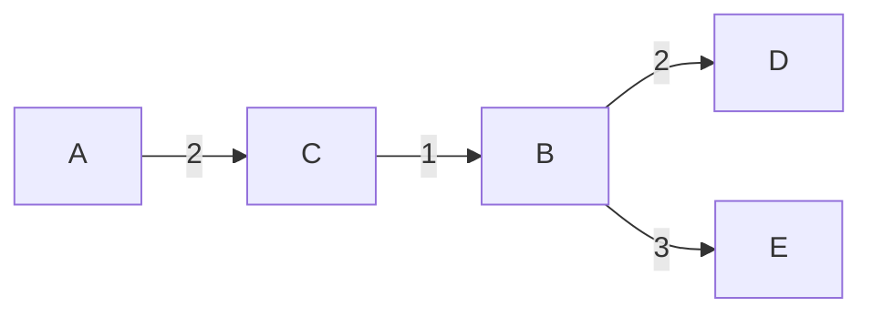

# Lecture 7：图中的路径——BFS、Dijkstra、Bellman–Ford 与 DAG 最短路

> 依据：[hand7.pdf](../lectures/hand7.pdf)（33 页讲义）与 [algo7.pdf](../lectures/algo7.pdf)（71 页，含逐步展示的幻灯片）。下文页码指讲义页脚编号。
> 主线：无权图距离与 BFS → 带权图与松弛 → Dijkstra 的贪心选择 → 优先队列与复杂度 → 负边与 Bellman–Ford → 负环检测 → DAG 上的最短路、最长路 → 两道练习。
> 标为“补充”“辨析”或“实现说明”的内容用于解释、补全证明、回答练习或指出适用条件，不是讲义原文。默认图有限、使用邻接表，记 $n=|V|\ge1,m=|E|$；复杂度按一次边权加法、比较为 $O(1)$ 分析。

## 1. 本讲研究什么？（第 3、7 页）

Lecture 6 主要问“能不能到达”；本讲进一步问“到达的最小代价是多少”。给定图 $G=(V,E)$ 与起点 $s$，单源最短路问题要求求出 $s$ 到每个顶点 $v$ 的距离。

- **无权图**：路径长度是经过的边数，相当于每条边权重为 1。
- **带权图**：每条边 $(u,v)$ 有权重 $\ell(u,v)$，路径长度是边权之和。
- **有向图**：只能沿边的方向走；**无向图**：每条边可以双向通行。

用 $\delta(s,v)$ 表示真实的最短距离，用 `dist[v]` 表示算法维护的当前估计。不可达时，约定 $\delta(s,v)=+\infty$。允许长度为 0 的空路径，因此没有相关负环时 $\delta(s,s)=0$。

**路径约定。** 最短路问题通常允许行走中重复经过顶点或边；没有相关负环时，总能去掉环，得到一条不更长的**简单路径**，即不重复顶点的路径。如果能从 $s$ 到达一个负环，并从该环到达 $v$，就可以反复绕环，使到 $v$ 的长度趋于 $-\infty$；这时没有有限的最短距离。第 8 节会细化这个条件。

本讲四个算法的区别，主要在于**按照什么顺序传播距离信息**：

| 图的条件 | 算法 | 处理顺序 | 时间 |
| --- | --- | --- | --- |
| 所有边权为 1 | BFS | 按距离层次，使用 FIFO 队列 | $O(n+m)$ |
| 所有边权非负 | Dijkstra | 每次取当前距离最小的未确定顶点 | 二叉堆下 $O((n+m)\log n)$ |
| 允许负边，需要检测可达负环 | Bellman–Ford | 反复扫描全部边 | 通常写为 $O(nm)$ |
| 有向无环图，允许负边 | DAG 最短路 | 按拓扑序处理顶点 | $O(n+m)$ |

二叉堆复杂度中的对数按 $n\ge2$ 表述；单顶点情况直接处理。Bellman–Ford 若连初始化一起计入，统一上界为 $O(n+nm)$。

## 2. BFS：无权图按层扩张（第 3–6 页）

### 2.1 为什么用队列？

定义第 $d$ 层为

$$
L_d=\{v\in V:\delta(s,v)=d\}.
$$

从 $L_0=\{s\}$ 开始，处理第 $d$ 层时，将它们尚未发现的邻居加入队尾。这些新发现顶点的距离恰好是 $d+1$。

FIFO 队列保证先发现的层先处理：还没有处理完第 $d$ 层，就不会开始处理第 $d+1$ 层。

**辨析。** 队列并非在任意时刻都只有一层。处理一层的过程中，它通常同时包含第 $d$ 层的剩余顶点和第 $d+1$ 层的已发现顶点；所有第 $d$ 层顶点排在第 $d+1$ 层之前。只有在层与层的交界处，队列才恰好包含完整的下一层。

### 2.2 完整伪代码

```text
BFS(G, s):
    for each v in V:
        dist[v] = infinity
        prev[v] = NIL
    dist[s] = 0
    Q = empty FIFO queue
    enqueue(Q, s)

    while Q is not empty:
        u = dequeue(Q)
        for each v in Adj[u]:
            if dist[v] == infinity:
                dist[v] = dist[u] + 1
                prev[v] = u
                enqueue(Q, v)

    return (dist, prev)
```

`prev` 是补充的路径记录项，保存首次发现顶点的前驱；`dist[v] != infinity` 同时承担“已经发现”的标记。

**实现说明。** 在入队时就设置距离，不能等到出队才标记，否则一个顶点可能被多个邻居重复加入队列。队列首尾操作应为 $O(1)$；若每次删除数组首项都搬移剩余元素，会破坏线性时间保证。

### 2.3 讲义例子

第 4 页按如下顺序扫描邻居：

| 刚处理的顶点 | 处理后的队列 |
| --- | --- |
| 尚未开始 | $[S]$ |
| $S$ | $[A,C,D,E]$ |
| $A$ | $[C,D,E,B]$ |
| $C$ | $[D,E,B]$ |
| $D$ | $[E,B]$ |
| $E$ | $[B]$ |
| $B$ | $[]$ |

因此

$$
\delta(S,S)=0,\qquad
\delta(S,A)=\delta(S,C)=\delta(S,D)=\delta(S,E)=1,\qquad
\delta(S,B)=2.
$$

邻接表顺序可能改变同一层内的访问次序和 `prev`，但不改变最短距离。

### 2.4 正确性：对距离层数归纳

讲义的不变量是：对每个非空距离层 $L_d$，存在一个时刻满足：

1. 所有真实距离不超过 $d$ 的顶点都已设置正确距离。
2. 其他顶点的距离仍为 $+\infty$。
3. 队列恰好包含 $L_d$ 中的全部顶点。

**补充证明。**

- **初始。** 队列只有 $s$，其距离为 0，其他距离均为无穷，因此 $d=0$ 时成立。
- **归纳步骤。** 假设处理第 $d$ 层之前成立。由 $u\in L_d$ 的边新发现 $v$ 时，存在一条长度为 $d+1$ 的路；又因所有距离至多为 $d$ 的顶点都已发现，$v$ 不可能属于更早层，因此 $\delta(s,v)=d+1$。
- **不会遗漏下一层。** 任意 $v\in L_{d+1}$ 的一条最短路，其倒数第二个顶点属于 $L_d$；处理该前驱时，一定会发现 $v$。

全部处理完 $L_d$ 后，队列恰好包含 $L_{d+1}$，归纳成立。队列最终为空时，所有可达顶点均已得到正确距离。

### 2.5 复杂度与适用范围

初始化需要 $O(n)$；每个顶点至多入队、出队一次；每条可达顶点的出边至多扫描一次。无向边通常在两个端点的邻接表中各出现一次，因此仍有

$$
\boxed{T_{\mathrm{BFS}}=O(n+m),\qquad \text{额外空间}=O(n)}.
$$

BFS 求的是**最少边数**。若所有边权都是同一个正数 $c$，可将 BFS 的边数乘以 $c$；若边权不同，最少边数不一定对应最小总权重。

例如 $s\to t$ 权重为 10，而 $s\to a\to t$ 的两条边权重均为 1。BFS 偏好一条边的路线，但带权最短路应选总权重为 2 的两条边路线。

## 3. 从拆边到闹钟：Dijkstra 的直觉（第 7–10 页）

### 3.1 正整数权重可以拆成单位边

若每条边的权重 $\ell_e$ 都是正整数，将边 $e=(u,v)$ 替换成一条包含 $\ell_e$ 条单位边的链，中间增加 $\ell_e-1$ 个虚拟顶点，就可以在新图上执行 BFS。

新图规模为

$$
n'=n+\sum_{e\in E}(\ell_e-1),\qquad
m'=\sum_{e\in E}\ell_e,
$$

所以时间为

$$
O\left(n+\sum_{e\in E}\ell_e\right).
$$

**补充。** 这依赖权重的数值大小。一条权重为 $2^b$ 的边，只需要约 $b+1$ 个二进制位表示，拆边后却要创建 $2^b$ 条边。因此拆边主要提供直觉，并不是处理大权重的高效实现。

### 3.2 只处理真正到达顶点的时刻

把边权想成旅行时间：

1. 给起点 $s$ 设置时刻 0 的闹钟。
2. 每次取最早响起的闹钟，假设顶点 $u$ 在时刻 $T$ 被确定到达。
3. 对每个尚未确定的邻居 $v$，尝试将它的闹钟设为 $T+\ell(u,v)$。
4. 如果 $v$ 已有更早的闹钟，则保留原值；若新时间更早，则提前闹钟。

不必逐一模拟虚拟顶点或每个整数时刻，只需要找到下一个最早事件。这就是优先队列在 Dijkstra 算法中的作用。

讲义从**正权**出发；实际上 Dijkstra 对任意**非负实数权重**都成立，允许 0，不要求整数。

## 4. 松弛：所有带权最短路算法的共同操作（第 19–21 页）

### 4.1 UPDATE / RELAX

讲义在讨论负边时引入 `UPDATE`，这里先提炼出来，便于统一理解后续算法。

对边 $(u,v)$，尝试“先到 $u$，再走到 $v$”：

$$
\boxed{\operatorname{dist}[v]\leftarrow
\min\{\operatorname{dist}[v],\operatorname{dist}[u]+\ell(u,v)\}}.
$$

这个操作称为**松弛（relaxation）**。

```text
RELAX(u, v, w):
    if dist[u] != infinity and dist[v] > dist[u] + w:
        dist[v] = dist[u] + w
        prev[v] = u
        return true
    return false
```

使用严格不等号，只在确实变短时更新前驱。若用一个大整数代替无穷，必须先判断 `dist[u]` 是否有限，避免溢出，或让“无穷加负数”产生虚假的可达状态。

### 4.2 距离估计始终是上界

初始化为 $\operatorname{dist}[s]=0$，其他为 $+\infty$。之后每个有限的 `dist[v]` 都对应一条从 $s$ 到 $v$ 的实际行走长度：松弛只是在已有路线后追加一条真实边。

所以当 $\delta(s,v)$ 有限时，始终有

$$
\boxed{\operatorname{dist}[v]\ge\delta(s,v)}.
$$

估计可以过大，但不会比真实最短距离还小。它只会下降或不变。

**辨析。** `dist[v]` 从无穷变成有限，只表示已经找到一条路线，不表示已经找到最短路。BFS 的首次发现、Dijkstra 的取出最小值、Bellman–Ford 的充分轮数，是不同的“答案已正确”的依据。

### 4.3 沿最短路径按顺序松弛，就能传播正确答案

假设 $(u,v)$ 是某条最短路的最后一条边，且 $\operatorname{dist}[u]=\delta(s,u)$，则

$$
\delta(s,v)=\delta(s,u)+\ell(u,v).
$$

松弛后 `dist[v]` 至多为右侧，又不可能低于真实距离，因此恰好正确。

更一般地，对一条最短路

$$
s=v_0\to v_1\to\cdots\to v_k=t,
$$

只要算法执行的松弛序列中，依次包含

$$
(v_0,v_1),(v_1,v_2),\ldots,(v_{k-1},v_k),
$$

就会把正确距离一路传到 $t$。这些操作之间可以夹杂其他松弛，因为上界性质保证正确距离不会被改坏。这里假设所讨论的最短距离有限。

## 5. Dijkstra：每次确定当前最近的顶点（第 11–12、17 页）

### 5.1 暂定距离与已确定集合

维护集合 $S$，其中的顶点已经从优先队列取出，距离被永久确定。对尚未进入 $S$ 的顶点，`dist` 只是当前已知的最好估计。

每一步选择

$$
v=\arg\min_{x\notin S}\operatorname{dist}[x],
$$

将 $v$ 加入 $S$，再松弛它的出边。非负权重保证这个最小值不会在以后被改善。

### 5.2 使用 decrease-key 的伪代码

```text
DIJKSTRA(G, s):              // every edge weight is nonnegative
    for each v in V:
        dist[v] = infinity
        prev[v] = NIL
        settled[v] = false
    dist[s] = 0
    H = make_min_priority_queue(V, keys = dist)

    while H is not empty:
        u = delete_min(H)
        if dist[u] == infinity:
            break           // all remaining vertices are unreachable
        settled[u] = true

        for each edge (u, v) with weight w in Adj[u]:
            if not settled[v] and dist[v] > dist[u] + w:
                dist[v] = dist[u] + w
                prev[v] = u
                decrease_key(H, v, dist[v])

    return (dist, prev)
```

堆中每个尚未确定的顶点只有一个条目；`decrease_key` 需要能定位顶点所在的堆位置。相同距离可以任意打破平局。

若只求 $s$ 到 $t$，可以在 $t$ **作为最小值被取出并确定**时停止，不能在第一次发现 $t$ 时停止。

### 5.3 讲义例子的完整过程

第 11 页是有向图，其带权出边为：

```text
A: B(4), C(2)
B: C(3), D(2), E(3)
C: B(1), D(4), E(5)
D: none
E: D(1)
```

以 $A$ 为起点，每行记录取出一个顶点并松弛其出边后的距离：

| 刚确定的顶点 | `dist[A]` | `dist[B]` | `dist[C]` | `dist[D]` | `dist[E]` |
| --- | --- | --- | --- | --- | --- |
| 初始化 | 0 | $\infty$ | $\infty$ | $\infty$ | $\infty$ |
| $A$ | 0 | 4 | 2 | $\infty$ | $\infty$ |
| $C$ | 0 | 3 | 2 | 6 | 7 |
| $B$ | 0 | 3 | 2 | 5 | 6 |
| $D$ | 0 | 3 | 2 | 5 | 6 |
| $E$ | 0 | 3 | 2 | 5 | 6 |

确定顺序为 $A,C,B,D,E$。例如，$B$ 首次被发现时距离为 4，经过 $C$ 后改成 3；$D$ 的估计从 6 改成 5。

最终前驱边组成一棵最短路树：



这里 $A\to C\to B\to D$ 长度为 $2+1+2=5$，$A\to C\to B\to E$ 长度为 $2+1+3=6$。

**辨析。** 最短路树保证从同一起点到每个可达顶点的树上路径最短，不是在最小化树的所有边权之和；它与最小生成树是不同的问题。

### 5.4 正确性：为什么取出的最小值一定正确？

**补充完整证明。** 对已确定顶点数归纳。归纳假设为：对所有 $x\in S$，都有 $\operatorname{dist}[x]=\delta(s,x)$。

初始先确定 $s$，其距离为 0；由于所有边权非负，不可能有更短的从 $s$ 回到自身的路线。

设下一次取出的顶点为 $v$，且 `dist[v]` 有限。考虑任意一条从 $s$ 到 $v$ 的路径 $P$，令 $(x,y)$ 是 $P$ 上第一条离开 $S$ 的边：$x\in S,y\notin S$。则

$$
\begin{aligned}
\ell(P)
&\ge \ell(P[s\leadsto x])+\ell(x,y)\\
&\ge \delta(s,x)+\ell(x,y)\\
&=\operatorname{dist}[x]+\ell(x,y)\\
&\ge\operatorname{dist}[y]\\
&\ge\operatorname{dist}[v].
\end{aligned}
$$

每一步的依据是：

1. 到达 $y$ 后的剩余边权非负，完整路径不会比这个前缀更短。
2. 到 $x$ 的任意路径都不短于最短路。
3. 归纳假设保证 $x$ 的距离已正确。
4. 确定 $x$ 时已经松弛过 $(x,y)$，之后 `dist[y]` 只会下降。
5. $v$ 是所有未确定顶点中 `dist` 最小的。

因此所有 $s\leadsto v$ 路线长度都至少为 `dist[v]`，即 $\delta(s,v)\ge\operatorname{dist}[v]$；结合距离估计的上界性质，得到等号。

**非负边权恰好用在第一步。** 允许零权重只会让不等号取等，不影响证明；负边则可能让后续路线变得更短。

## 6. 优先队列决定 Dijkstra 的复杂度（第 13–16 页）

### 6.1 需要哪些操作？

| 操作 | 含义 |
| --- | --- |
| `make_queue` | 根据初始键值建立优先队列 |
| `insert` | 插入新元素 |
| `decrease_key` | 将某个已有元素的键值减小 |
| `delete_min` | 返回并移除键值最小的元素 |

上述 Dijkstra 版本至多执行 $n$ 次 `delete_min`，扫描 $m$ 条有向边，并执行至多 $m$ 次成功的 `decrease_key`。无向图按双向邻接表计数，仅差一个常数因子。

### 6.2 不同数据结构的比较

| 实现 | `delete_min` | `insert / decrease_key` | Dijkstra 总时间 |
| --- | --- | --- | --- |
| 无序数组 | $O(n)$ | $O(1)$ | $O(n^2+m)$；简单图为 $O(n^2)$ |
| 二叉堆 | $O(\log n)$ | $O(\log n)$ | $O((n+m)\log n)$ |
| $d$ 叉堆 | $O(d\log_d n)$ | $O(\log_d n)$ | $O((dn+m)\log_d n)$ |
| Fibonacci 堆 | $O(\log n)$，摊还 | $O(1)$，摊还 | $O(n\log n+m)$ |

**补充说明。**

- 数组每次线性扫描所有未确定顶点找最小值，但修改一个键值只需常数时间。
- 二叉堆可以在线性时间建堆；之后每次取最小值或减小键值最多沿堆高调整。
- $d$ 叉堆高度为 $O(\log_d n)$。上浮每层比较一个父亲，下沉每层可能比较 $d$ 个孩子，因而取最小值多出 $d$ 因子。
- Fibonacci 堆一行给的是摊还界，不表示每次操作的最坏情况都满足该成本。

在顶点数组、前驱数组和每个顶点一个堆条目的实现下，不计输入图，额外空间为 $O(n)$。

### 6.3 稀疏图与稠密图如何选择？

对简单图，$m=O(n^2)$：

- **稀疏图**：若 $m=O(n)$，二叉堆给出 $O(n\log n)$，优于数组的平方时间上界。
- **稠密图**：若 $m=\Theta(n^2)$，数组为 $O(n^2)$，二叉堆的通常上界为 $O(n^2\log n)$。
- 粗略比较两种上界，分界在 $m$ 约为 $n^2/\log n$ 的量级；当 $m=o(n^2/\log n)$ 时，二叉堆的上界渐近优于平方时间。实际速度还受常数和实现影响。

讲义给出 $d\approx m/n$ 的选择思路，用于平衡 $dn$ 与 $m$。实现时至少取 $d=2$，例如 $d=\max\{2,\lceil m/n\rceil\}$；对于简单图，这给出常用的平衡方案，不必把近似式当成所有参数下的精确最优值。

### 6.4 补充：没有 decrease-key 时怎么办？

可以使用“重复插入新条目”的最小堆：

```text
push(H, (0, s))
while H is not empty:
    (du, u) = pop_min(H)
    if du != dist[u]:
        continue                 // obsolete entry
    for each edge (u, v) with weight w:
        if dist[v] > du + w:
            dist[v] = du + w
            prev[v] = u
            push(H, (dist[v], v))
```

初始化与前面的版本相同，只把起点加入堆。旧的较大条目留在堆里，弹出时跳过。必须按最新距离处理，不能把旧条目误当成一次新的有效扩展。

此版本可能保存 $O(m)$ 个堆条目，统一时间界可写为 $O(n+(m+1)\log(m+2))$，额外空间为 $O(n+m)$。简单图下常简写为 $O((n+m)\log n)$，但空间界与每个顶点只有一个条目的实现不同。

## 7. 负边与 Bellman–Ford（第 18–24 页）

### 7.1 为什么 Dijkstra 不能直接处理负边？

**补充反例。** 考虑没有环的有向图：

$$
s\xrightarrow{2}a,\qquad
s\xrightarrow{5}b,\qquad
b\xrightarrow{-4}a.
$$

Dijkstra 在处理 $s$ 后，先将 $a$ 的距离 2 永久确定；但真正最短路是 $s\to b\to a$，长度为 $5-4=1$。

问题不是松弛失去安全性，而是**“当前暂定距离最小，就可以永久确定”不再成立**。这个反例甚至是 DAG，说明无环和非负是两种不同的结构条件。

### 7.2 为什么重复 $n-1$ 轮足够？

假设从 $s$ 可达的部分没有负环。任何可达顶点都有一条最短简单路径：若路线重复顶点，重复段构成权重非负的环，删除它不会增加长度。

简单路径最多包含 $n$ 个不同顶点，因此最多有 $n-1$ 条边。

我们虽然不知道最短路上的边应该按什么顺序松弛，但可以保证：

> 每轮扫描全部边，让正确距离沿每条最短路径至少向前推进一条边。

因此扫描 $n-1$ 轮之后，所有有限的最短距离都已得到。

### 7.3 带提前结束与负环检测的伪代码

```text
BELLMAN_FORD(G, s):
    for each v in V:
        dist[v] = infinity
        prev[v] = NIL
    dist[s] = 0

    for i = 1 to |V| - 1:
        changed = false
        for each edge (u, v) with weight w in E:
            if RELAX(u, v, w):
                changed = true
        if not changed:
            return (dist, prev, NO_REACHABLE_NEGATIVE_CYCLE)

    for each edge (u, v) with weight w in E:
        if dist[u] != infinity and dist[v] > dist[u] + w:
            return REACHABLE_NEGATIVE_CYCLE

    return (dist, prev, NO_REACHABLE_NEGATIVE_CYCLE)
```

这里 `RELAX` 使用第 4 节的过程。讲义主体给出固定 $n-1$ 轮；提前结束、返回状态与最后一轮检测是补全后的实现。

**实现说明。** 一轮内就地更新 `dist`。边的扫描顺序可以任意选，影响的是一轮内传播多远以及多久提前收敛，不影响无可达负环时的最终正确性。

### 7.4 正确性与“第 $k$ 轮”的准确含义

定义

$$
D_k(v)=\text{从 }s\text{ 到 }v\text{、至多使用 }k\text{ 条边的最小长度}.
$$

这个定义在固定 $k$ 时也允许重复顶点。状态转移为

$$
\boxed{D_k(v)=\min\left\{D_{k-1}(v),
\min_{(u,v)\in E}\bigl(D_{k-1}(u)+\ell(u,v)\bigr)\right\}}.
$$

初值是 $D_0(s)=0$，其他为无穷。

**补充归纳证明。** 就地更新的 Bellman–Ford 在第 $k$ 轮结束后满足

$$
\delta(s,v)\le\operatorname{dist}[v]\le D_k(v)
$$

（对最短距离有限的顶点）。右侧不等式来自：每条边在本轮都被扫描，而扫描时前驱的估计不会大于上一轮结束的值；左侧是松弛的上界性质。

无可达负环时，$D_{n-1}(v)=\delta(s,v)$，两侧夹住 `dist[v]`，故算法正确；不可达点保持无穷。

**辨析：就地更新不等于同步更新。**

- **同步版本**：每轮只读取上一轮的距离，写入另一份数组；第 $k$ 轮后恰好得到 $D_k$。
- **就地版本**：后扫描的边可能读到本轮刚更新的值，一轮就传播多条边；只能保证已覆盖所有至多 $k$ 条边的候选路线，可能更早得到更长路径上的结果。

例如按 $s\to a,a\to b,b\to c$ 的顺序扫描，一轮就能把距离传到 $c$；反向扫描则需要三轮。不能把“第 $k$ 轮后只使用了 $k$ 条边”套在就地版本上。

### 7.5 讲义例子：八个顶点、七轮更新

第 24 页图的有向边为：

```text
S: A(10), G(8)
A: E(2)
B: A(1), C(1)
C: D(3)
D: E(-1)
E: B(-2)
F: A(-4), E(-1)
G: F(1)
```

讲义表格可以按上述**同步版本**理解，每列是 $D_k$：

| 顶点 | 0 | 1 | 2 | 3 | 4 | 5 | 6 | 7 |
| --- | --- | --- | --- | --- | --- | --- | --- | --- |
| $S$ | 0 | 0 | 0 | 0 | 0 | 0 | 0 | 0 |
| $A$ | $\infty$ | 10 | 10 | 5 | 5 | 5 | 5 | 5 |
| $B$ | $\infty$ | $\infty$ | $\infty$ | 10 | 6 | 5 | 5 | 5 |
| $C$ | $\infty$ | $\infty$ | $\infty$ | $\infty$ | 11 | 7 | 6 | 6 |
| $D$ | $\infty$ | $\infty$ | $\infty$ | $\infty$ | $\infty$ | 14 | 10 | 9 |
| $E$ | $\infty$ | $\infty$ | 12 | 8 | 7 | 7 | 7 | 7 |
| $F$ | $\infty$ | $\infty$ | 9 | 9 | 9 | 9 | 9 | 9 |
| $G$ | $\infty$ | 8 | 8 | 8 | 8 | 8 | 8 | 8 | 8 |

到 $D$ 的一条最短路恰好有 7 条边：

$$
S\to G\to F\to A\to E\to B\to C\to D,
$$

总长度为

$$
8+1-4+2-2+1+3=9.
$$

这个例子说明，按同步更新时确实可能需要全部 $n-1$ 轮。就地更新可能更早达到同样的最终距离，具体中间表格取决于边顺序。

### 7.6 提前结束与复杂度

如果某一整轮没有任何改善，则所有可达边都已满足

$$
\operatorname{dist}[v]\le\operatorname{dist}[u]+\ell(u,v).
$$

下一轮使用相同的值，也不会产生新变化，因此可以提前结束。第 8 节的论证还保证，这时不存在从 $s$ 可达的负环。

固定轮数的边扫描成本是 $O(nm)$，加上初始化后为

$$
\boxed{T_{\mathrm{BF}}=O(n+nm),\qquad \text{额外空间}=O(n)}.
$$

当 $m\ge1$ 时通常简写为 $O(nm)$；若 $m=0$，仍需要 $O(n)$ 初始化。提前结束能改善部分输入上的时间，但不改变最坏情况上界。

## 8. 负环：哪些最短距离不再有有限答案？（第 25 页）

### 8.1 负边与负环不是一回事

负环是总边权小于 0 的有向环。允许负边，并不代表一定存在负环；上一节例子就有负边，却有有限的最短距离。

若存在从 $s$ 到负环 $C$、再从 $C$ 到 $t$ 的路线，那么重复绕 $C$ 共 $r$ 次，可以得到长度

$$
\ell(s\leadsto C)+r\ell(C)+\ell(C\leadsto t).
$$

因为 $\ell(C)<0$，该值随 $r\to\infty$ 趋向 $-\infty$。

因此针对具体终点 $t$，准确条件是

$$
\boxed{\delta(s,t)=-\infty
\iff \text{存在负环 }C\text{，使 }s\leadsto C\leadsto t}.
$$

**讲义表述辨析。** “图中有负环，就不能问最短路”范围过宽：

- 从 $s$ 不可达的负环，不影响从 $s$ 出发的距离。
- 从 $s$ 可达的负环，只使该环能够继续到达的顶点受到影响。
- 其他顶点可能仍有有限最短距离，或者完全不可达。

在无向图中，一条可达负边就能通过来回走使长度无限下降；这是本讲允许重复行走的最短路约定下的结论。若强制只考虑简单路径，问题的性质会改变。

### 8.2 多检查一轮，为什么能检测负环？

执行 $n-1$ 轮后，检查是否仍有从有限距离顶点出发的边满足

$$
\operatorname{dist}[v]>\operatorname{dist}[u]+\ell(u,v).
$$

结论是：

$$
\boxed{\text{第 }n\text{ 轮仍能改善距离}
\iff \text{存在从 }s\text{ 可达的负环}}.
$$

**补充证明。**

**若没有可达负环。** $n-1$ 轮后所有可达距离已经正确，真实最短距离满足每条边的三角不等式，因此不可能进一步改善。

**若存在可达负环。** $n-1$ 轮后，负环上的顶点都已得到有限估计，因为到每个可达顶点至少存在一条不超过 $n-1$ 条边的简单可达路径。若环上所有边都不能改善，设环为 $v_0\to v_1\to\cdots\to v_{k-1}\to v_0$，则

$$
\operatorname{dist}[v_{i+1}]
\le \operatorname{dist}[v_i]+\ell(v_i,v_{i+1})
$$

对全部环边成立，下标模 $k$。将它们相加，距离项相消，得到

$$
0\le\sum_{i=0}^{k-1}\ell(v_i,v_{i+1})=\ell(C),
$$

与负环权重小于 0 矛盾。因此必然存在可以继续改善的边。

最后一轮只做判断也可以；如果实际执行松弛，只要该轮发生任何改善，就足以报告可达负环。

### 8.3 补充：检测整个图的负环

普通单源 Bellman–Ford 检测的是**从该起点可达的负环**。若要检测图中任何位置的负环，可以：

1. 加一个超级源点 $q$，向每个原顶点连一条权重为 0 的边。
2. 从 $q$ 执行 Bellman–Ford，按新图顶点数安排轮次。

等价的简化实现是，将原图所有 `dist[v]` 初始化为 0，然后执行 $n$ 轮边扫描；若第 $n$ 轮仍有改善，则存在负环。这个初始化是为负环检测设计的，不再表示某个原起点的单源最短距离。

### 8.4 补充：标出所有距离为 $-\infty$ 的顶点

在完成 $n-1$ 轮后的距离数组上，找出所有仍可松弛边的终点，以这些顶点为起点，沿原图出边做一次多源 BFS 或 DFS。所有能到达的顶点，都是受可达负环影响的顶点。

这里收集终点时可只检查不修改距离：每个可达负环至少提供一个种子；而若某条可达边仍可改善，其终点不可能拥有已经确定的有限最短距离。再沿出边扩张，恰好得到所有可以利用负环无限降低代价的顶点。额外遍历需要 $O(n+m)$ 时间。

## 9. DAG：按拓扑序，一轮就够（第 26–29 页）

### 9.1 没有负环的两种原因

讲义强调两类图自动排除负环：

- 所有边权非负：可以有环，但环权重不会为负。
- 图本身是 DAG：可以有负边，但根本没有有向环。

DAG 的关键结构是 Lecture 6 中的**拓扑序**：对每条边 $u\to v$，$u$ 必须排在 $v$ 之前。因此任何路径上的顶点也都按拓扑序递增。

只要按拓扑序处理每个顶点的出边，所有路径的边都会以正确的先后关系被松弛。无需像 Bellman–Ford 那样反复扫描，也无需用优先队列比较距离。

### 9.2 正确伪代码

```text
DAG_SHORTEST_PATHS(G, s):
    order = TOPOLOGICAL_SORT(G)    // report failure if G has a cycle
    for each v in V:
        dist[v] = infinity
        prev[v] = NIL
    dist[s] = 0

    for each u in order:
        if dist[u] == infinity:
            continue
        for each edge (u, v) with weight w in Adj[u]:
            RELAX(u, v, w)

    return (dist, prev)
```

**讲义伪代码纠正。** 第 28 页把内层循环写成了 `for all e in E`。线性时间算法应当只扫描**当前顶点 $u$ 的出边**。若对拓扑序中的每个顶点都扫描全部边，就变成约 $nm$ 次扫描，失去了这一算法的线性时间优势。初始化中的 `dists = 0` 应理解为 `dist[s] = 0`。

起点 $s$ 不一定是整个图的第一个拓扑顶点；排在它之前但从它不可达的顶点会被跳过。

### 9.3 正确性：前驱先于后继

**补充证明。** 按拓扑序归纳。处理顶点 $v$ 时，所有入边 $(u,v)$ 的起点都已经处理完毕，因而所有来自前驱的最短路候选值都已传递到 $v$。

对任一从 $s$ 可达且不同于 $s$ 的顶点 $v$，最短路的最后一步必来自某个前驱，所以

$$
\delta(s,v)=\min_{(u,v)\in E}\{\delta(s,u)+\ell(u,v)\}.
$$

所有有限候选值都已参与松弛，故处理 $v$ 时 `dist[v]` 已正确。后面不会再出现一个尚未处理的前驱，因此其值可以确定。

证明依赖的是**拓扑顺序**，不要求边权非负。

拓扑排序耗时 $O(n+m)$，随后每个顶点处理一次、每条边松弛一次，因此

$$
\boxed{T_{\mathrm{DAG}}=O(n+m),\qquad \text{额外空间}=O(n)}.
$$

### 9.4 补充例子：负边不妨碍拓扑松弛

仍用第 7.1 节的图，取拓扑序 $s,b,a$：

| 刚处理的顶点 | `dist[s]` | `dist[b]` | `dist[a]` |
| --- | --- | --- | --- |
| 初始化 | 0 | $\infty$ | $\infty$ |
| $s$ | 0 | 5 | 2 |
| $b$ | 0 | 5 | 1 |
| $a$ | 0 | 5 | 1 |

即使 $b$ 的距离 5 大于 $a$ 当时的估计 2，也要先处理拓扑序在前的 $b$，让负边把 $a$ 的距离改成正确的 1。

## 10. 最长路：DAG 与一般有向图的差别（第 29–30 页）

### 10.1 DAG 最长路同样可以线性时间求解

在 DAG 中没有环，路径不会重复顶点，最长路径有有限长度。可以把每条边权取负，运行 DAG 最短路，再把可达顶点的答案取负：

$$
\min_P\sum_{e\in P}(-\ell_e)
=-\max_P\sum_{e\in P}\ell_e.
$$

更直接的写法是将 `min` 改成 `max`，初始化为

$$
L[s]=0,\qquad L[v]=-\infty\quad(v\ne s),
$$

然后按拓扑序，对每条从有限状态出发的边执行

$$
\boxed{L[v]\leftarrow\max\{L[v],L[u]+\ell(u,v)\}}.
$$

若更新，记录 `prev[v] = u`。时间仍为 $O(n+m)$。

**辨析。** 求单源最长路时，不能把所有顶点初始化为 0，否则相当于允许从任何顶点起步；不可达状态应为 $-\infty$。这里允许负权边，因此“长度尚未算出来”也不能简单用 0 代替。

Lecture 6 中“完成全部课程所需最少学期数”正是 DAG 最长依赖链的应用：单位边权下，路径边数再加 1，得到链上的课程数。

### 10.2 一般有向图的最长简单路径为什么困难？

第 30 页问：边权全部为正的一般有向图，能否高效求最长**简单**路径？

**补充解答。** 这个问题是 NP-hard。一个直接的归约是把有向 Hamilton 路径问题的每条边都赋权 1：图中存在经过全部 $n$ 个顶点的简单路径，当且仅当最长简单路径长度为 $n-1$。

因此，若能在多项式时间内求一般有向图的最长简单路径，就能在多项式时间内判定有向 Hamilton 路径问题；不能把 DAG 的线性时间结论直接推广过去。

权重取负也不能绕开困难：

- 若允许重复行走，原图的正权环变成负环，最短路可能没有有限答案。
- 若强制简单路径，仍然必须处理“不能重复顶点”的全局限制。

DAG 容易，是因为拓扑序让“不能重复顶点”自动成立，并给出了可直接计算的依赖顺序。

## 11. 如何从距离恢复实际路径？

**实现补充。** 前面算法在确定更好的候选路线时，设置 `prev[v] = u`。对已经得到有限、正确最短距离的终点 $t$，沿前驱从 $t$ 回到 $s$，再反转即可。

```text
RESTORE_PATH(s, t, dist, prev):
    if dist[t] == infinity:
        return NO_PATH
    path = empty list
    v = t
    while v != s:
        append v to path
        v = prev[v]
    append s to path
    return reverse(path)
```

该过程以正确的前驱链已经建立为前提；$t=s$ 时返回 $[s]$。若路径有 $k$ 条边，恢复时间和输出空间都是 $O(k+1)$。

若 Bellman–Ford 报告了会影响 $t$ 的负环，就不存在可恢复的有限最短路径，不能机械地沿 `prev` 无限追溯。只保存距离只能回答“多长”，不能直接输出“怎么走”。

## 12. 练习一：所有边统一加一个大常数，能消除负边吗？（第 32 页）

题意：给每条边加足够大的常数 $c$，使所有边权都变正，然后运行 Dijkstra，并把得到的路径当作原图的最短路。这个方案是否正确？

### 12.1 关键：加的是每条边，不是每条路径

**补充解答。** 不正确。对包含 $k$ 条边的路径 $P$，变换后的长度为

$$
\ell'(P)=\sum_{e\in P}(\ell_e+c)=\ell(P)+kc.
$$

不同路径的边数 $k$ 不同，增加的代价也不同，因此原有的路径优劣顺序可能颠倒。

### 12.2 一个无环反例

令

$$
s\xrightarrow{2}t,\qquad
s\xrightarrow{-2}a\xrightarrow{3}t.
$$

原图中：

- 直接走 $s\to t$：长度为 2。
- 走 $s\to a\to t$：长度为 $-2+3=1$，是最短路。

给每条边加 $c=3$ 后，所有权重均为正：

- 直接路线变成 $2+3=5$。
- 两条边路线变成 $(-2+3)+(3+3)=7$。

Dijkstra 会选择原来更差的直接路线，因此算法错误。这个反例没有环，所以错误与负环无关。

只有在候选路径的边数全都相同等额外条件下，统一加常数才保证不改变排序。路径选错之后，再从所得长度中减去“边数乘常数”，也无法恢复被错过的最优路线。

## 13. 练习 4.14：所有点对之间必须经过 $v_0$（第 33 页）

给定强连通有向图，边权为正，并指定顶点 $v_0$。要求求出所有点对 $(u,v)$ 之间、必须经过 $v_0$ 的最短路线。

### 13.1 将路线拆成两段

**补充解答。** 任意经过 $v_0$ 的 $u\leadsto v$ 路线，都可在一次经过 $v_0$ 的位置拆成

$$
u\leadsto v_0\leadsto v.
$$

因此受限距离为

$$
\boxed{D(u,v)=\delta_G(u,v_0)+\delta_G(v_0,v)}.
$$

证明也分两部分：

1. 任意合法路线的两段分别不短于对应的最短距离，所以总长度至少为右侧。
2. 拼接一条最短 $u\leadsto v_0$ 路线和一条最短 $v_0\leadsto v$ 路线，就能达到右侧，而且确实经过 $v_0$。

### 13.2 在原图和反图上各跑一次 Dijkstra

构造反图 $G^R$：将每条边 $u\to v$ 改成 $v\to u$，权重保持不变。路径反转保留总长度，因此

$$
\delta_{G^R}(v_0,u)=\delta_G(u,v_0).
$$

算法如下：

```text
VIA_VERTEX_DISTANCES(G, v0):
    (out, prev_out) = DIJKSTRA(G, v0)
    GR = reverse all edges of G, preserving weights
    (into, prev_reverse) = DIJKSTRA(GR, v0)

    // distance query for any ordered pair (u, v):
    D(u, v) = into[u] + out[v]
    return (into, out, prev_reverse, prev_out)
```

强连通保证两个数组中的距离都有限；正权保证 Dijkstra 适用。若图不强连通，同一做法也能处理，只需将某一段不可达的点对标记为无解。

### 13.3 时间、输出规模与路径恢复

- 构造反图：$O(n+m)$。
- 两次二叉堆 Dijkstra：$O((n+m)\log n)$。
- 保存两个距离数组后，每个点对的距离查询：$O(1)$。
- 若显式输出全部 $n^2$ 个距离，需要再花 $\Theta(n^2)$ 时间；完整时间为 $O((n+m)\log n+n^2)$。

保存反图需要 $O(n+m)$ 空间，距离和前驱数组需要 $O(n)$。若还保存整个答案矩阵，再增加 $\Theta(n^2)$ 空间。

恢复路线时：

1. 在反图搜索的前驱数组中，从 $u$ 沿 `prev_reverse` 走向 $v_0$，恰好得到原图的 $u\leadsto v_0$ 顺序。
2. 用原图搜索的前驱数组恢复 $v_0\leadsto v$。
3. 拼接两段，接点 $v_0$ 只写一次。

恢复一条路线的时间与其输出长度成正比。若要逐条列出全部点对的完整路线，最坏输出规模可达 $\Theta(n^3)$，不能只计算两次 Dijkstra 的成本。

### 13.4 辨析：题目中的“经过”允许重复顶点

上述标准解法求的是允许重复顶点的受限路线。两段最短路分别可以是简单路径，但拼接后未必仍然简单。

例如原图只有双向边

$$
a\leftrightarrow v_0,\qquad a\leftrightarrow b,
$$

所有边权都为 1。图强连通，从 $a$ 到 $b$ 且必须经过 $v_0$ 的最短路线为

$$
a\to v_0\to a\to b,
$$

长度为 3，却重复了 $a$。若另行要求整条路径必须简单，这个例子甚至没有合法解，不能直接套用两段距离相加的公式。

正权只能说明去掉环会缩短路线；但在本题中，去掉包含 $v_0$ 的那段环可能破坏“必须经过 $v_0$”的约束。

## 14. 四种算法的统一理解与速查

四种算法都在传播“从起点到某顶点的一条更好路线”；不同之处在于利用什么条件，保证传播顺序足够正确。

| 算法 | 核心结构 | 何时可确定一个顶点的答案？ | 负边 | 负环 |
| --- | --- | --- | --- | --- |
| BFS | FIFO 队列、距离分层 | 第一次发现时 | 不适用；要求单位边权 | 不涉及 |
| Dijkstra | 当前距离最小的优先队列 | 最小值被取出时 | 一般不允许 | 非负权前提排除负环 |
| Bellman–Ford | 全边扫描、反复松弛 | 无可达负环时，至多 $n-1$ 轮后；也可无更新提前结束 | 允许 | 额外一轮检测可达负环 |
| DAG 最短路 | 拓扑序 | 轮到处理顶点时，所有前驱已处理 | 允许 | 图无环，自动排除 |

算法选择时先看结构：若是 DAG，无论权重正负都能线性处理；否则单位权重用 BFS，非负权重用 Dijkstra，一般含负边的图可用 Bellman–Ford。

最值得记住的三个式子是：

$$
\boxed{\operatorname{dist}[v]\leftarrow
\min\{\operatorname{dist}[v],\operatorname{dist}[u]+\ell(u,v)\}}
$$

$$
\boxed{\text{Dijkstra：最小估计先确定；DAG：前驱先处理；BF：反复覆盖全部边。}}
$$

$$
\boxed{D_{\text{via }v_0}(u,v)=\delta(u,v_0)+\delta(v_0,v)}.
$$

## 15. 易错点速查

| 容易误记的说法 | 应掌握的表述 |
| --- | --- |
| BFS 的队列始终只有一层 | 层内处理时通常包含相邻两层，较近层排在前面 |
| BFS 到出队时再标记即可 | 入队时就标记，避免重复入队 |
| BFS 可以直接求任意带权最短路 | BFS 按边数分层，通常要求单位权重 |
| 有限的 `dist` 就是真实最短距离 | 有限值只表示找到了一条路线，可能仍是过大的估计 |
| Dijkstra 要求严格正权、整数权 | 非负实数权重即可，允许零权 |
| Dijkstra 第一次发现目标就能停止 | 应等目标被作为最小值取出并确定 |
| Dijkstra 没有负环就一定可用 | 即使无环，一条负边也可能破坏贪心选择 |
| 二叉堆在任何图上都比数组快 | 稠密简单图的数组实现有 $O(n^2)$ 上界 |
| Bellman–Ford 第 $k$ 轮恰好只考虑 $k$ 条边 | 同步版本对应至多 $k$ 条边；就地版本可能传播得更远 |
| 有负边就没有最短路 | 有相关负环才会让距离无下界 |
| 多一轮更新能发现图中所有负环 | 普通单源初始化只能发现从源点可达的负环 |
| 存在可达负环，所有顶点距离都为 $-\infty$ | 只有负环能够继续到达的顶点受影响 |
| DAG 每处理一个顶点都扫描全部边 | 只松弛当前顶点的出边，才能保持线性时间 |
| DAG 最长路把所有状态初始化为 0 | 单源版本除源点外应初始化为 $-\infty$ |
| 所有边加同一个常数不改变最短路 | 含 $k$ 条边的路线增加 $kc$，不同路线增加量不同 |
| 必经 $v_0$ 的全点对问题需要跑 $n$ 次 Dijkstra | 原图、反图各从 $v_0$ 跑一次即可支持距离查询 |
| 两次 Dijkstra 的时间包含输出全部答案 | 距离矩阵输出有 $\Theta(n^2)$ 成本，完整路线可能更多 |
| 两段简单最短路径拼接后仍然简单 | 两段可能共享其他顶点，需区分路径是否允许重复 |

## 16. 复习检查清单

- [ ] 能说明 BFS 的队列为何按距离非递减排列，并证明层次不变量。
- [ ] 能写出 BFS，并在入队时设置距离与前驱。
- [ ] 能解释正整数权重拆边方法为什么可能依赖巨大的权重数值。
- [ ] 能写出松弛操作，证明距离估计是上界。
- [ ] 能区分“已发现”“暂定距离有限”和“距离永久确定”。
- [ ] 能手算第 11 页 Dijkstra 的确定顺序与最短路树。
- [ ] 能用路径第一次离开已确定集合的边，证明 Dijkstra 正确性。
- [ ] 能指出证明中非负权重使用的位置，并给出含负边的反例。
- [ ] 能根据取最小值、减小键值的次数推导各类优先队列的复杂度。
- [ ] 能解释重复插入堆条目时为什么要跳过过期值。
- [ ] 能证明无可达负环时，总存在至多 $n-1$ 条边的最短路径。
- [ ] 能区分 Bellman–Ford 的同步更新和就地更新，并解释提前结束条件。
- [ ] 能复现第 24 页距离表，核对到 $D$ 的七条边最短路。
- [ ] 能证明额外一轮改善与可达负环等价。
- [ ] 能区分不可达、有限距离和受负环影响的 $-\infty$。
- [ ] 能写出只扫描当前顶点出边的 DAG 最短路算法，并说明负边为何可用。
- [ ] 能将 DAG 最短路改成单源最长路，正确初始化不可达状态。
- [ ] 能说明一般图最长简单路径与 Hamilton 路径的关系。
- [ ] 能给出统一加常数改变最短路径的具体反例。
- [ ] 能用原图与反图两次 Dijkstra 解答必经 $v_0$ 的点对查询，并计入输出成本。
- [ ] 能使用 `prev` 恢复路线，理解必经顶点约束下两段拼接可能重复顶点。
