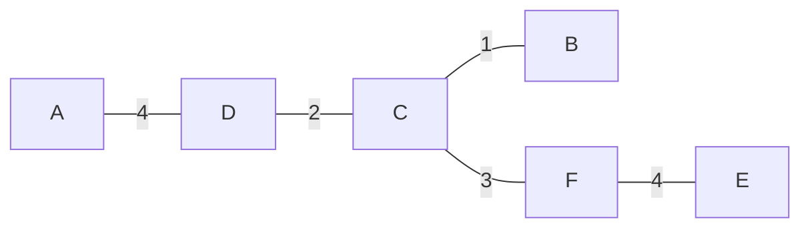

# Lecture 8：贪心算法——最小生成树、集合覆盖与零钱兑换

> 依据：[hand8.pdf](../lectures/hand8.pdf)（40 页讲义）与 [algo8.pdf](../lectures/algo8.pdf)（109 页，含逐步展示的幻灯片）。下文页码指讲义页脚编号。
> 主线：树的性质 → 切分性质与交换论证 → Kruskal 与并查集 → Prim → 红蓝规则 → 集合覆盖的贪心近似 → 零钱兑换的反例与正确性证明。
> 标为“补充”“辨析”或“实现说明”的内容用于解释、补全证明、回答思考题或纠正笔误，不是讲义原文。图论部分默认有限、连通、无向图，记 $n=|V|\ge1,m=|E|$；采用邻接表，边权加法、比较按 $O(1)$ 计。集合覆盖部分另行定义 $n,m$。

## 1. 本讲研究什么？

**贪心算法（greedy algorithm）**每一步都按当前标准作出一个局部最优选择，并保留此前的决定。关键问题是：为什么这样的选择不会损害最终答案？

Lecture 7 的 Dijkstra 已经使用了贪心思想：在非负边权下，每次确定当前距离最小的顶点。本讲进一步比较三种结果：

| 问题 | 每一步的贪心选择 | 能保证什么？ |
| --- | --- | --- |
| 最小生成树：Kruskal | 选择不会成环的最轻边 | 得到全局最优解 |
| 最小生成树：Prim | 选择连接当前树与外部顶点的最轻边 | 得到全局最优解 |
| 最小集合覆盖 | 选择能覆盖最多未覆盖元素的集合 | 一般不最优，但有对数级近似保证 |
| 零钱兑换 | 选择不超过剩余金额的最大面值 | 对某些面值系统最优，对任意面值系统不成立 |

本讲反复使用的证明方法是**交换论证（exchange argument）**：从一个最优解出发，把它的一小部分替换成贪心选择，证明仍然可行且代价不增加。这样就能说明，至少存在一个最优解与贪心决定一致。

## 2. 最小生成树与树的基本性质（第 3–8 页）

### 2.1 从网络建设到 MST

把计算机看作顶点，把可建设的连接看作无向边，把维护费用看作边权。希望所有计算机彼此连通，同时所选边的总费用尽量小。

**生成树（spanning tree）**是覆盖原图全部顶点的一棵树。最小生成树问题要求找到

$$
T=(V,E_T),\qquad E_T\subseteq E,
$$

使 $T$ 连通、无环，并最小化

$$
\boxed{w(T)=\sum_{e\in E_T}w(e)}.
$$

**辨析：网络建模与边权条件。** 讲义说“最优连接方案不能包含环”，这里隐含维护费用为正：删去环上一条边仍连通，且费用严格下降。若费用只是非负，则能找到一个树形最优方案，但零权环也可能出现在某个最优连接方案中。若允许负权，最便宜的任意连通子图可能主动保留负权环，此时它与 MST 是不同的问题。

MST 本身要求答案是一棵树；**Kruskal 和 Prim 都允许零权、负权**，不需要 Dijkstra 的非负权前提。

### 2.2 性质一：删去环上的一条边，不会破坏连通性

设删去的是环上的边 $e=\{u,v\}$。环的其余部分仍提供从 $u$ 到 $v$ 的路线，因此原来用到 $e$ 的路线都能绕过去。

这条性质使我们可以“先加边形成环，再删除一条边”，同时保持连通，是后面交换证明的基础。

### 2.3 性质二：$n$ 个顶点的树恰好有 $n-1$ 条边

从 $n$ 个孤立顶点开始，逐条加入树的边。每条边的两个端点必定处于不同的连通分量，否则已有路径加上这条边会形成环。

因此每加入一条边，连通分量数恰好减少 1。从 $n$ 个分量变成 1 个分量，总共需要

$$
\boxed{|E_T|=n-1}.
$$

**补充。** 有 $k$ 个连通分量的森林恰好有 $n-k$ 条边。这个等式直接解释了 Kruskal 的合并次数。

### 2.4 性质三：连通且恰有 $n-1$ 条边的无向图是一棵树

若图中存在环，就反复删除环上的边，直到无环。删除过程保持连通，所以最后得到一棵覆盖所有顶点的树，仍应有 $n-1$ 条边。

原图一开始就只有 $n-1$ 条边，因此不可能实际删去任何边；原图已经无环。

**辨析。** 仅有“$n-1$ 条边”不够，还必须连通。例如一个三角形加一个孤立顶点有 4 个顶点、3 条边，却不是树。

### 2.5 性质四：树中任意两个不同顶点之间恰有一条简单路径

- 树连通，所以至少存在一条路径。
- 若存在两条不同的简单路径，它们的并中包含环，与无环矛盾。
- 反过来，若任意两个顶点间都恰有一条简单路径，则图连通，而且不能有环。

这里必须说**简单路径**，即不重复顶点的路径；允许来回重复经过边的行走并不唯一。

由此得到另一个常用结论：**给树添加一条原本不在树中的边，会产生唯一一个环**，由新边与树中连接它两端的唯一路径组成。

## 3. 切分性质：什么样的边可以安全加入？（第 10–14 页）

### 3.1 切分与安全边

将顶点分成两个非空部分 $S$ 和 $V\setminus S$，称为一个**切分（cut）**。端点分别位于两侧的边称为跨越该切分的边。

设当前已选边集为 $X$。若 $X$ 中没有边跨越这个切分，就说这个切分**尊重 $X$**。等价地，$S$ 是森林 $(V,X)$ 的若干完整连通分量的顶点集合之并。

**切分性质（cut property）。** 假设 $X$ 包含于某棵 MST。选取一个尊重 $X$ 的切分，并令 $e$ 为跨越该切分的一条最轻边，则

$$
\boxed{X\cup\{e\}\text{ 仍包含于某棵 MST。}}
$$

这样的边 $e$ 称为相对于 $X$ 的**安全边**。

### 3.2 交换论证

取一棵包含 $X$ 的 MST $T$。

1. **若 $e\in T$**，结论已经成立。
2. **若 $e\notin T$**，把 $e$ 加入 $T$，产生唯一环 $C$。
3. $e$ 跨越切分，因此环上还存在另一条跨越切分的边 $f$：进入另一侧之后，总要再次跨回。
4. 因为切分尊重 $X$，所以 $f\notin X$。删除 $f$ 不会破坏已经作出的选择。
5. 令

   $$
   T'=T\cup\{e\}\setminus\{f\}.
   $$

   删除环边保持连通，且边数仍为 $n-1$，所以 $T'$ 是生成树。
6. $e$ 是最轻跨边，因此 $w(e)\le w(f)$，从而

   $$
   w(T')=w(T)+w(e)-w(f)\le w(T).
   $$

   $T$ 已经最优，因此只能等号成立；$T'$ 也是 MST，并包含 $X\cup\{e\}$。

真正需要维护的不变量是：

$$
\boxed{\text{已经选中的全部边，可以同时扩展成某棵 MST。}}
$$

不能只分别证明“每条已选边都出现在某棵 MST 中”，因为那些 MST 可能不同。例如等权三角形的每条边都出现在某棵 MST 中，但三条边不能同时属于一棵树。

### 3.3 相同权重与唯一性

- 若存在多条并列最轻跨边，可以任选其中一条；结论是它与当前 $X$ 共同属于**某棵** MST。
- 若某条边是一个切分上**唯一**的最轻边，则它属于**每一棵** MST。否则交换会严格降低总权重。
- **补充。** 所有边权互不相同足以保证 MST 唯一，但不是必要条件。例如边权为 $1,1,2$ 的三角形也只有一棵 MST。

## 4. Kruskal：按边权从小到大合并分量（第 9、15 页）

### 4.1 贪心规则与伪代码

从空边集开始，将所有边按权重非递减排序。依次考虑每条边：**若加入后不成环，就接受；否则跳过。**

当前已选边始终构成森林。对一条边 $\{u,v\}$，加入它会形成环，当且仅当 $u,v$ 已属于同一连通分量。

```text
KRUSKAL(G, w):
    for each v in V:
        MAKESET(v)
    X = empty edge set
    sort E by nondecreasing weight

    for each edge (u, v) in sorted E:
        if FIND(u) != FIND(v):
            add (u, v) to X
            UNION(u, v)
            if |X| == |V| - 1:
                break

    return X
```

`FIND` 和 `UNION` 由并查集实现。重复权重的处理次序可以任意固定；扫描每条无向边一次即可。

### 4.2 为什么正确？

初始 $X=\varnothing$，显然包含于某棵 MST。

考虑算法接受边 $e=\{u,v\}$ 的时刻。令 $S$ 为当前包含 $u$ 的连通分量，则 $v\notin S$，且 $X$ 没有边跨越 $(S,V\setminus S)$。

**$e$ 必是该切分的一条最轻跨边。** 如果存在更轻的跨边 $f$，它早已被扫描。当前 $f$ 的两端仍在不同分量，之前也不可能在同一分量，因为分量只会合并、不会拆分。因此当时应接受 $f$，使两端合并，与它现在仍跨越这个分量矛盾。

由切分性质，加入 $e$ 保持“$X$ 包含于某棵 MST”的不变量。连通图中最终得到 $n-1$ 条边，于是 $X$ 就是 MST。

**补充：不连通图。** 若图有 $k$ 个连通分量，不存在覆盖全图的生成树。Kruskal 扫描完所有边后，会得到每个分量的一棵 MST，合称**最小生成森林**，共 $n-k$ 条边。

### 4.3 讲义例子：逐边执行（第 9 页）

按课件指定的并列边顺序处理：

| 边 | 权重 | 决定 | 原因 |
| --- | --- | --- | --- |
| $BC$ | 1 | 接受 | 合并 $B,C$ |
| $CD$ | 2 | 接受 | 将 $D$ 接入 $\{B,C\}$ |
| $BD$ | 2 | 跳过 | $B,C,D$ 已连通，会成环 |
| $CF$ | 3 | 接受 | 将 $F$ 接入 |
| $DF$ | 4 | 跳过 | $D,F$ 已连通 |
| $EF$ | 4 | 接受 | 将 $E$ 接入 |
| $AD$ | 4 | 接受 | 将 $A$ 接入，已有 5 条边 |
| $AB,CE,AC$ | $5,5,6$ | 不再需要 | 树已完成；继续扫描也会全部跳过 |

得到

$$
X=\{BC,CD,CF,EF,AD\},\qquad w(X)=1+2+3+4+4=\boxed{14}.
$$



若把权重同为 2 的 $BD$ 放在 $CD$ 前面，会得到另一棵 MST；总权重仍为 14。

## 5. 并查集：如何快速判断是否成环？（第 16–19 页）

### 5.1 三种操作

并查集（disjoint-set union，DSU）维护若干互不相交的集合。在 Kruskal 中，每个集合对应已选森林的一个连通分量。

| 操作 | 含义 | Kruskal 中的次数 |
| --- | --- | --- |
| `MAKESET(x)` | 创建只含 $x$ 的集合 | $n$ 次 |
| `FIND(x)` | 返回 $x$ 所属集合的代表元 | 外层判定至多 $2m$ 次 |
| `UNION(x,y)` | 合并 $x,y$ 所在集合 | 连通图中恰好 $n-1$ 次 |

若 `UNION` 内部再次调用 `FIND`，会多出 $2(n-1)$ 次查找，但不改变渐近上界。实现时也可以直接合并外层已经找到的两个根。

### 5.2 用父指针树表示集合

每个元素 $x$ 保存父指针 `parent[x]`。沿父指针向上走，最终到达根 $r$；根满足 `parent[r] = r`，并作为集合的代表元。

$$
\boxed{x,y\text{ 在同一集合}\iff\operatorname{FIND}(x)=\operatorname{FIND}(y)}.
$$

**辨析。** 并查集中的父子关系只是数据结构内部的表示，不一定对应原图中的边，更不等于正在构造的 MST 边。MST 必须单独保存在 $X$ 中。

### 5.3 按秩合并（union by rank）

讲义首先只使用按秩合并。此时 `rank` 可解释为对应子树的高度：

- 将较矮树的根接到较高树的根下面。
- 若两个根的秩不同，合并后根的秩不变。
- 若两个根的秩相同，任选一个作为新根，并将其秩加 1。
- 两个元素已属于同一集合时，不作任何修改。

下面补全实现；为对应讲义例子，等秩时把第一个根接到第二个根下。

```text
MAKESET(x):
    parent[x] = x
    rank[x] = 0

FIND(x):
    while parent[x] != x:
        x = parent[x]
    return x

UNION(x, y):
    a = FIND(x)
    b = FIND(y)
    if a == b:
        return
    if rank[a] > rank[b]:
        swap(a, b)
    parent[a] = b
    if rank[a] == rank[b]:
        rank[b] = rank[b] + 1
```

### 5.4 为什么高度至多是 $O(\log n)$？（补充证明）

**不变量：秩为 $r$ 的根，其集合至少有 $2^r$ 个元素。**

- 初始秩为 0，集合大小为 $1=2^0$。
- 不等秩合并时，新根的秩不增加，集合只会变大。
- 等秩 $r$ 的两棵树合并时，新秩为 $r+1$，集合大小至少为 $2^r+2^r=2^{r+1}$。

因为集合最多有 $n$ 个元素，所以

$$
2^r\le n\quad\Longrightarrow\quad r\le\lfloor\log_2 n\rfloor.
$$

因此仅使用按秩合并时，`FIND` 与 `UNION` 的单次最坏时间均为 $O(\log n)$，并查集总空间为 $O(n)$。

### 5.5 讲义例子

按第 18–19 页的操作顺序：

| 操作 | 结果 |
| --- | --- |
| 对 $A,\ldots,G$ 分别 `MAKESET` | 7 个秩为 0 的单元素集合 |
| `UNION(A,D)` | $A$ 指向 $D$，$D$ 的秩为 1 |
| `UNION(B,E)` | $B$ 指向 $E$，$E$ 的秩为 1 |
| `UNION(C,F)` | $C$ 指向 $F$，$F$ 的秩为 1 |
| `UNION(C,G)` | 找到 $C$ 的根 $F$，令 $G$ 指向 $F$ |
| `UNION(E,A)` | 根 $E,D$ 等秩，令 $E$ 指向 $D$，$D$ 的秩升为 2 |
| `UNION(B,G)` | 根为 $D,F$，令 $F$ 指向 $D$；$D$ 的秩仍为 2 |

最终父指针关系为：

```text
A -> D
B -> E -> D
C -> F -> D
G -> F -> D
D -> D
```

这也说明 `UNION(B,G)` 合并的是它们所在集合的根，不能直接随意把 `parent[B]` 改成 `G`。

### 5.6 补充：路径压缩

查找根之后，可以把沿途顶点直接接到根上：

```text
FIND_COMPRESSED(x):
    if parent[x] != x:
        parent[x] = FIND_COMPRESSED(parent[x])
    return parent[x]
```

将各处 `FIND` 替换为这个版本，并配合按秩合并，可把每次操作的**摊还**成本降为 $O(\alpha(n))$；$\alpha$ 是增长极慢的反 Ackermann 函数。这个复杂度结论是补充，不在本讲证明范围内，也不表示每次操作的最坏时间都是常数。

路径压缩会降低实际树高，而 `rank` 通常不重新计算；此时它是高度的上界与合并依据，**不再等于当前实际高度**。

### 5.7 Kruskal 的总复杂度

排序需要 $O(m\log m)$。仅用按秩合并时，并查集操作需要 $O(n+m\log n)$，因此总时间为

$$
O(m\log m+m\log n+n).
$$

对连通简单图且 $n\ge2$，有 $n-1\le m\le n(n-1)/2$，可写为

$$
\boxed{T_{\mathrm{Kruskal}}=O(m\log n)}.
$$

加入路径压缩后，总时间可写为 $O(m\log m+(n+m)\alpha(n))$，通常仍由排序主导。若允许大量平行边，应保留 $\log m$，不能无条件用 $\log n$ 替代。

并查集和结果占 $O(n)$ 空间；若另外复制边表进行排序，再需要 $O(m)$ 空间，排序算法自身的额外空间另计。单顶点图直接返回空树。

## 6. Prim：从一个顶点逐步长出整棵树（第 20–24 页）

### 6.1 与 Kruskal 共享同一个安全边原则

第 21 页给出的通用框架是：反复选择一个尊重 $X$ 的切分，加入该切分上的最轻边，直到得到 $n-1$ 条边。

- Kruskal 维护一片森林，每次合并两个连通分量。
- Prim 选定任意起点 $s$，让已选边始终连成一棵树；每次接入一个新顶点。

记已经加入树的顶点集合为 $S$。每一步选择连接 $S$ 与 $V\setminus S$ 的最轻边。这个切分显然尊重当前已选边，因此切分性质保证选择安全。

### 6.2 `cost[v]` 的含义

对每个尚未加入树的顶点 $v$，维护

$$
\boxed{\operatorname{cost}[v]=\min_{u\in S,\,\{u,v\}\in E}w(u,v)}.
$$

若 $v$ 没有邻居在 $S$ 中，则取 $+\infty$。`prev[v]` 记录达到这个最小值的树内顶点。

这表示**把 $v$ 接到当前树上所需的最轻单条边**，并不是从起点到 $v$ 的路径长度。

### 6.3 完整伪代码

```text
PRIM(G, w, s):
    for each v in V:
        cost[v] = infinity
        prev[v] = NIL
        in_tree[v] = false
    cost[s] = 0
    H = min-priority queue containing V, keyed by cost
    X = empty edge set

    while H is not empty:
        u = DELETE_MIN(H)
        if cost[u] == infinity:
            return "graph is disconnected; no spanning tree"

        in_tree[u] = true
        if prev[u] != NIL:
            add (prev[u], u) to X

        for each neighbor v of u:
            if not in_tree[v] and w(u, v) < cost[v]:
                cost[v] = w(u, v)
                prev[v] = u
                DECREASE_KEY(H, v, cost[v])

    return (X, prev)
```

**讲义笔误与实现补全。** 第 23 页判断的是 `cost(z) > w(v,z)`，但随后写成 `cost(v) = w(v,z)`，应改为 **`cost(z) = w(v,z)`**。此外，必须只更新仍在队列中的顶点，即上面的 `not in_tree[v]`；否则可能修改已确定的父边，并对已经出队的对象调用 `DECREASE_KEY`。

起点键值设为 0 只是为了让它最先取出，不表示额外选择了一条零权边。

### 6.4 正确性与复杂度

处理完每个新顶点的邻接表后，所有树外顶点的 `cost` 都是其连接 $S$ 的最轻边权。因此取出最小 `cost`，等价于选取整个切分 $(S,V\setminus S)$ 上的一条最轻边。

由切分性质，每次加入的父边都是安全边；结束时覆盖全部顶点，共选入 $n-1$ 条边，得到 MST。

使用支持定位顶点、减小键值的二叉堆时，有 $n$ 次删除最小值、至多 $O(m)$ 次减小键值，故

$$
\boxed{T_{\mathrm{Prim}}=O((n+m)\log n)}.
$$

连通图且 $n\ge2$ 时可简写为 $O(m\log n)$。不计输入图，数组、堆和结果共占 $O(n)$ 额外空间。

**补充。** 若每次用数组扫描寻找最小 `cost`，总时间为 $O(n^2+m)$；简单图中即 $O(n^2)$，适合稠密图。若用重复插入实现堆，则需要跳过过期或已入树的条目，并重新按实际堆大小分析空间与对数因子。

### 6.5 用第 9 页的图手算 Prim（补充）

从 $A$ 出发，权重相同时在候选 $B,C$ 中先取 $C$：

| 加入的顶点 | 接入边 | 该边权重 | 关键更新 |
| --- | --- | --- | --- |
| $A$ | 起点，无父边 | 0 | $B:5,C:6,D:4$ |
| $D$ | $AD$ | 4 | $B:2,C:2,F:4$ |
| $C$ | $DC$ | 2 | $B:1,F:3,E:5$ |
| $B$ | $CB$ | 1 | 无改善 |
| $F$ | $CF$ | 3 | $E:4$ |
| $E$ | $FE$ | 4 | 完成 |

总权重仍为 $14$。注意接入边权依次为 $4,2,1,3,4$，**不必单调递增**；Prim 的候选边会随树的扩张而改变。

### 6.6 Prim 与 Dijkstra 的区别

| 比较项 | Prim | Dijkstra |
| --- | --- | --- |
| 目标 | 生成树的总边权最小 | 起点到每个顶点的距离最小 |
| 键值含义 | 接到当前树的最轻单边 | 从起点出发的最短距离估计 |
| 更新候选值 | $w(u,v)$ | $\operatorname{dist}[u]+w(u,v)$ |
| 常见图类型 | 无向图 | 有向图或无向图 |
| 边权要求 | 可正、可零、可负 | 非负 |
| 正确性依据 | 切分性质 | 非负权下最近顶点可以永久确定 |

**补充反例。** 三角形边权为 $w(s,a)=2,w(s,b)=2,w(a,b)=1$。最短路树选择 $sa,sb$，总权重为 4；MST 选择 $ab$ 加任一条权重为 2 的边，总权重为 3，但树内从 $s$ 到另一个顶点的路长变成 3。

因此，**最小生成树不保证树内任意两点之间的路径最短，最短路树也不保证总边权最小**。

## 7. 思考题：红蓝规则为什么得到 MST？（第 25 页）

### 7.1 两种着色规则

初始所有边都未着色。

- **红规则：** 找到一个不含红边的环，从中选一条尚未着色、且在整个环上权重最大的边，染成红色，表示排除。
- **蓝规则：** 找到一个没有蓝边跨越的切分，从其跨边中选一条尚未着色、且在所有跨边中权重最小的边，染成蓝色，表示保留。

这里“最大／最小”是与整个环／切分的相关边比较，不能只在未着色边中比较而忽略已着色边的权重。并列时选择符合规则的未着色边即可。

讲义要求以任意合法顺序应用规则，直到所有边都有颜色，并说明最后的蓝边形成 MST。

### 7.2 同时维护保留与排除的不变量（补充解答）

记蓝边集合为 $E_B$，红边集合为 $E_R$。需要证明始终存在一棵 MST $T$，满足

$$
\boxed{E_B\subseteq T,\qquad E_R\cap T=\varnothing.}
$$

初始没有着色边，不变量显然成立。

**应用蓝规则。** 设新染蓝的边为 $e$。若 $e\in T$，不必修改。否则把 $e$ 加入 $T$，形成环；环上还存在另一条跨越该切分的边 $f$。

- 切分没有蓝色跨边，所以 $f$ 不是蓝边。
- $f\in T$，所以 $f$ 不是红边。
- $e$ 是最轻跨边，因此 $w(e)\le w(f)$。

用 $e$ 替换 $f$，得到仍满足不变量的 MST。

**应用红规则。** 设新染红的边为 $e$。若 $e\notin T$，不必修改。否则从 $T$ 删除 $e$，得到两个连通分量，构成一个切分。

红规则选中的环在去掉 $e$ 后，仍有一条连接其两端的路径，所以该路径上存在一条跨越上述切分的边 $f$。

- $f\notin T$，因为删除 $e$ 后的两分量之间没有其他树边。
- 原环没有红边，所以 $f$ 不是红边。
- $e$ 尚未着色，因此删除它不会丢掉已有蓝边。
- $e$ 是环上的最重边，因此 $w(f)\le w(e)$。

用 $f$ 替换 $e$，又得到满足不变量的 MST。

所有边着色完成后，$T$ 不含红边，因此只能包含蓝边；同时它包含全部蓝边，故

$$
T=E_B.
$$

这就证明最终蓝边恰好构成一棵 MST，且结论不依赖合法规则的应用顺序。

### 7.3 环性质与相等权重

从红规则的交换思路可提炼出**环性质（cycle property）**：

- 环上的一条最重边，可以从某个 MST 的候选解中排除，即至少存在一棵 MST 不含它。
- 如果它是环上**唯一最重**的边，则它不属于任何 MST；否则交换会严格降低权重。

等权三角形中的每条边都是某个环的最重边，却也都可能属于某棵 MST。因此不能把“环上的最重边可排除”误记成“环上的最重边绝不会出现在 MST 中”。

## 8. 集合覆盖：每次覆盖尽量多的新元素（第 26–30 页）

### 8.1 建学校问题如何建模？

每所学校必须建在一个城镇中，每个城镇都应能在 30 英里范围内找到一所学校。目标是学校数量最少。

设全部城镇组成全集 $B$。对每个候选城镇 $x$，定义

$$
S_x=\{y\in B:\text{城镇 }y\text{ 到 }x\text{ 的距离不超过 30 英里}\}.
$$

在 $x$ 建学校，等价于选择集合 $S_x$。注意 $x\in S_x$：学校也覆盖所在城镇。

一般的**最小基数集合覆盖（set cover）**问题为：

- 输入：全集 $B$，以及候选集合 $S_1,\ldots,S_m\subseteq B$。
- 可行解：选择下标集合 $I\subseteq\{1,\ldots,m\}$，满足 $\bigcup_{i\in I}S_i=B$。
- 目标：最小化 $|I|$，即所选集合的数量。

本节及下一节记 $n=|B|$，$m$ 为候选集合数。讨论近似比时假设 $n\ge1$ 且实例可覆盖；$B=\varnothing$ 时直接返回空解。

### 8.2 贪心策略与伪代码

令 $U$ 为尚未覆盖的元素。每次选择

$$
\boxed{i\in\operatorname*{arg\,max}_{1\le j\le m}|S_j\cap U|},
$$

然后删除这些新覆盖的元素。

```text
GREEDY_SET_COVER(B, S[1..m]):
    U = B
    I = empty list

    while U is not empty:
        choose i maximizing |S[i] intersect U|
        if no such i exists or |S[i] intersect U| == 0:
            return "no cover exists"
        append i to I
        U = U minus S[i]

    return I
```

**关键是新增覆盖量。** 不能一直按原始集合大小 $|S_i|$ 排序，因为已经覆盖的元素不再贡献收益。已选集合的新增覆盖量为 0，不会被有效地重复选择。

每次成功迭代至少覆盖一个新元素，且选择一个新集合，因此至多迭代 $\min(n,m)$ 次。

### 8.3 讲义城镇图：贪心需要 4 所，最优只需 3 所（补充演算）

在第 27、30 页的关系图中，一条边表示两个城镇在覆盖范围内。这里直接使用图中的邻接关系，不把多跳可达当作 30 英里内可达。

城镇 $a$ 覆盖

$$
S_a=\{a,b,d,e,h,i,k\},
$$

共有 7 个城镇，是初始覆盖量最大的选择。选它之后，剩余

$$
U=\{c,f,g,j\}.
$$

接下来可在 $e$ 建学校，一次覆盖尚未覆盖的 $f,g$；但 $c,j$ 仍需分别处理。例如贪心可以选择

$$
a,e,b,h,
$$

总共 4 所学校。平局也可以作其他选择，但第一步选 $a$ 后，余下三组需求 $\{c\},\{f,g\},\{j\}$ 无法由同一所学校跨组覆盖，仍需至少 3 所新学校。

更好的方案只选 $b,e,h$：

$$
S_b=\{a,b,c,d\},\qquad
S_e=\{a,e,f,g\},\qquad
S_h=\{a,h,i,j,k\}.
$$

它们的并覆盖全部 11 个城镇。

为什么 3 所已经最优？覆盖 $c$ 的学校只能在 $\{b,c,d\}$；覆盖 $f$ 的学校只能在 $\{e,f,g\}$；覆盖 $j$ 的学校只能在 $\{h,i,j,k\}$。这三个候选位置集合互不相交，因此至少需要 3 所学校。

所以该例中

$$
\operatorname{OPT}=3,\qquad\operatorname{GREEDY}=4.
$$

局部新增覆盖最多，并不保证最终集合数量最少。

### 8.4 朴素实现复杂度（补充）

令输入集合的总成员数为

$$
L=\sum_{i=1}^{m}|S_i|.
$$

若元素已编号，并用布尔数组判断是否尚未覆盖，每轮扫描全部集合计算新增覆盖量，需要 $O(m+L)$ 时间。连同初始化，朴素实现的总时间可写为

$$
O\bigl(n+m+L+\min(n,m)(m+L)\bigr).
$$

除输入集合外，覆盖状态和所选下标占 $O(n+m)$ 空间。更高效的实现可以维护每个元素出现在哪些集合中，并增量更新新增覆盖量，但这不改变后面的近似保证。

## 9. 集合覆盖的近似比证明（第 31–32 页）

### 9.1 每轮至少覆盖剩余元素的 $1/\operatorname{OPT}$

记最优解使用 $k=\operatorname{OPT}\ge1$ 个集合，$n_t$ 为贪心执行 $t$ 轮后尚未覆盖的元素数，故 $n_0=n$。

固定一个最优覆盖。它的 $k$ 个集合仍然覆盖所有尚未覆盖的元素，因此

$$
\sum_{S_i\text{ 属于该最优覆盖}}|S_i\cap U_t|\ge n_t.
$$

集合间可以重叠，所以这里是“至少”而不是等号。由平均值原理，其中必有一个集合至少覆盖 $n_t/k$ 个剩余元素；贪心选出的集合不会更差。

于是

$$
\boxed{n_{t+1}\le n_t-\frac{n_t}{k}
=n_t\left(1-\frac1k\right)}.
$$

重复应用得到

$$
n_t\le n\left(1-\frac1k\right)^t.
$$

这就是“每轮至少消去一个固定比例”的分析：剩余规模按几何级数下降。

### 9.2 从几何衰减到对数轮数

使用

$$
1-x\le e^{-x},
$$

且 $x\ne0$ 时严格不等。因 $1/k>0$，对整数 $t\ge1$ 有

$$
n_t\le n\left(1-\frac1k\right)^t<ne^{-t/k}.
$$

当 $n\ge2$ 时，取整数

$$
t=\lceil k\ln n\rceil\ge1,
$$

便有

$$
n_t<ne^{-t/k}\le ne^{-\ln n}=1.
$$

$n_t$ 是非负整数，因此 $n_t=0$。若算法提前结束，可把此后的 $n_t$ 都看作 0。因此

$$
\boxed{\operatorname{GREEDY}\le\lceil\operatorname{OPT}\ln n\rceil
\qquad(n\ge2).}
$$

$n=1$ 时，任何可覆盖实例都恰需 1 个集合，直接单独处理。

### 9.3 讲义表述的边界与严谨版本

第 31 页写为“最多使用 $\ln n\cdot\operatorname{OPT}$ 个集合”，第 32 页把 $t=\operatorname{OPT}\ln n$ 直接代入。但算法轮数必须是整数，且 $n=1$ 时 $\ln n=0$；不能不加说明地把该表达式当作对所有实例都成立的精确上界。

例如 $n=2$、一个集合就能覆盖全部元素时，贪心要选 1 个集合，而 $\operatorname{OPT}\ln n=\ln2<1$。

由上一节可得到对全部非空可覆盖实例成立的常用形式：

$$
\boxed{\operatorname{GREEDY}\le(1+\ln n)\operatorname{OPT}.}
$$

这里 $\ln$ 是自然对数。近似比描述的是**答案代价与最优代价的比值**，不是运行时间，也不是加法误差。

### 9.4 补充：更精确的调和数上界

实际上可以证明

$$
\boxed{\operatorname{GREEDY}\le H_n\operatorname{OPT},\qquad
H_n=1+\frac12+\cdots+\frac1n\le1+\ln n.}
$$

下面给出一个计费证明。

1. 若某一轮新覆盖了 $q$ 个元素，就给每个新覆盖元素分摊 $1/q$ 的费用。这轮总费用为 1，等于选一个集合的成本。
2. 设该轮开始时有 $r$ 个未覆盖元素。由前面的平均值论证，$q\ge r/k$，因此每个新元素的费用至多为 $k/r$。
3. 将元素按首次覆盖的顺序排成第 $1,\ldots,n$ 个，同一轮内任意排序。覆盖全局第 $j$ 个元素的那轮开始时，至少还剩 $n-j+1$ 个元素，因此其费用至多为

   $$
   \frac{k}{n-j+1}.
   $$

对全部元素求和，得到

$$
\operatorname{GREEDY}
\le\sum_{j=1}^{n}\frac{k}{n-j+1}
=kH_n
\le k(1+\ln n).
$$

这个证明也覆盖 $n=1$。对空全集直接返回 0 个集合，不需要定义近似比。

### 9.5 这与 MST 的证明有什么不同？

MST 的交换证明表明，每步贪心选择都能与某个最优解兼容，因此最终得到精确最优解。

集合覆盖不能作出同样保证；城镇图已经给出反例。这里证明的是：虽然每一步可能偏离所有最优方案，但它至少取得足够多的覆盖进展，从而控制最终多用了多少集合。

## 10. 零钱兑换：最大面值优先何时失效？（第 33–37 页）

### 10.1 问题与收银员算法

给定正整数面值

$$
0<c_1<c_2<\cdots<c_d,
$$

每种硬币供应无限。对于非负整数金额 $x$，要求恰好凑出 $x$，且使用硬币数最少。金额与面值应统一为最小货币单位，避免浮点数误差。

收银员算法（cashier's algorithm）每次选择**不超过剩余金额的最大面值**。

```text
CASHIER(x, coins):
    sort coins increasingly
    answer = empty list

    while x > 0:
        choose the largest coin c with c <= x
        if no such coin exists:
            return "greedy got stuck"
        append c to answer
        x = x - c

    return answer
```

**实现说明。** 讲义第 35 页用集合并集记录已选硬币，但同一面值可以出现多次；实际应使用列表、多重集或面值计数数组。代码中的“卡住”也不能直接解释为原问题无解，后面会给出反例。

对讲义研究的面值集合 $\{1,5,10,25,100\}$，金额 $289$ 的贪心结果为

$$
289=100+100+25+25+25+10+1+1+1+1,
$$

共 10 枚硬币。

**补充复杂度。** 若最终输出 $q$ 枚硬币，每次二分查找面值需要 $O(d\log d+q\log d)$ 时间（单面值直接处理）。也可从大到小遍历面值，直接取商和余数，得到各面值的使用数量；在整数运算按常数时间计的模型下，排序后只需 $O(d)$ 时间。若还要逐枚列出硬币，仍需 $\Omega(q)$ 输出时间。

### 10.2 有面值 1，也不保证贪心最优

第 37 页给出邮票面值

$$
\{1,10,21,34,70,100,350,1225,1500\}.
$$

对金额 140：

- 贪心：$100+34+1+1+1+1+1+1$，共 8 枚。
- 最优：$70+70$，共 2 枚。

更小的补充反例是面值 $\{1,3,4\}$、金额 6：贪心选 $4+1+1$，最优选 $3+3$。

因此，$c_1=1$ 只保证任意非负整数金额都可以被凑出，**不保证最大面值优先使用的硬币数最少**。

### 10.3 没有面值 1 时，甚至可能错过可行解

面值为 $\{7,8,9\}$，金额为 15：

- 贪心先取 9，剩余 6，无法继续。
- 实际存在可行解 $7+8=15$。

所以第 35 页伪代码里的 `RETURN no solution` 只能理解为“当前贪心过程无法完成”；对任意面值系统，它不是可靠的无解判定。

### 10.4 第 36 页选择题

题目承接前文指定的 $\{1,5,10,25,100\}$ 面值系统，正确选项为 **C：由于这些面值的特殊性质，收银员算法是最优的。**

- A 错在“贪心算法总是最优”。
- B 错在“只要最小面值为 1 就一定最优”。
- D 若用于否定该特定面值系统，则不正确；若问题改为任意面值系统，贪心确实可能失败。

## 11. 为什么 $\{1,5,10,25,100\}$ 上贪心最优？（第 38–40 页）

### 11.1 先约束最优解的硬币组合

记最优解中面值为 $1,5,10,25$ 的硬币数量分别为 $P,N,D,Q$。以下性质来自局部交换：若违反，就能保持总金额不变，同时减少硬币数，与最优性矛盾。

| 最优解必须满足 | 若违反，可作的改进 |
| --- | --- |
| $P\le4$ | 用 1 枚面值 5 替换 5 枚面值 1 |
| $N\le1$ | 用 1 枚面值 10 替换 2 枚面值 5 |
| $Q\le3$ | 用 1 枚面值 100 替换 4 枚面值 25 |
| $N+D\le2$ | 利用下述两种兑换减少硬币数 |

最后一条分情况证明：

- 若 $D\ge3$，将 $10+10+10$ 换成 $25+5$，由 3 枚变成 2 枚。
- 已知 $N\le1$；若 $N=1$ 且 $D\ge2$，将 $5+10+10$ 换成 $25$，由 3 枚变成 1 枚。

因此任何最优解都必须满足上述四个限制。

### 11.2 小面值在最优解中最多能凑多少？

利用这些限制，可得到：

| 下一种面值 $c_k$ | 在最优解中，所有小于 $c_k$ 的硬币合计至多为 |
| --- | --- |
| 1 | 0 |
| 5 | $4$ |
| 10 | $4+5=9$ |
| 25 | $4+20=24$ |
| 100 | $4+20+75=99$ |

例如，小于 25 的硬币由 1、5、10 组成。$P\le4$，且 $N+D\le2$，所以总价值最多是 $4+2\cdot10=24$。

这些都是**最优解中的组合上界**，不是说任意硬币组合无法用小面值凑出更大的金额。比如 100 枚面值 1 当然能凑出 100，只是它不可能是最优兑换。

### 11.3 贪心选择必定出现在最优解中

设 $c_k$ 是不超过当前金额 $x>0$ 的最大面值。

- 大于 $c_k$ 的面值也大于 $x$，不可能出现在任何恰好兑换 $x$ 的方案中。
- 假如一个最优解不含 $c_k$，它只能使用更小面值。
- 但根据上表，这些小面值在最优解中的总价值至多为 $c_k-1<x$，不足以凑出金额 $x$。

因此，每个最优解都至少包含一枚 $c_k$。贪心第一步选择 $c_k$ 是安全的。

**讲义边界修正。** 第 40 页写成 $c_k\le x\le c_{k+1}$；若 $x=c_{k+1}$，贪心应直接选择 $c_{k+1}$。应写为

$$
c_k\le x<c_{k+1},
$$

最大面值 100 则单独对应 $x\ge100$，或约定下一面值为 $+\infty$。

### 11.4 对金额作强归纳

**基础情形。** $x=0$ 时不需要任何硬币，显然最优。

**归纳假设。** 对所有 $0\le y<x$，贪心都能用最少硬币凑出 $y$。

**归纳步骤。** 对金额 $x$，令贪心选中的最大可用面值为 $c_k$。上一节证明了某个最优解中必有这枚硬币。移除它后，剩余部分必须是金额 $x-c_k$ 的最优解；否则用更少硬币替换剩余部分，就能改进原来的最优解。

因此

$$
\operatorname{OPT}(x)=1+\operatorname{OPT}(x-c_k).
$$

由于 $x-c_k<x$，归纳假设保证贪心能最优地解决剩余金额，所以贪心对 $x$ 也最优。

$$
\boxed{\text{最大面值优先在 }\{1,5,10,25,100\}\text{ 上总能最少用币。}}
$$

证明依赖具体面值之间的兑换关系；更换、增加或删除面值后，需要重新验证，不能直接沿用结论。

### 11.5 补充：任意面值系统的精确解思路

对任意正整数面值，可以用动态规划同时处理最少用币与无解判定。令 $dp[a]$ 为凑出金额 $a$ 所需的最少硬币数：

$$
dp[0]=0,\qquad
dp[a]=1+\min_{c_i\le a}dp[a-c_i].
$$

不可达状态记为 $+\infty$，没有可用面值时最小值也取 $+\infty$。按 $a=1,\ldots,x$ 的顺序计算即可；时间为 $O(dx)$，空间为 $O(x)$。

这只是与后续动态规划思想的连接。它依赖金额数值 $x$；若 $x$ 用二进制表示，该时间是**伪多项式**的，不能把 $O(x)$ 当作关于输入位数的多项式时间。

## 12. 本讲的证明方法与算法速查

| 方法或问题 | 核心不变量／进展保证 | 得到的结论 |
| --- | --- | --- |
| 切分性质 | 已选边始终能共同扩展成某棵 MST | 安全选择最轻跨边 |
| Kruskal | 森林中的分量可由并查集维护 | 连通简单图上 $O(m\log n)$ 求 MST |
| Prim | 每个树外顶点记录最轻接入边 | 二叉堆下 $O((n+m)\log n)$ 求 MST |
| 红蓝规则 | 存在一棵 MST 包含全部蓝边、避开全部红边 | 全部着色后蓝边恰为 MST |
| 贪心集合覆盖 | 每轮至少覆盖剩余元素的 $1/\operatorname{OPT}$ | $H_n\le1+\ln n$ 的近似比 |
| 特定面值零钱兑换 | 小面值在最优解中的总价值有严格上界 | 最大可用面值必出现在最优解中 |

设计一个贪心算法时，可以依次问：

1. **选择规则是什么？** 必须明确“最小／最大”究竟在什么候选范围内比较。
2. **选择后是否可行？** 例如 Kruskal 必须避免环，集合覆盖必须覆盖新元素。
3. **能否证明安全？** 尝试将贪心选择交换进某个最优解，同时保留此前选择。
4. **能否归纳推进？** 说明选择后剩余问题或不变量仍然满足相同条件。
5. **若不能保证精确最优，能否给出近似界或反例？** 集合覆盖给出近似界，任意面值兑换给出失败实例。

## 13. 易错点速查

| 容易误记的说法 | 应掌握的表述 |
| --- | --- |
| 连通图里任意删除一条边都仍连通 | 只有保证该边在环上，才能直接用环性质说明删除安全 |
| 有 $n-1$ 条边的图一定是树 | 还需要连通，或等价地再要求无环 |
| MST 就是最短路树 | 前者最小化整棵树的边权和，后者最小化从指定源点出发的距离 |
| MST 算法不能处理负权 | Kruskal 和 Prim 均允许负权；原问题要求输出树 |
| 一条最轻跨边属于所有 MST | 一般只保证属于某棵 MST；唯一最轻时才是所有 MST 必选 |
| 每条已选边分别属于某棵 MST 就够了 | 必须存在同一棵 MST 同时包含全部已选边 |
| Kruskal 从小到大取 $n-1$ 条边即可 | 每次还必须检查是否成环 |
| 并查集父指针就是 MST 的边 | 父指针只是集合表示，MST 边需要另外记录 |
| 两个根每合并一次，秩都加 1 | 只有两个根原先秩相同时，新根的秩才加 1 |
| 路径压缩后秩仍是实际高度 | 秩通常不重算，只保留为合并依据与高度上界 |
| Prim 更新为 `cost[u] + w(u,v)` | Prim 比较单条边的 $w(u,v)$；累加路径长度是 Dijkstra |
| Prim 可以更新已经在树里的顶点 | 只更新尚未入树的顶点 |
| Prim 接入的边权必须递增 | 新顶点可以暴露更轻的接入边，边权序列不必递增 |
| 环上的最重边一定不属于任何 MST | 只有唯一最重时才可断言所有 MST 都排除它 |
| 集合覆盖每次选原本最大的集合 | 应选择新增覆盖最多的集合 |
| 对数近似比表示运行时间是对数级 | 它约束所用集合数与最优集合数之比 |
| $\ln n\cdot\operatorname{OPT}$ 可直接当作任意实例的整数上界 | 应处理轮数取整与 $n=1$；常用保证为 $H_n\operatorname{OPT}$ |
| 有面值 1，最大面值优先一定最优 | 面值 1 保证可行性，不保证最少硬币数 |
| 贪心兑换卡住说明原问题无解 | 可能只是此前选择不合适，例如 $15=7+8$ |
| 硬币用普通集合存储即可 | 同一面值可重复，需列表、多重集或计数 |
| 所有边同时加常数会改变 MST | 每棵生成树都恰有 $n-1$ 条边，总权重统一增加 $(n-1)c$，最优树集合不变 |

最后一条是补充辨析：它与 Lecture 7 中“统一加常数可能改变最短路”形成对照，因为不同路径的边数可以不同。

## 14. 复习检查清单

- [ ] 能区分一般最小费用连通子图与 MST，并说明维护费用的符号为什么影响建模。
- [ ] 能证明树的边数、唯一简单路径，以及加边产生唯一环的性质。
- [ ] 能准确陈述切分性质，解释“切分尊重已选边”的必要作用。
- [ ] 能完整写出加一条边、删一条边的交换证明。
- [ ] 能区分“某棵 MST 包含这条边”和“所有 MST 都包含这条边”。
- [ ] 能手算第 9 页 Kruskal 的接受／跳过顺序，得到总权重 14。
- [ ] 能用并查集判断是否成环，解释为什么只合并根。
- [ ] 能证明秩为 $r$ 的根至少代表 $2^r$ 个元素，推导对数树高。
- [ ] 能解释路径压缩后的秩与实际高度有什么不同。
- [ ] 能写出正确的 Prim 更新，并指出第 23 页的变量笔误与队列成员条件。
- [ ] 能用同一张图演算 Prim，区分它与 Dijkstra 的键值含义。
- [ ] 能用同一个 MST 的存在性不变量证明红蓝规则。
- [ ] 能把学校选址转化为集合覆盖，解释为何必须按新增覆盖量贪心。
- [ ] 能复现城镇例子的贪心 4 所、最优 3 所，并证明 3 所是下界。
- [ ] 能推导 $n_{t+1}\le n_t(1-1/\operatorname{OPT})$，再用指数界估计轮数。
- [ ] 能说明集合覆盖近似界中的取整与 $n=1$ 边界，理解调和数计费证明。
- [ ] 能分别给出零钱兑换“可行但不最优”和“有解但贪心卡住”的反例。
- [ ] 能利用局部兑换证明 $P\le4,N\le1,Q\le3,N+D\le2$。
- [ ] 能由小面值总价值上界证明最大可用面值必选，再对金额完成强归纳。
- [ ] 能区分贪心的精确正确性证明、近似比分析与失败反例。
