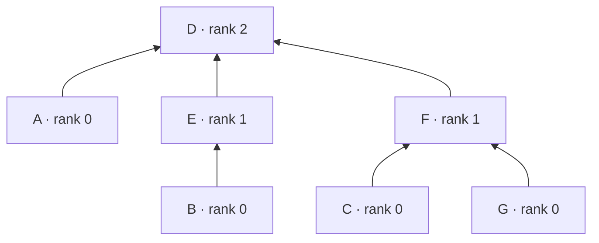

# Lecture 9：高级数据结构——优先队列、堆与并查集的摊还分析

> 依据：[hand9.pdf](../lectures/hand9.pdf)（45 页讲义）与 [algo9.pdf](../lectures/algo9.pdf)（123 页，含逐步展示的幻灯片）。下文页码指讲义页脚编号。
> 主线：Dijkstra 的操作计数 → 数组与二叉堆 → $d$ 叉堆与 Fibonacci 堆 → Kruskal 的操作计数 → 按秩合并 → 路径压缩 → 用秩分组和记账法证明 $O(\log^* n)$ 摊还界。
> 标为“补充”“辨析”或“实现说明”的内容用于解释、补全证明或澄清适用条件，不是讲义原文。图算法中记 $n=|V|,m=|E|$，使用邻接表；并查集部分的 $n$ 表示元素总数，$f$ 表示 `FIND` 调用总数，避免与边数混淆。对数默认以 2 为底，含 $\log n$ 或 $\log^* n$ 的渐近式默认 $n\ge2$；单元素情况直接处理。比较、数组访问和指针操作均按 $O(1)$ 计。

## 1. 本讲研究什么？

[Lecture 7](lecture7.md) 与 [Lecture 8](lecture8.md) 已经介绍了 Dijkstra 和 Kruskal。本讲把重点转向：**算法需要哪些数据结构操作，这些操作怎样实现，整个操作序列究竟要花多少时间？**

| 图算法 | 需要维护的信息 | 关键操作 | 本讲的数据结构 |
| --- | --- | --- | --- |
| Dijkstra | 尚未确定的顶点及其距离估计 | 插入、减小键值、删除最小值 | 优先队列与各种堆 |
| Kruskal | 已选森林的连通分量 | 建立单元素集合、查找代表元、合并集合 | 并查集 |

两个部分都遵循同一个分析顺序：

$$
\boxed{\text{统计操作次数}\ \longrightarrow\ \text{选择实现}\ \longrightarrow\ \text{计算总成本。}}
$$

本讲最后引入**摊还分析（amortized analysis）**：允许某一次操作较慢，只要能证明任意一整段操作序列的总成本足够小。

## 2. Dijkstra 为什么需要优先队列？（第 3–6 页）

### 2.1 复习：每次取距离估计最小的顶点

对非负边权图，Dijkstra 维护 `dist[v]`，每次取出尚未确定、且距离估计最小的顶点，再尝试改善其邻居的距离。

下面把优先队列接口写得明确一些：

```text
DIJKSTRA(G, length, s):
    for each v in V:
        dist[v] = infinity
        prev[v] = NIL
    dist[s] = 0
    H = MAKE_QUEUE(V, key = dist)

    while H is not empty:
        u = DELETE_MIN(H)
        if dist[u] == infinity:
            break
        for each outgoing edge (u, v):
            if v is still in H:
                candidate = dist[u] + length(u, v)
                if candidate < dist[v]:
                    DECREASE_KEY(H, v, candidate)
                    prev[v] = u

    return (dist, prev)
```

这里约定队列直接用 `dist` 作为键值，`DECREASE_KEY` 同时更新 `dist[v]` 并修复队列。若实现另存一份堆键，则必须同步两份值。

**辨析。** 第 5 页输入写的是正边权；正确性实际上允许零权，即要求非负边权。提前遇到 $+\infty$ 时，剩余顶点都不可达，可以结束。这里增加队列成员判断，使接口的使用前提清楚。

### 2.2 讲义例子

第 4 页从 $A$ 出发，依次确定的顶点为 $A,C,B,D,E$。

| 已处理的顶点 | $\operatorname{dist}[A]$ | $\operatorname{dist}[B]$ | $\operatorname{dist}[C]$ | $\operatorname{dist}[D]$ | $\operatorname{dist}[E]$ |
| --- | --- | --- | --- | --- | --- |
| 初始化 | 0 | $\infty$ | $\infty$ | $\infty$ | $\infty$ |
| $A$ | 0 | 4 | 2 | $\infty$ | $\infty$ |
| $C$ | 0 | 3 | 2 | 6 | 7 |
| $B$ | 0 | 3 | 2 | 5 | 6 |
| $D,E$ | 0 | 3 | 2 | 5 | 6 |

例如，$B$ 的键值从 4 降到 3，这正是一次 `DECREASE_KEY`。最短路树的父边为 $A\to C,C\to B,B\to D,B\to E$。

### 2.3 先数操作，再代入成本

若把所有顶点一次性放入队列：

- 建队列 1 次；粗略地可用 $n$ 次插入来上界。
- `DELETE_MIN` 至多 $n$ 次；不提前退出时恰好 $n$ 次。
- 每条边被扫描常数次，成功的 `DECREASE_KEY` 至多 $O(m)$ 次。

因此一般形式是

$$
T=O(n+m)+T_{\mathrm{build}}(n)
  +nT_{\mathrm{delete}}(n)+O(m)T_{\mathrm{decrease}}(n).
$$

讲义采用的方便上界是

$$
\boxed{n\times\text{删除最小值的成本}
+(n+m)\times\text{插入／减小键值的成本。}}
$$

这说明：**最优实现取决于操作的比例，而不只是某个操作单独有多快。**

## 3. 优先队列接口与无序数组（第 7–9 页）

### 3.1 四种基本操作

最小优先队列维护一组带键值的元素，允许不同元素拥有相同键值。

| 操作 | 含义 |
| --- | --- |
| `INSERT(x, k)` | 插入元素 $x$，键值为 $k$ |
| `DECREASE_KEY(x, k)` | 将现有元素 $x$ 的键值降低到 $k$ |
| `DELETE_MIN()` | 返回并删除一个键值最小的元素 |
| `MAKE_QUEUE(S)` | 根据已有元素及键值建立队列 |

**辨析。** 优先队列是接口，堆是实现。普通 FIFO 队列按入队顺序删除，而优先队列按键值选择元素。

### 3.2 无序数组：更新便宜，取最小值昂贵

在 Dijkstra 中，可以按顶点编号存储键值，并用布尔数组标记顶点是否仍在队列中。

- 插入、减小键值：直接修改对应位置，$O(1)$。
- 删除最小值：扫描所有尚未删除的元素，$O(n)$。
- 建队列：初始化数组，$O(n)$。

总时间为

$$
\boxed{T_{\mathrm{array}}=O(n^2+m).}
$$

对简单图有 $m=O(n^2)$，于是简化成讲义中的 $O(n^2)$。若允许任意多条平行边，就不能省略扫描边的 $O(m)$。

## 4. 二叉堆：用完全二叉树维护局部有序（第 10–14 页）

### 4.1 两个不变量

**最小二叉堆（binary min-heap）**同时满足：

1. **形状性质：** 是完全二叉树；除最后一层外，其余层全满，最后一层从左到右连续填充。
2. **堆序性质：** 每个父节点的键值不大于其孩子。

沿任意根到叶的路径，键值非递减，所以根一定是全局最小值。

**辨析。** 堆不是二叉搜索树。左右子树之间没有整体大小关系，同一层也不要求有序；不能对堆数组直接使用二分查找。

### 4.2 用数组表示

采用从 1 开始的数组下标，按层从左到右存储节点。下标为 $j$ 的节点满足

$$
\operatorname{parent}(j)=\left\lfloor\frac j2\right\rfloor\quad(j>1),
\qquad \operatorname{left}(j)=2j,
\qquad \operatorname{right}(j)=2j+1.
$$

孩子下标超过当前堆大小时，该孩子不存在。若有 $N\ge1$ 个节点，树高为 $\lfloor\log_2 N\rfloor$，因此沿父子指针移动一条路径至多需要 $O(\log N)$ 步。

**补充：从 0 开始的下标。** 对应父亲为 $\lfloor(j-1)/2\rfloor$（$j>0$），孩子为 $2j+1,2j+2$。两套公式不能混用。

### 4.3 插入与减小键值：上浮

**插入：** 把新元素放在数组末尾，保持完全二叉树形状；若比父亲小，就向上交换，直到堆序恢复。

**减小键值：** 元素已经在树中，只降低它的键。它与孩子的关系不会被破坏，唯一可能违反堆序的方向是父亲，因此从当前位置上浮。

两种操作最多经过树高这么多层，时间均为 $O(\log N)$。

### 4.4 删除最小值：用末尾元素补根，再下沉

1. 保存根节点，作为返回值。
2. 把最后一个节点移到根，删除数组末尾位置。
3. 比较当前节点与其孩子；若违反堆序，就与**较小的孩子**交换。
4. 重复，直到当前位置已经合法或到达叶子。

一定要选较小的孩子。若根为 12，两个孩子为 5 和 7，却与 7 交换，新根 7 仍大于另一个孩子 5，堆序没有恢复。

每层只需常数次比较，故 `DELETE_MIN` 为 $O(\log N)$；若只是读取最小值而不删除，则为 $O(1)$。

### 4.5 讲义插入与删除例子

第 12 页的初始堆，按层存储为

```text
[3, 10, 5, 11, 12, 6, 8, 15, 20, 13]
```

插入 7 后，上浮过程为

```text
追加末尾： [3, 10, 5, 11, 12, 6, 8, 15, 20, 13,  7]
与 12 换： [3, 10, 5, 11,  7, 6, 8, 15, 20, 13, 12]
与 10 换： [3,  7, 5, 11, 10, 6, 8, 15, 20, 13, 12]
```

7 不小于根 3，停止。接着执行第 14 页的删除最小值，返回 3：

```text
末尾补根： [12, 7,  5, 11, 10,  6, 8, 15, 20, 13]
与 5 交换：[ 5, 7, 12, 11, 10,  6, 8, 15, 20, 13]
与 6 交换：[ 5, 7,  6, 11, 10, 12, 8, 15, 20, 13]
```

第 13 页沿用上浮示意图说明 `DECREASE_KEY`；真正执行减小键值时，堆的元素个数不变。

### 4.6 实现说明：必须能定位被减小键值的元素

仅有一个堆数组，不能自动在 $O(1)$ 时间找到顶点 $v$ 当前位于哪里。用于 Dijkstra 时，通常维护：

- `A[i]`：堆位置 $i$ 上的元素编号。
- `key[x]`：元素 $x$ 的键值。
- `pos[x]`：元素 $x$ 当前的堆下标；不在堆中时为 `NIL`。

每次交换堆节点，都必须更新对应的 `pos`。否则 `DECREASE_KEY(v)` 可能修改错误的元素；若每次线性搜索位置，也会失去 $O(\log N)$ 的复杂度。

以下是补全后的核心伪代码。数组容量预先足够；插入要求元素尚未在堆中，减小键值要求元素仍在堆中。

```text
SWAP_POS(i, j):
    swap(A[i], A[j])
    pos[A[i]] = i
    pos[A[j]] = j

SIFT_UP(i):
    while i > 1:
        p = floor(i / 2)
        if key[A[p]] <= key[A[i]]:
            break
        SWAP_POS(i, p)
        i = p

SIFT_DOWN(i):
    while 2 * i <= size:
        j = 2 * i
        if j + 1 <= size and key[A[j + 1]] < key[A[j]]:
            j = j + 1
        if key[A[i]] <= key[A[j]]:
            break
        SWAP_POS(i, j)
        i = j

INSERT(x, k):
    size = size + 1
    A[size] = x
    key[x] = k
    pos[x] = size
    SIFT_UP(size)

DECREASE_KEY(x, k):
    assert k <= key[x]
    key[x] = k
    SIFT_UP(pos[x])

DELETE_MIN():
    assert size > 0
    x = A[1]
    SWAP_POS(1, size)
    size = size - 1
    pos[x] = NIL
    if size > 0:
        SIFT_DOWN(1)
    return x
```

### 4.7 补充：建堆可以是 $O(N)$

逐个插入的上界为 $O(N\log N)$，但可以从最后一个非叶节点开始，向前逐个下沉：

```text
MAKE_QUEUE(elements, key):
    copy elements into A[1..N]
    size = N
    for i = 1, ..., N:
        pos[A[i]] = i
    for i = floor(N / 2), ..., 1:
        SIFT_DOWN(i)
```

处理某个节点时，它的两个孩子子树都已经是堆，因此一次下沉即可让整个子树成为堆。

不能把每个节点都按 $O(\log N)$ 计费后就认定这是紧界：底层有很多节点，却几乎不需要下沉。高度至少为 $h$ 的节点至多有 $\lfloor N/2^h\rfloor$ 个，所以所有节点可下沉的总层数至多为

$$
\sum_{h=1}^{\lfloor\log N\rfloor}\left\lfloor\frac{N}{2^h}\right\rfloor<N.
$$

加上初始化与各次调用的常数开销，得到

$$
\boxed{T_{\mathrm{build\ heap}}=O(N).}
$$

## 5. $d$ 叉堆：降低树高，但增加每层比较（第 15 页）

### 5.1 数组下标与高度

$d$ 叉堆把二叉堆推广为每个节点至多有 $d$ 个孩子的完全树，仍满足最小堆序。取整数 $d\ge2$。

采用从 1 开始的下标，节点 $j>1$ 的父亲为

$$
\boxed{\operatorname{parent}(j)=\left\lceil\frac{j-1}{d}\right\rceil
=\left\lfloor\frac{j-2}{d}\right\rfloor+1.}
$$

其孩子下标为

$$
(j-1)d+2,\ (j-1)d+3,\ldots,
\min\{N,(j-1)d+d+1\}.
$$

若起始下标已经大于 $N$，则没有孩子。代入 $d=2$ 就得到二叉堆的公式。

对 $2\le d\le N$，树高为

$$
\Theta(\log_d N)=\Theta\left(\frac{\log N}{\log d}\right).
$$

### 5.2 两类操作的代价不同

- 插入、减小键值：每层只比较一个父亲，时间为 $O(\log_d N)$。
- 删除最小值：每层要从至多 $d$ 个孩子中选最小者，时间为 $O(d\log_d N)$。

$$
\boxed{\text{增大 }d\text{ 会减少层数，却增加下沉时每层寻找最小孩子的成本。}}
$$

因此不能只看“树变矮了”，就认为所有操作都会变快。

### 5.3 代入 Dijkstra

根据操作计数，可得

$$
\begin{aligned}
T_d
&=O\bigl(nd\log_d n+(n+m)\log_d n\bigr)\\
&=\boxed{O\left(\frac{dn+m}{\log d}\log n\right)}.
\end{aligned}
$$

讲义给出的选取原则是 $d\approx m/n$：边越多，减小键值相对于删除最小值越频繁，可以使用更大的分支数。

**边界补全。** 对简单图、$n\ge2$，可取

$$
d=\min\left\{n,\ \max\left\{2,\left\lceil\frac mn\right\rceil\right\}\right\}.
$$

不能在 $m<n$ 时直接得到 $d=0$ 或 1。对于 $m=O(n)$ 的稀疏图，这一原则取常数 $d$；对于 $m=\Theta(n^2)$ 的稠密图，取 $d=\Theta(n)$ 可得到 $O(n^2)$ 上界。

**补充辨析。** $d\approx m/n$ 是便于平衡 $dn$ 与 $m$ 的渐近选取原则，不是对连续函数的精确最小化结果。若只对 $(dn+m)/\ln d$ 求导，驻点满足

$$
nd(\ln d-1)=m.
$$

实际还需考虑 $d$ 的整数约束与实现常数。本讲需要掌握的是操作比例与分支数之间的关系。

## 6. Fibonacci 堆：一片堆序树组成的森林（第 16–17 页）

### 6.1 结构

Fibonacci 堆由多棵满足最小堆序的有根树组成，结构不像二叉堆那样要求完全。

- 所有树根通过一个循环双向链表连接。
- `min[H]` 指向所有根中键值最小的节点，也就是整个堆的最小元素。
- 节点 `x` 保存父指针 `p[x]` 和指向任意一个孩子的 `child[x]`。
- 同一个父亲的孩子组成循环双向链表，使用 `left[x]`、`right[x]` 表示左右兄弟。
- 若某个链表中只有一个节点，则它的左右指针都指向自己。

这里“无序”是指兄弟和各棵树的排列顺序任意，**父亲键值不大于孩子的堆序仍然成立**。

第 17 页示意图的根键值为 $23,7,3,17,24$，`min[H]` 指向键值 3；图的下半部分展开了循环双向链表的指针。

### 6.2 本讲需要记住的复杂度

| 操作 | Fibonacci 堆的成本 |
| --- | --- |
| 插入 | $O(1)$ |
| 减小键值 | $O(1)$ 摊还 |
| 删除最小值 | $O(\log n)$ 摊还 |

因此用于 Dijkstra 时，总时间为

$$
\boxed{T_{\mathrm{Fib}}=O(n\log n+m).}
$$

**辨析。** 这里删除最小值的对数界也是摊还界，不能读成每一次调用都只花 $O(\log n)$。讲义介绍了结构和复杂度结果，没有展开合并树、级联切断及其摊还证明；这些不属于本讲推导的主体。

## 7. 哪种优先队列更合适？（第 18–19 页）

设队列最多有 $n$ 个元素，$d$ 为合法分支数：

| 实现 | 插入／减小键值 | 删除最小值 | Dijkstra 总时间 |
| --- | --- | --- | --- |
| 无序数组 | $O(1)$ | $O(n)$ | $O(n^2+m)$；简单图上为 $O(n^2)$ |
| 二叉堆 | $O(\log n)$ | $O(\log n)$ | $O((n+m)\log n)$ |
| $d$ 叉堆 | $O(\log_d n)$ | $O(d\log_d n)$ | $O((dn+m)\log_d n)$ |
| Fibonacci 堆 | $O(1)$ 摊还 | $O(\log n)$ 摊还 | $O(n\log n+m)$ |

### 7.1 稀疏图与稠密图

- 若 $m=O(n)$，二叉堆的上界为 $O(n\log n)$，比数组的 $O(n^2)$ 更好。
- 若简单图中 $m=\Theta(n^2)$，数组上界为 $O(n^2)$，二叉堆上界为 $O(n^2\log n)$。
- 比较 $m\log n$ 与 $n^2$，分界尺度约为 $m=n^2/\log n$；当 $m=o(n^2/\log n)$ 时，二叉堆的上述上界渐近小于 $n^2$。

这比较的是理论上界，不能据此保证某个具体程序在每一份输入上更快。

### 7.2 实现条件也属于复杂度的一部分

表中的堆实现假定能通过位置表或句柄直接定位要更新的元素。若改为把新距离重复插入堆，则需要跳过旧条目，堆大小可能达到 $O(n+m)$，应按实际条目数重新分析时间和空间。

使用位置表、每个顶点只保留一个条目时，上述队列实现均只需 $O(n)$ 额外存储；输入图的 $O(n+m)$ 空间另计。

## 8. 从 Kruskal 到并查集（第 20–25 页）

### 8.1 算法需要判断“是否已经连通”

Kruskal 按边权非递减顺序考虑边，只接受不会形成环的边。若已选边构成森林，则加入 $\{u,v\}$ 会成环，当且仅当 $u,v$ 已在同一连通分量。

```text
KRUSKAL(G, w):
    for each v in V:
        MAKESET(v)
    X = empty edge set
    sort E by nondecreasing weight

    for each edge (u, v) in sorted E:
        a = FIND(u)
        b = FIND(v)
        if a != b:
            add (u, v) to X
            LINK_ROOTS(a, b)

    return X
```

这里 `LINK_ROOTS` 直接合并已经找到的根，避免再次查找。连通图最后得到 MST；不连通图则得到最小生成森林。

第 23 页例子按给定并列顺序接受 $BC,CD,CF,EF,AD$，总权重为 $1+2+3+4+4=14$。本讲关注的是如何快速跳过已经连通的 $BD,DF$ 等边；贪心正确性见 Lecture 8 的切分性质。

### 8.2 三种并查集操作

并查集（disjoint-set union，DSU）维护若干互不相交的集合。

| 操作 | 含义 | 连通图的 Kruskal 中的次数 |
| --- | --- | --- |
| `MAKESET(x)` | 建立只含 $x$ 的集合 | $n$ 次 |
| `FIND(x)` | 返回 $x$ 所在集合的代表元 | 扫描全部边时 $2m$ 次 |
| `UNION(x,y)` | 合并 $x,y$ 所在集合 | 成功合并 $n-1$ 次 |

若 `UNION` 内部自行执行两次 `FIND`，还应计入额外的 $2(n-1)$ 次查找。提前在选满 $n-1$ 条边时退出，可以减少实际次数，但不改变渐近上界。

## 9. 按秩合并：让父指针树保持浅（第 26–31 页）

### 9.1 用树表示集合

每个节点保存父指针 `parent[x]`，沿父指针最终到达根 $r$，根满足 `parent[r] = r`，并作为整个集合的代表元。

$$
\boxed{x,y\text{ 属于同一集合}\iff\operatorname{FIND}(x)=\operatorname{FIND}(y).}
$$

这些父指针只用于表示集合，不一定对应原图中的边，也不等于 Kruskal 选中的 MST 边。

如果总是把一棵树任意接到另一棵树下，可能形成长度为 $\Theta(n)$ 的链，导致一次 `FIND` 花 $\Theta(n)$ 时间。

### 9.2 按秩合并的规则

在尚未使用路径压缩时，`rank[x]` 等于以 $x$ 为根的子树高度。

- 不等秩：把较小秩的根接到较大秩的根下，新根的秩不变。
- 等秩：任选一个作为新根，将新根的秩加 1。
- 已经同根：不再合并，也不增加秩。

下面与讲义一致，在等秩时把第一个根接到第二个根下：

```text
MAKESET(x):
    parent[x] = x
    rank[x] = 0

FIND(x):
    while parent[x] != x:
        x = parent[x]
    return x

LINK_ROOTS(a, b):
    assert parent[a] == a and parent[b] == b
    if a == b:
        return
    if rank[a] > rank[b]:
        parent[b] = a
    else:
        parent[a] = b
        if rank[a] == rank[b]:
            rank[b] = rank[b] + 1

UNION(x, y):
    LINK_ROOTS(FIND(x), FIND(y))
```

`LINK_ROOTS` 是 $O(1)$，但 `UNION(x,y)` 还包含两次查找，不能直接写成 $O(1)$。

### 9.3 讲义中的操作序列

对 $A,\ldots,G$ 分别建集合后：

| 操作 | 新的父指针／秩变化 |
| --- | --- |
| `UNION(A,D)` | $A\to D$，$\operatorname{rank}(D)=1$ |
| `UNION(B,E)` | $B\to E$，$\operatorname{rank}(E)=1$ |
| `UNION(C,F)` | $C\to F$，$\operatorname{rank}(F)=1$ |
| `UNION(C,G)` | 根为 $F,G$，令 $G\to F$；$F$ 的秩仍为 1 |
| `UNION(E,A)` | 根为 $E,D$，令 $E\to D$；$D$ 的秩升到 2 |
| `UNION(B,G)` | 根为 $D,F$，令 $F\to D$；$D$ 的秩仍为 2 |

最终结构为：



箭头表示指向父亲；根的自指针省略。

## 10. 关于秩的三个引理（第 32–35 页）

### 10.1 引理一：沿父指针，秩严格递增

对任意非根节点 $x$，

$$
\boxed{\operatorname{rank}(x)<\operatorname{rank}(\operatorname{parent}(x)).}
$$

只需检查合并时新建的父子关系：

- 不等秩合并时，较小秩的根接到较大秩的根下，严格不等式成立。
- 等秩合并时，新父亲的秩加 1，严格不等式仍成立。
- 其他父指针不变；根的秩即使增加，也不会破坏原有不等式。

这个证明比只说“秩等于高度”更便于推广到路径压缩。

### 10.2 引理二：秩为 $k$ 的根至少代表 $2^k$ 个元素

$$
\boxed{\operatorname{rank}(r)=k\ \Longrightarrow\ |\operatorname{set}(r)|\ge2^k.}
$$

对合并过程归纳：

- 初始秩为 0，集合大小为 $1=2^0$。
- 不等秩合并时，新根的秩不变，集合只会增大。
- 等秩 $k-1$ 的两棵树合并时，新秩为 $k$，元素数至少为 $2^{k-1}+2^{k-1}=2^k$。

因此任何秩都不超过 $\lfloor\log_2 n\rfloor$。结合引理一，任意父指针路径长度至多为 $O(\log n)$。

仅按秩合并时：

$$
\boxed{\text{单次 FIND 和 UNION 的最坏时间均为 }O(\log n).}
$$

### 10.3 引理三：秩恰为 $k$ 的节点至多有 $n/2^k$ 个

$$
\boxed{\#\{x:\operatorname{rank}(x)=k\}\le\frac{n}{2^k}.}
$$

这里计数的是**所有节点**，包括已经不再是根的节点。

在还没有路径压缩时：

1. 每个秩为 $k$ 的节点都曾是根，其子树至少有 $2^k$ 个节点，包含它自己。
2. 一旦不再是根，其秩及子树成员不再改变：后续合并只在根之间发生。
3. 两个秩相同的节点不能互为祖先，否则违反沿父指针秩严格递增。
4. 树中两个节点的子树要么不相交，要么存在祖先关系。因此不同秩 $k$ 节点的子树互不相交。

这些互不相交的子树各占至少 $2^k$ 个元素，总数不超过 $n$，于是得到结论。

**关键作用。** 引理二控制单条路径有多长；引理三进一步说明：**秩大的节点很少。** 后者是摊还分析的关键。

### 10.4 Kruskal 的当前瓶颈

按秩合并需要 $O(n+m\log n)$ 的并查集时间；比较排序需要 $O(m\log m)$，所以总时间为

$$
O(m\log m+m\log n+n).
$$

对连通简单图且 $n\ge2$，$n-1\le m\le n(n-1)/2$，可简写为 $O(m\log n)$。

第 35 页提出：如果边已经按权重排序，或者权重是取值范围为 $O(m)$ 的整数，可以线性排序，那么排序不再主导；此时需要继续加速并查集。

**辨析。** “权重小”要配合整数范围等条件，才能使用计数排序等线性方法。任意小实数并不自动获得线性排序算法。

## 11. 路径压缩：查找之后，把沿途节点接到根（第 36–40 页）

### 11.1 递归实现

```text
FIND(x):
    if parent[x] != x:
        parent[x] = FIND(parent[x])
    return parent[x]
```

递归先找到根，回溯时把查找路径上的节点直接接到这个根。之后 `UNION` 继续使用原来的按秩合并规则。

**正确性。** 修改前后节点仍指向同一集合的根，没有改变集合划分，也没有改变代表元；只是缩短了后续查找的路径。

**补充：两遍迭代实现。** 第一遍找根，第二遍改指针，避免递归栈：

```text
FIND(x):
    r = x
    while parent[r] != r:
        r = parent[r]
    while x != r:
        next = parent[x]
        parent[x] = r
        x = next
    return r
```

第二遍必须先保存旧父亲 `next`，否则改写后就找不到原路径的下一步。

### 11.2 讲义例子：先查找 $I$，再查找 $K$

第 37 页中，初始路径包括

```text
I -> F -> E -> A
K -> G -> E -> A
J -> F
H -> E
D -> C -> A
```

其中 $A$ 是根，秩为 3；$E$ 的秩为 2；$C,F,G$ 的秩为 1。

执行 `FIND(I)` 后，$I,F,E$ 都直接指向 $A$；不在查找路径上的 $J$ 仍指向 $F$，$K$ 仍指向 $G$，$G$ 仍指向 $E$。

再执行 `FIND(K)`，实际经过 $K\to G\to E\to A$，将 $K,G$ 也直接接到 $A$。最后仍有 $D\to C$、$H\to E$、$J\to F$，所以一次查找不会把整棵树全部压平。

### 11.3 秩不再等于当前高度

路径压缩修改父指针，**不修改任何 `rank`**。

- 节点只有作为根并参与等秩合并时，秩才增加。
- 一旦成为非根，它以后不会重新成为根，秩永久固定。
- 当前树可能已经很矮，但根仍保留较大的历史秩。

因此加入路径压缩后，秩仍是高度的上界与合并依据，但不能继续解释为当前实际高度，也不应在压缩后重新降低秩。

### 11.4 三个引理为什么仍成立？

**引理一仍成立。** 压缩把节点接到原来的祖先。原路径上秩严格递增，新的父亲秩仍严格大于该节点的秩。

**引理二仍成立。** 压缩没有改变根、集合大小和秩；根代表的元素数仍至少为 $2^{\operatorname{rank}(r)}$。

**引理三仍成立，但证明需要解释历史结构。** 压缩后，一个非根节点可能失去许多后代，不能继续声称“它当前还有至少 $2^k$ 个后代”。

可以在分析中保留一份**不执行压缩的辅助森林**：每次真实合并两个根时，在辅助森林中作完全相同的根链接。两份结构的根和秩始终相同，只是父指针路径不同。辅助森林仍满足第 10.3 节的子树计数证明，因此真实结构中秩为 $k$ 的节点数也仍不超过 $n/2^k$。

这份辅助森林只是证明工具，不需要在程序中真的存储。

**实现辨析。** 第 39 页说“`union` 只处理顶层”，准确地说是**找到两个根之后的链接步骤**只修改根；完整的 `UNION(x,y)` 内部仍然可能执行路径压缩查找。

## 12. 摊还分析与 $\log^* n$（第 38、41–42 页）

### 12.1 摊还界不是概率平均，也不是单次最坏界

路径压缩不能让当前查找省掉已经走过的路径；它的主要收益体现在未来操作中。因此需要分析整段操作序列。

| 概念 | 要回答的问题 |
| --- | --- |
| 单次最坏时间 | 某一次操作最多可能花多少时间？ |
| 平均情况分析 | 在指定输入概率分布下，期望花多少时间？ |
| 摊还分析 | 任意合法操作序列的总成本，平均分摊到各次操作是多少？ |

按秩合并加路径压缩后，一次首次访问较深节点的 `FIND` 仍可能花 $\Theta(\log n)$；本讲要证明的是许多次操作加起来不会每次都这么贵。这里没有任何随机输入假设。

### 12.2 迭代对数的定义

$\log^* n$ 表示反复取以 2 为底的对数，直到结果不大于 1 所需的次数：

$$
\log^* n=
\begin{cases}
0,&n\le1,\\
1+\log^*(\log_2 n),&n>1.
\end{cases}
$$

例如

$$
1000\ \to\ 9.966\ \to\ 3.317\ \to\ 1.730\ \to\ 0.791,
\qquad \boxed{\log^*1000=4.}
$$

| $n$ | $\log^* n$ |
| --- | --- |
| $1$ | $0$ |
| $2$ | $1$ |
| $4$ | $2$ |
| $16$ | $3$ |
| $65536=2^{16}$ | $4$ |
| $2^{65536}$ | $5$ |

它增长极慢，但仍不是一个与 $n$ 无关的常数。也不要把 $\log^*n$ 误读成 $\log\log n$。

### 12.3 把秩划分成增长极快的组

秩范围是 $0,1,\ldots,\lfloor\log n\rfloor$。将 0 单独作为一组，其余依次分组：

$$
\{0\},\quad\{1\},\quad\{2\},\quad\{3,4\},\quad
\{5,6,\ldots,16\},\quad
\{17,18,\ldots,65536\},\quad\ldots
$$

除了单独处理的 $\{0\}$ 和首组 $\{1\}$，各组形如

$$
B_k=\{k+1,k+2,\ldots,2^k\},
\qquad k=1,2,4,16,65536,\ldots
$$

由于组的右端点反复取指数，而最大秩只到 $\log n$，所需正秩组数至多为 $\log^* n$；加上秩 0 也只有 $O(1+\log^* n)$ 组。

**边界补全。** 讲义把组数直接写作 $\log^* n$；严格计数可能因取整与最后一组是否出现而更少。证明只需要 $O(\log^* n)$ 这个上界。

## 13. 核心证明：路径压缩为什么几乎是常数成本？（第 42–45 页）

### 13.1 证明目标与记账思路

考虑共建立 $n$ 个元素、执行 $f$ 次 `FIND` 的任意操作序列；$f$ 包含 `UNION` 内部调用的查找。成功的根链接最多有 $n-1$ 次。

我们要证明，总成本为

$$
\boxed{O((n+f)\log^* n)}\qquad(n\ge2).
$$

使用记账法，把成本分到两类账户：

1. 每次 `FIND` 直接承担 $O(\log^* n)$ 的工作。
2. 给节点预留一些“零钱”，支付其他工作；全部节点一生获得的零钱总数为 $O(n\log^* n)$。

“零钱”只用于证明，不是算法需要维护的数据。

### 13.2 节点什么时候领钱，领多少？

一个节点第一次失去根身份时，秩从此固定，此时一次性发钱：

- 秩为 0：不用发钱，后面说明它的访问可直接计费。
- 秩为 1：可以发 1 元；实际上同组中没有更大的秩，因而不需要同组付款。
- 秩在 $B_k=\{k+1,\ldots,2^k\}$ 中：发 $2^k$ 元。

节点永远不会重新成为根，因此每个节点至多领一次钱。

注意金额是 **$2^k$，不是 $2k$**。金额虽然可能很大，但能领到这么多钱的节点很少。

### 13.3 每个秩组发出的总钱数至多为 $O(n)$

由引理三，秩大于 $k$ 的节点数至多为

$$
\sum_{r=k+1}^{\infty}\frac{n}{2^r}
=\frac{n}{2^k}.
$$

秩在 $B_k$ 中的节点只是其中一部分，每个节点发 $2^k$ 元，所以该组总发放额至多为

$$
\frac{n}{2^k}\cdot2^k=n.
$$

首组 $\{1\}$ 同样只需 $O(n)$。一共 $O(\log^* n)$ 组，因此总预算为

$$
\boxed{O(n\log^* n).}
$$

**为什么这个计数能覆盖整个序列？** 已经领钱的节点从此秩不变，因此在序列结束时仍处于原来的秩组。对最终的辅助森林使用引理三，就能同时约束所有曾经领过钱的节点。

### 13.4 一次查找经过的边，怎样分类？

设查找路径为

$$
x_0\to x_1\to\cdots\to x_t=r,
$$

其中 $r$ 为根，沿途秩严格递增。处理每条父指针边 $x\to p$ 时，分成以下情况：

| 情况 | 谁承担成本？ | 为什么成本可控？ |
| --- | --- | --- |
| $p$ 已经是根 | 本次 `FIND` 直接承担 | 一条查找路径至多有一条这样的边 |
| $x$ 与 $p$ 位于不同秩组 | 本次 `FIND` 直接承担 | 组编号严格增加，最多跨越 $O(\log^* n)$ 次 |
| $x$ 与 $p$ 位于同一秩组，且 $p$ 不是根 | 由节点 $x$ 支付 1 元 | 本次压缩会让 $x$ 的父亲秩严格增加 |

根处的检查、函数调用等常数开销一并直接计费；递归回溯改指针与前进步数同阶，不改变结论。

秩为 0 的非根节点，其父亲秩至少为 1，必然跨组，因此不用给它同组付款的零钱。

**重要的证明补全。** 第 44–45 页把边分为“跨组”和“同组”，但“父亲已经是根”的边应额外直接计费。否则对一个根的孩子重复执行 `FIND`，父指针始终不变，却可能被反复要求付款，“每付款一次父亲秩就增加”便不成立。单独计入这至多一条边，只增加每次 $O(1)$ 成本。

### 13.5 为什么每个节点的钱一定够用？

考虑需要付款的节点 $x$，其旧父亲为 $p$，本次找到的根为 $r$。

付款条件要求 $p$ 不是根，因此旧路径中 $p$ 是 $r$ 的真后代。由秩沿路径严格递增：

$$
\operatorname{rank}(r)>\operatorname{rank}(p).
$$

路径压缩后令 `parent[x] = r`，所以

$$
\boxed{\text{每次让 }x\text{ 付款，都使其父亲的秩严格增加。}}
$$

此外，父亲的秩在后续操作中不会下降：节点的秩只增不减，压缩也只会把父亲换成秩更大的祖先。

若 $x$ 的固定秩位于 $B_k=\{k+1,\ldots,2^k\}$，它只有在父亲也处于这一组时才付款。同组内的整数秩总共不超过 $2^k$ 种，每次付款后父亲的秩都严格前进，因此 $x$ 一生至多付款 $2^k$ 次。

父亲一旦进入更高组，就不会再退回；之后访问 $x$ 时都按跨组处理。因此最初发的 $2^k$ 元足够覆盖全部付款。

### 13.6 把所有成本相加

- $f$ 次查找的直接成本：$O(f\log^* n)$。
- 全部节点支付的成本：不超过总预算 $O(n\log^* n)$。
- $n$ 次建立集合与至多 $n-1$ 次成功根链接：$O(n)$。

所以

$$
\begin{aligned}
T
&=O(n)+O(f\log^* n)+O(n\log^* n)\\
&=\boxed{O((n+f)\log^* n)}.
\end{aligned}
$$

即使存在很多次无效 `UNION`，每次也会执行两次已经计入 $f$ 的查找，其余常数开销可被吸收。

若把 `MAKESET`、`FIND`、`UNION` 都视为外部操作，记操作总数为 $q$，则 $n\le q$、内部查找总数 $f=O(q)$，因而

$$
\boxed{T=O(q\log^* n),\qquad\text{每次操作的摊还成本为 }O(\log^* n).}
$$

**辨析。** 从 $O((n+f)\log^* n)$ 不能在任意小的 $f$ 下直接声称“只对这 $f$ 次查找平均，每次都是 $O(\log^* n)$”，因为还包含建集合与发放预算的 $n$ 项。摊还结论应针对包含初始化的整个操作序列，或者明确计入预处理成本。

### 13.7 补充：更强的逆 Ackermann 界

更精细的分析能把按秩合并加路径压缩的摊还上界改进为 $O(\alpha(n))$，其中 $\alpha$ 为逆 Ackermann 函数，增长比 $\log^* n$ 还慢。

应区分：

- **本讲实际证明的界：** $O(\log^* n)$ 摊还。
- **更强的经典结果：** $O(\alpha(n))$ 摊还，本讲未证明。
- **单次最坏界：** 仍可达到 $\Theta(\log n)$，不能用“实际近似常数”替代上述区分。

## 14. 回到 Kruskal：优化到底改善了哪一部分？

对于 $n$ 个顶点、$m$ 条边，并查集有 $n$ 次建集合、$O(m)$ 次查找，以及至多 $n-1$ 次成功合并。

| 并查集实现 | 并查集部分总成本 | 加上比较排序后的 Kruskal 总成本 |
| --- | --- | --- |
| 仅按秩合并 | $O(n+m\log n)$ | $O(m\log m+m\log n+n)$ |
| 按秩合并 + 路径压缩，本讲分析 | $O((n+m)\log^* n)$ | $O(m\log m+(n+m)\log^* n)$ |
| 按秩合并 + 路径压缩，更强分析 | $O((n+m)\alpha(n))$ | $O(m\log m+(n+m)\alpha(n))$ |

对普通未排序的连通简单图，比较排序通常仍然主导，总体上界依然可写成 $O(m\log n)$。

如果边已经有序，或满足线性排序的条件，路径压缩带来的改进就直接体现在总时间中：根据本讲证明，可做到 $O((n+m)\log^* n)$。

并查集自身只需要 `parent` 和 `rank` 两个数组，空间为 $O(n)$。两遍迭代 `FIND` 只使用 $O(1)$ 临时空间；递归版本的栈深最坏为 $O(\log n)$。

## 15. 易错点速查

| 容易误记的说法 | 应掌握的表述 |
| --- | --- |
| 优先队列就是普通队列 | 前者按键值取最小元素，后者按进入顺序出队 |
| 二叉堆数组已经整体排序 | 只有父子堆序，没有兄弟间或左右子树间的全序 |
| 减小键值之后应该下沉 | 最小堆中减小键值只可能破坏与父亲的关系，应上浮 |
| 删除根之后任选一个孩子交换 | 必须选择键值较小的孩子 |
| 有了堆就能直接快速找到任意顶点 | 需要位置表或句柄；每次交换必须同步更新 |
| 建堆一定要 $O(n\log n)$ | 从最后一个非叶节点开始下沉，可在线性时间建堆 |
| $d$ 越大，堆的所有操作越快 | 上浮更短，但下沉每层要比较至多 $d$ 个孩子 |
| $d=m/n$ 可以直接取任意结果 | $d$ 必须是至少为 2 的整数，还要考虑有效范围 |
| Fibonacci 堆每次删除都只需对数时间 | 讲义使用的是摊还对数界 |
| `UNION(x,y)` 只需修改一个指针 | 还要找到两个根；已知根后的链接才是常数时间 |
| 合并一次，根的秩就加 1 | 只有两个不同根原先等秩时才加 1 |
| `rank` 表示集合大小 | 它是用于控制高度的秩；秩 $k$ 只保证至少有 $2^k$ 个元素 |
| 路径压缩后要重算并降低秩 | 秩保留历史值；压缩不修改秩 |
| 一次查找会压平整棵树 | 只修改当前查找路径上的父指针 |
| 非根节点压缩后仍有至少 $2^k$ 个当前后代 | 后代可能移走；计数证明应使用历史／辅助森林 |
| 摊还分析假设随机输入 | 它约束任意合法操作序列的总成本，不依赖概率分布 |
| 路径压缩让每次查找最坏 $O(1)$ | 本讲给出整体 $O(\log^* n)$ 摊还界，单次仍可为 $\Theta(\log n)$ |
| $\log^*n$ 就是 $\log\log n$ | 它是把 $n$ 反复取对数直到不大于 1 的次数 |
| 同组父指针每次都可以向节点收费 | 父亲已经是根的边要单独直接计费，否则父亲秩未必增加 |
| 路径压缩后 Kruskal 整体一定近乎线性 | 仍需计入边排序；边已排序或可线性排序时收益最直接 |

## 16. 复习检查清单

- [ ] 能从 Dijkstra 伪代码数出 $n$ 次删除最小值、$O(m)$ 次减小键值。
- [ ] 能解释无序数组为什么适用于稠密图，并写出未省略边扫描的 $O(n^2+m)$。
- [ ] 能写出二叉堆的形状性质、堆序性质和数组父子下标。
- [ ] 能手算讲义中插入 7、删除最小值 3 的上浮与下沉过程。
- [ ] 能解释 `pos` 数组为什么必要，以及为什么交换节点时要同时更新它。
- [ ] 能用各层可下沉步数的总和证明线性建堆。
- [ ] 能推导 $d$ 叉堆上浮 $O(\log_d n)$、下沉 $O(d\log_d n)$。
- [ ] 能把不同优先队列操作成本代入 Dijkstra，并根据图密度比较上界。
- [ ] 能说明 Fibonacci 堆的根链表、孩子链表及 `min` 指针。
- [ ] 能区分并查集代表元、父指针树与 Kruskal 实际选择的边。
- [ ] 能写出按秩合并，正确处理等秩和已经同根的情况。
- [ ] 能证明父亲秩严格更大、秩 $k$ 的根至少有 $2^k$ 个元素。
- [ ] 能证明秩为 $k$ 的节点至多有 $n/2^k$ 个，并解释压缩后如何继续使用该结论。
- [ ] 能写出递归或两遍迭代的路径压缩，说明它不改变集合划分。
- [ ] 能手算第 37 页 `FIND(I)` 和 `FIND(K)` 后哪些父指针发生变化。
- [ ] 能区分单次最坏复杂度、概率平均复杂度和摊还复杂度。
- [ ] 能计算 $\log^*1000=4$，列出秩分组的前几组。
- [ ] 能证明每个秩组的总零钱至多为 $O(n)$，全部预算为 $O(n\log^* n)$。
- [ ] 能把跨组边、直接连根边和同组非根边分别计费。
- [ ] 能说明每次节点付款都会使其父亲的秩严格增加，从而保证预算足够。
- [ ] 能完整推出 $O((n+f)\log^* n)$，并正确解释“每次摊还”的操作序列范围。
- [ ] 能区分本讲证明的 $\log^* n$ 界与补充的 $\alpha(n)$ 界。
- [ ] 能解释为什么边已排序时，并查集优化对 Kruskal 总时间更关键。
